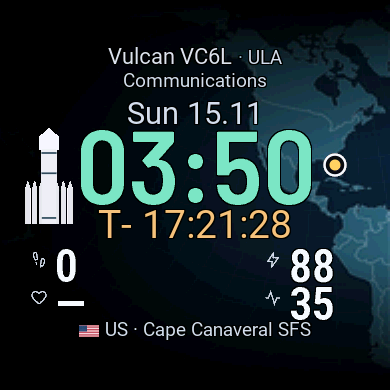
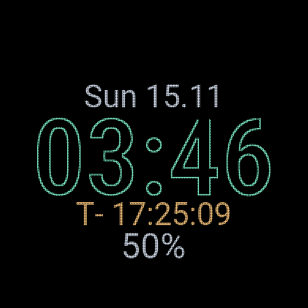

# SpaceFox

SpaceFox is an independent space-themed watch face for selected Garmin watches, including Forerunner 165 and 165 Music. It shows a 24-hour clock, four activity fields, the next launch, rocket artwork and a launch-site map.

These Forerunner 165 Music SDK captures use the production-signed 0.1.10 program (SHA-256 `cbe65f126b9e9afcdccac795e8850445410790701b585bec98ea042805a423d7`), a live launch feed and simulated activity values. They were captured at different times; the always-on countdown is a permitted minute snapshot. Physical delivery and execution of 0.1.10 remain unverified. See [supported devices](docs/SUPPORTED_DEVICES.md) and [testing](TESTING.md) for qualification boundaries. Find releases and report issues on [GitHub](https://github.com/JekaMas/SpaceFox). The public schedule is at [feed.json](https://jekamas.github.io/SpaceFox/feed.json).

The countdown shows `T-` before a known target, `T+` after it, and `--:--:--` when the time is unknown. Passing zero does not establish that a launch occurred. The watch retains an accepted schedule for offline use. Stale and rescheduled data have separate indicators.

The default language is English. Four fixed positions can show supported Garmin activity metrics; unavailable readings remain unavailable. Primary software-supported languages are English, Russian, German, French and Spanish. The settings menu and persisted choices were exercised in an SDK watch-app host; the signed watch face system entry, phone and physical-device behavior remain unverified. Artwork and catalogue coverage are still being developed.

Developers can read [project setup](docs/AGENT_SETUP.md), [the update pipeline](docs/CLOUD_DELIVERY.md), and the [project workflow](docs/PROJECT_WORKFLOW.md). See [contributing](CONTRIBUTING.md) for source changes and checks, or report bugs through [GitHub Issues](https://github.com/JekaMas/SpaceFox/issues); do not include private health data or credentials.

SpaceFox is available under the [MIT license](LICENSE). Fonts, data and other third-party materials retain their [notices](THIRD_PARTY_NOTICES.md). See the [privacy policy](docs/PRIVACY.md).
