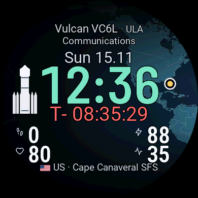
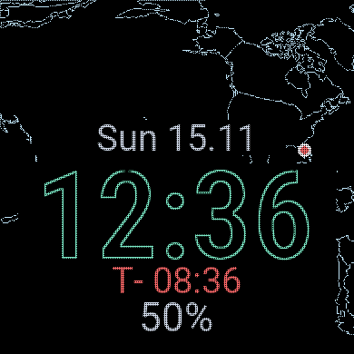

# SpaceFox

SpaceFox is an independent space-themed watch face for selected Garmin watches, including Forerunner 165 and 165 Music. It shows a 24-hour clock, four activity fields, the next launch, rocket artwork and a launch-site map.

These Forerunner 165 Music SDK captures show the production-signed 0.1.13 build (program SHA-256 `5cb199019325ff803a65d6eaba1f49f0d84795e710267b36ebfde084e4a8c542`) using retained public launch data and simulated activity values. The active image shows decoded rocket and flag assets; the always-on image shows the full geographic outline and launch point. They were captured at different times. Simulator results do not establish physical delivery or execution. See [supported devices](docs/SUPPORTED_DEVICES.md) and [testing](TESTING.md) for qualification boundaries; the [integration checks](docs/INTEGRATION_CHECKS_0.1.13.md) link each design and function check to its evidence. Find releases and report issues on [GitHub](https://github.com/JekaMas/SpaceFox). The public schedule is at [feed.json](https://jekamas.github.io/SpaceFox/feed.json).

Signed test builds for Forerunner 165 and 165 Music are available from [GitHub releases](https://github.com/JekaMas/SpaceFox/releases). These test builds are separate from Garmin Store releases. Follow the installation instructions supplied with the chosen release; physical installation and phone delivery remain unverified.

The clock uses fixed 24-hour `HH:mm` and the current local weekday and `DD.MM` date. The active countdown shows `T- HH:mm:ss` before a known target and `T+ HH:mm:ss` from zero onward, with accumulating hours. Always-on uses minute precision; an unknown target is shown as dashes. Passing zero does not establish liftoff. The selected launch remains for at least 15 minutes, or through a later sourced ascent end. The watch retains an accepted schedule for offline use; stale and rescheduled data have separate indicators.

The active flat map fades behind the text and shows a source-qualified site marker when its projection matches. Always-on retains the map outline and launch point, the clock, date, weekday, countdown and battery; it omits the four activity fields. The rocket is unmarked; the header shows the rocket and supplied operator with mission purpose, and the footer shows the launch-country flag and site without repeating the operator. Four fixed fields independently select steps, Body Battery, heart rate, stress, calories or watch battery. Clock, countdown and the four fields have independent colors. The default feed base is `https://jekamas.github.io/SpaceFox`; native transfers use byte-identical text sidecars for the schema-3 SFR1M feed and assets.

The default language is English. Four fixed positions can show supported Garmin activity metrics; unavailable readings remain unavailable. The menu offers Auto and the five primary software-supported languages: English, Russian, German, French and Spanish. The other 31 retained internal language resources are best effort. The settings menu and persisted choices were exercised in an SDK watch-app host; the signed watch face system entry, phone and physical-device behavior remain unverified. Artwork and catalogue coverage are still being developed.

Developers can read [project setup](docs/AGENT_SETUP.md), [the update pipeline](docs/CLOUD_DELIVERY.md), and the [project workflow](docs/PROJECT_WORKFLOW.md). See [contributing](CONTRIBUTING.md) for source changes and checks, or report bugs through [GitHub Issues](https://github.com/JekaMas/SpaceFox/issues); do not include private health data or credentials.

SpaceFox is available under the [MIT license](LICENSE). Fonts, data and other third-party materials retain their [notices](THIRD_PARTY_NOTICES.md). See the [privacy policy](docs/PRIVACY.md).
