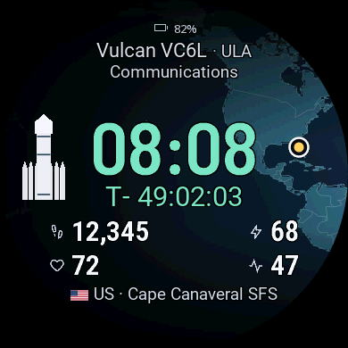

# SpaceFox

SpaceFox is an independent space-themed watch face for selected Garmin watches, including Forerunner 165 and 165 Music. It shows a 24-hour clock, four activity fields, the next launch, rocket artwork and a launch-site map.

The [supported devices](docs/SUPPORTED_DEVICES.md) are listed with qualification boundaries. The image is a retained Garmin simulator observation of the native design. Its activity values are simulated. The test package and installation boundaries are described in [TESTING.md](TESTING.md). Find releases and report issues on [GitHub](https://github.com/JekaMas/SpaceFox). The public schedule is at [feed.json](https://jekamas.github.io/SpaceFox/feed.json).

The countdown shows `T-` before a known target, `T+` after it, and `--:--:--` when the time is unknown. Passing zero does not establish that a launch occurred. The watch retains an accepted schedule for offline use. Stale and rescheduled data have separate indicators.

The default language is English. Four fixed positions can show supported Garmin activity metrics; unavailable readings remain unavailable. Primary software-supported languages are English, Russian, German, French and Spanish. On-watch settings navigation and phone/device behavior require separate verification for this test build. Artwork and catalogue coverage are still being developed.

Developers can read [project setup](docs/AGENT_SETUP.md), [the update pipeline](docs/CLOUD_DELIVERY.md), and the [project workflow](docs/PROJECT_WORKFLOW.md). Contributions and bug reports are welcome through [GitHub Issues](https://github.com/JekaMas/SpaceFox/issues); do not include private health data or credentials.

SpaceFox is available under the [MIT license](LICENSE). Fonts, data and other third-party materials retain their [notices](THIRD_PARTY_NOTICES.md). See the [privacy policy](docs/PRIVACY.md).
