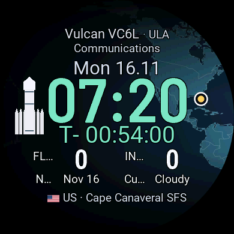

# SpaceFox

SpaceFox is a free, MIT-licensed space watch face for Garmin watches, including Forerunner 165 and Forerunner 165 Music. It combines a large digital clock, rocket artwork, a launch-site map, a local T−/T+ countdown and four configurable activity fields.

**[Install from Connect IQ](https://apps.garmin.com/apps/7ef095e4-72fe-44cd-bc39-8987b6ab49e3)** · **[0.1.21 test release](https://github.com/JekaMas/SpaceFox/releases/tag/v0.1.21-test.1)** · **[FR165 install ZIP](https://github.com/JekaMas/SpaceFox/releases/download/v0.1.21-test.1/SpaceFox-0.1.21-FR165-install.zip)** · [Release notes](release/RELEASE-NOTES-0.1.21.md)

The 0.1.21 GitHub test prerelease integrates the published 0.1.20 watchdog repair with the separately reviewed B1 clock and lifecycle work. The owner reported an IQ error on a physical non-Music FR165 with 0.1.18; its cause and physical acceptance of 0.1.21 remain unknown. Garmin Store availability is separate and has not been established.

Native simulator capture; it is not a physical watch photograph.

## What it shows

- A fixed 24-hour clock, local date and weekday.
- An active countdown with seconds; always-on uses minutes. Both use the same UTC launch target. At T0 the timer becomes T+, and the launch remains visible for at least 15 minutes or through a later sourced ascent end.
- A fading flat map with the launch point, the corresponding rocket, operator and mission purpose. The country flag appears beside the launch site; the rocket has no flag or abbreviation painted on it.
- Four independently configurable fields. The existing steps, Body Battery, heart rate, stress, calories and watch-battery choices remain; on-watch settings also offer accessible Garmin and user complications and supported daily activity readings. Clock, countdown and field colors can be configured separately.
- A full map outline and launch point in always-on mode, with centered time, date, weekday, minute countdown and battery. The four activity fields and animation are hidden in this mode.
- Optional, quiet-aware launch reminders. They are off by default; when enabled, Garmin schedules notifications from T−15. Device settings control vibration and delivery.

A delayed or rescheduled launch uses a reddish countdown; stale data has a separate dotted indicator. Passing zero is a time calculation, not confirmation of liftoff. Missing Garmin readings remain unavailable; Body Battery uses Garmin's current complication value when selected.

## Data and settings

In watch settings, open **Field 1–4 → More sources** to select sources available to that watch, including sources whose current reading is unavailable. Phone settings have a static list: choose **Selected on watch** to use the source last selected on the watch for that position. If none has been selected, the position shows a dash. Changing back to an established phone choice does not erase the watch-selected source; choosing **Selected on watch** again restores it. A missing provider remains selected and shows a dash until it returns.

English and `https://jekamas.github.io/SpaceFox` are defaults. English, Russian, German, French and Spanish are the five primary software-supported languages; Auto is also available. The other 31 retained internal translations are best effort. Future watch models need separate qualification.

The watch calculates the countdown locally, keeps accepted launch data offline and preloads a bounded set of upcoming launches so the face can advance locally at the retention deadline. Partial or failed updates preserve known future launches and their refresh targets across restart. New schedules and artwork arrive through Garmin Connect on the paired phone. The public [feed](https://jekamas.github.io/SpaceFox/feed.json) is maintained by GitHub Actions with an independent Cloudflare timer; it does not need an agent or computer to stay running. No AWS account, subscription or SpaceFox login is required.

See [installation](https://github.com/JekaMas/SpaceFox/releases/download/v0.1.21-test.1/INSTALLATION.md), [supported watches](docs/SUPPORTED_DEVICES.md), [settings and testing](TESTING.md), and [permissions and privacy](docs/PRIVACY.md). Use the existing SpaceFox Connect IQ listing for updates. USB installation uses the PRG matching the watch model; IQ is the Store export, not a file to open on a phone.

## Contributing and SDD

Start with [CONTRIBUTING.md](CONTRIBUTING.md), [the SDD guide](docs/SDD_WORKFLOW.md) and [project workflow](docs/PROJECT_WORKFLOW.md). Keep the requirement, implementation, tests and evidence together in the relevant OpenSpec change. Finish a coherent task with green checks, obtain independent verification, and update its progress record. Reuse green checks unless their actual inputs changed.

[Agent setup](docs/AGENT_SETUP.md) and [cloud delivery](docs/CLOUD_DELIVERY.md) explain how to run an independent feed. Report bugs in [GitHub Issues](https://github.com/JekaMas/SpaceFox/issues), including the exact watch model and the version shown in SpaceFox settings. Do not include credentials or private health data.

The [0.1.17 incident evidence](openspec/changes/spacefox-watchface/evidence/rollover017/FINAL.md), [independent repair and review](openspec/changes/spacefox-watchface/evidence/rollover017/INDEPENDENT.md) and [root judgment](openspec/changes/spacefox-watchface/evidence/rollover017/ROOT-JUDGMENT.md) contain the native, memory and source-export evidence. Simulator qualification and physical-device results are recorded separately.

SpaceFox's source and original specifications use [MIT](LICENSE). Fonts, data and other third-party materials retain their [notices](THIRD_PARTY_NOTICES.md).
