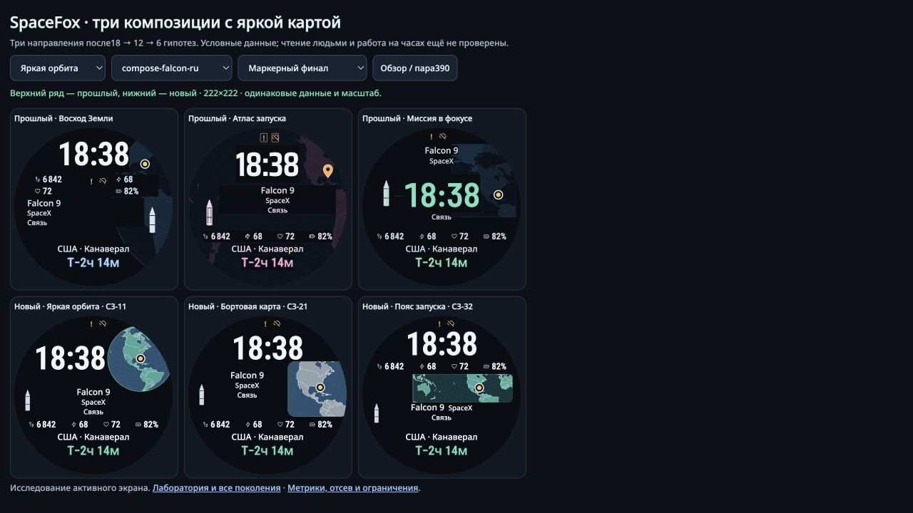

# SpaceFox: композиция с яркой географией

2026-11-11. Выполнены **три поколения 18 → 12 → 6**:36 наборов параметров,
шесть пространственных семейств,288 наблюдений новых вариантов на восьми
авторских сценах. Для трёх зафиксированных предложений сохранены 24 наблюдения
из G3 и выполнены 18 дополнительных. Все 42 проходят объявленные инженерные
критерии. Это ограниченный результат браузерного исследования; независимого
ревью, измерения чтения людьми и проверки на Garmin в этом раунде нет.

[Парная галерея](../prototype/composition/review.html) ·
[все поколения](../prototype/composition/index.html) ·
[цель и прогресс](../openspec/changes/compose-brighter-geography/PROGRESS.md) ·
[численные результаты](../openspec/changes/compose-brighter-geography/evidence/SUMMARY.json).

## Вопрос и цель

Как сделать Землю или карту заметной частью циферблата, сохранив ясное время,
полные подписи и точку космодрома? Предыдущий раунд оставил геометрию текста
неизменной и оптимизировал знак. Здесь меняются расположение и группировка
информации, размер/окно географии, светлота моря/суши, сетка и её соседство с
текстом. Обновление расписания, фитнес-логика и нативная реализация не меняются.

Цель до G1: до трёх разных композиций, каждая проходит все заданные ограничения
на основных и шести дополнительных сценах. Карта имеет не менее 12% полезной
площади круга, среднюю линейную светлоту не ниже 0,10 и как минимум удвоенный
интегральный световой сигнал относительно объявленного текущего родителя.
Неудачу в одном показателе нельзя компенсировать суммарным баллом красоты.

## Источники и переносимые идеи

Подборка — первичные руководства и исследовательская публикация. Их рекомендации
превращены в проверяемые гипотезы, а не в утверждение об удобстве SpaceFox:

- [Esri: пять принципов картографии](https://www.esri.com/news/arcuser/0112/make-maps-people-want-to-look-at.html): различать фигуру и фон, согласовывать контраст с иерархией и оценивать баланс всей композиции. Отсюда отказ от случайных чёрных вырезов поверх Земли.
- [NN/G: визуальные принципы](https://www.nngroup.com/articles/principles-visual-design/): относительный масштаб, группировка и контраст. Проверялись отдельные области для карты и текста, общие оси и объединение коротких метаданных.
- [IBM: композиция и пространство](https://www.ibm.com/design/language/layout/tips-and-techniques/): ритм, свободное место и управляемая асимметрия. Пустота не считается автоматической ошибкой; сравниваются целые группы.
- [W3C: текстовый контраст](https://www.w3.org/WAI/WCAG22/Understanding/contrast-minimum.html) и [графические объекты](https://www.w3.org/WAI/WCAG22/Understanding/non-text-contrast.html): расчёт через линейную светлоту. Использованы консервативные проектные ограничения; соответствие WCAG для часов не заявлено.
- [Garmin: Watch Faces](https://developer.garmin.com/connect-iq/articles/user-experience-guidelines/Watch_Faces.html): круглый экран и раздельные режимы активности/AOD. Исследуется яркий активный экран, AOD остаётся задачей нативного продукта.
- [Islam et al.: пространство дизайна циферблатов](https://arxiv.org/html/2310.16185v2): циферблат рассматривается как компактный набор связанных компонентов. Это ориентир для поиска, не рейтинг наших вариантов.
- [Esri: иерархия на картах](https://www.esri.com/arcgis-blog/products/arcgis-online/education/visual-hierarchy-for-maps) и [баланс](https://www.esri.com/arcgis-blog/products/arcgis-pro/mapping/design-principles-for-cartography): уменьшать конкурирующие детали и смотреть на карту вместе с подписью/легендой. В G2/G3 уменьшалась сетка, сравнивались боковые области и цельная кривая глобуса.
- [D3: проекции и отсечение](https://d3js.org/d3-geo/projection): окно карты, вращение и проекция координаты учитываются раздельно. Знак всегда следует настоящей входной координате.

[Реестр прочитанных разделов и ограничений](../openspec/changes/compose-brighter-geography/evidence/source-ledger.json)
и [таблица признаков для мутации](../openspec/changes/compose-brighter-geography/evidence/FEATURES.md)
сохранены. Apple Support вернул 429; PDF Esri и страница MIT о clutter оказались
недоступны. Они не засчитаны как просмотренные примеры. Опубликованный алгоритм
Feature Congestion не реализован и не подменён простой плотностью пикселей.

## Метрики и границы

Пороги из [policy.json](../prototype/composition/policy.json) зафиксированы до G1.
Они являются инженерными эвристиками, кроме заимствованной формулы контраста;
это не измеренные пороги восприятия ребёнка на запястье.

| Показатель | Проверка / цель | Что он не доказывает |
|---|---|---|
| Полезная география | ≥12% площади круга: реально закрашенные пиксели SVG за вычетом непрозрачных панелей и прямоугольников видимого текста/переднего плана | Узнаваемость страны или хорошую композицию |
| Светлота карты | Среднее линейное Y≥0,10; сумма Y по площади экрана ≥2× соответствующего маркерного родителя | Физическую яркость в нитах, расход батареи |
| Суша и море | Номинальный контраст красок ≥1,8; доля суши 3–85% | Читаемость всех берегов/островов при малом масштабе |
| Целостность | Сохранность карты после непрозрачных панелей ≥85%; крупнейшая связная часть ≥95% | Эстетическую цельность по одному числу |
| Текст | Точные значения, прежние минимумы шрифтов, контраст ≥4,5; для большого времени ≥3 | Скорость чтения и предпочтение человеком |
| Геометрия | Круг, отсутствие наложений; между разными ролями ≥4 px; от полного кольца ≥4 px | Оптический баланс всей группы |
| Выравнивание | Отклонение от объявленной оси ≤1 px; у пары ракета/компания проверяется ось объединённой группы | Превосходство симметрии над асимметрией |

Проверки текста используют реальные Range-строки DOM и метрики шрифта; эти
прямоугольники консервативнее полного контура каждого глифа. Цвет карты измеряется
отдельной растеризацией живого SVG с вычисленными стилями, круглым отсечением и
непрозрачными панелями. Это диагностическое изображение карты, **не анализ
пикселей всего браузерного JPEG**. Реальные снимки отдельно проверяют вид целого
циферблата. Модель внимания, человеческий эксперимент и измерение AMOLED не
подразумеваются.

Во всех 36 новых вариантах фиксированы Roboto Condensed для чисел и Noto Sans
для подписей. Контроли сохраняют свои прежние шрифты, включая Barlow/Saira;
поэтому сравнение не отделяет причинный эффект компоновки от каждого отличия
со старым вариантом. Новых шрифтов или сторонних зависимостей не добавлено.

## Поколения и реальные отказы

| Этап | Что проверялось | Результат и переход |
|---|---|---|
| G1 ·18 | Шесть географических компоновок × blue/teal/silver |27/144 сцен проходят все критерии; ни один вариант не проходит все 8. У яркого фона реальны конфликты с текстом, у ракеты — с полями, у узких метаданных — переполнение вниз. Пояс ближе всего:6/8. |
| G2 ·12 | Шесть наблюдавшихся родителей × два исправления/альтернативы |19/96 сцен; два варианта проходят 8/8. Отдельная боковая область и верхний глобус сохраняют яркость и ясные подписи. Затемнение под текстом теряет карту и не защищает все длинные строки. Принудительный ряд метаданных не помещается в длинных случаях. |
| G3 ·6 | Цельный контур глобуса; боковая карта/её зеркальная версия; пояс со стеком/адаптивным переносом |45/48 сцен; четыре варианта проходят 8/8. Большой глобус задевает название ракеты в 2 сценах; зеркальная версия — длинную компанию в 1. Они отсеяны. |
| Фиксация ·3 | C3-11, C3-21, C3-32; точные параметры до новых сцен |24/24 сохранённых основных наблюдения и 18/18 дополнительных проходят. Никакой подстройки параметров после дополнительных сцен. |

Все 36 наборов различаются параметрами и наблюдаемыми дескрипторами короткой
RU-сцены. Это шесть структурных семейств, а не 36 независимых дизайн-концепций.
Число проходящих сцен не является оценкой вероятности успеха: сцены и потомки
зависимы. Поколения имеют разные распределения трудностей и не ранжируются
простым сравнением 27/144 против 19/96.

Десять точных контролей включают все пять предыдущих R4-финалистов и все пять
маркерных M2/M3-финалистов. Их повторы не считаются независимыми образцами.
Авторские сцены включают короткие/длинные RU/EN, реальные каталожные точки,
индикаторы, неизвестное время и отсутствие координаты. Дополнительные шесть
созданы после фиксации и охватывают Канаверал, Махию и Куру в обоих языках.
Это дополнительные испытания автора, не слепой независимый holdout.

## Три предложения

| Предложение | Полезная карта в 13 сценах с координатой | Среднее Y карты | Моя оценка композиции |
|---|---|---|---|
| **Яркая орбита · C3-11** |14,36–14,39% |0,156–0,296 |Основной выбор. Время и глобус образуют верхнюю пару; общий нижний блок метаданных/полей остаётся спокойным. Цельный лимб лучше передаёт Землю, чем прежние прямоугольные вырезы. |
| **Бортовая карта · C3-21** |15,88–15,90% |0,147–0,364 |Наибольшая полезная область из трёх. Карта и повествование разделены. У длинных подписей получается более плотная колонка, а для Махии в окне много океана и меньше географического контекста. Этот компромисс слабее глобуса. |
| **Пояс запуска · C3-32** |14,38–14,38% |0,134–0,207 |Сильная альтернатива: время → поля → карта → миссия. Короткие ракета и компания стоят в одном ряду, длинные естественно переносятся. Окно карты выглядит намеренным и не режется текстом. |

Все три проходят 14/14 сцен, включая одну без координаты; в ней карта и точка
не выдумываются. Минимальный расчётный контраст подписей 12,82; максимальное
отклонение от объявленных осей 0,004 px; зазор полного кольца до переднего плана
не меньше 28,08 px. Эти числа описывают измеренные сцены, а не произвольные строки.

По исправленному расчёту интегральный сигнал карты относительно своего текущего
родителя вырос в 10,85–15,37 раза у «Орбиты»,3,92–10,50 у «Бортовой карты» и
8,72–28,29 у «Пояса». В этом числе одновременно участвуют цвет, площадь и
перекрытия. Его нельзя называть «яркостью экрана во столько-то раз».

Показательный контроль: в короткой RU-сцене старый M2-51 «Атлас» имеет 53,1%
полезной географической площади, но среднее Y лишь 0,0086; новая боковая карта
меньше по площади и гораздо светлее. **Одна только площадь карты — плохая цель.**
У старого M2-41 чёрные панели оставляют 61,2% исходного рисунка географии;
у трёх новых предложений непрозрачные текстовые панели её не вырезают.

## Ошибки измерителя и исправления

1. Версия 1 считала пустые поля CSS-строки частью видимого текста. Она давала
   ложный выход времени за круг. Сохранены первый 144-наблюдательный экспорт и
   восемь точных источников. Версия 2 использует Range-строки и метрики чернил;
   G1 повторён до выбора родителей, численные пороги не менялись.
2. При финальной сверке версия 2 не распознавала непрозрачный цвет, если браузер
   сериализовал его как `rgb`, а не `rgba`. Площади/сигнал старых карт были завышены.
   Версия 3 перепроверила только затронутые 10 контролей на 14 сценах:140 наблюдений.
   У новых вариантов все рассматриваемые фоны прозрачны; их наблюдения сохранены
   с исходными привязками версии 2, а вердикты пересчитаны относительно исправленных
   контролей. Состав и число проходящих вариантов не изменились. Никакая повторная
   квалификация новых рендеров здесь не выдумана.

Оба отказа, старые экспорты/версии исходников и
[поправка версии 3](../openspec/changes/compose-brighter-geography/evidence/metric-v3-correction.json)
сохранены. Тесты дополнены реальными примерами ложной геометрии, яркого фона под
подписью и непрозрачных RGB-панелей; первоначальные два теста лишь со скалярными
векторами не считались достаточным подтверждением измерителя.

## Проверка и повтор

[Собственная визуальная проверка](../openspec/changes/compose-brighter-geography/evidence/visual-review.md)
разделена с числами. Просмотрены сравнительные обзоры, все 6 вариантов G3 при 390,
три итоговых пары на длинных RU/EN, Махия/Куру и резервные состояния. Отдельный
наблюдатель в этом раунде не привлекался.

Для повторения открыть лабораторию через локальный HTTP-сервер, выбрать поколение,
нажать «Измерить поколение» и сохранить экспорт. Дополнительный банк открывается
с `?bank=additional&generation=final`. Исходные версии лежат в `evidence/versions/`.
`prototype/composition/recheck.html` выполняет целевой повтор контролей версии 3;
`node tools/reconcile_composition.js` пересчитывает сохранённые вердикты,
`python3 -B -m tools.summarize_composition` строит сводку. Новые проверочные случаи:
`python3 -B -m unittest -v tests.test_composition`.

Новый код изолирован; прежние рендереры, каталоги и их 53 браузерные зависимости
сохранены. Новый десятислучайный DAG прошёл на чистом исходнике; [квитанция](../openspec/changes/compose-brighter-geography/evidence/verification-final.json) содержит все 10 реально выполненных test ID. Неизменённые зелёные проверки старых раундов не перезапускались.
Нативное время, автономное расписание, батарея, AOD, работа на запястье и все 36
языков не квалифицированы этим исследованием. Более длинные строки и остальные
языки не запрещены продуктом; конечный RU/EN-набор не доказывает их размещение.

Оригинальные исходники, спецификация и отчёт — MIT; шрифты и сторонние ресурсы
сохраняют прежние лицензии. Методический источник применённого навыка:
[Kassis, Agarwal, He, Patel, Brueckner (2026), Scientific Agent Skills](https://doi.org/10.48550/arXiv.2609.00065).
Эта процедурная ссылка не подтверждает качество циферблатов.
