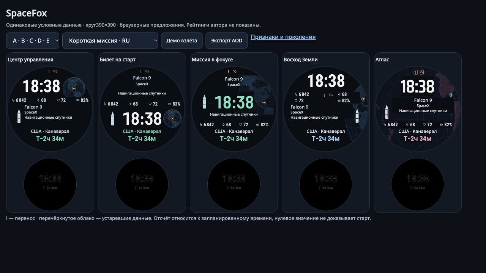

# SpaceFox: исследование признаков и пять направлений

11 ноября 2026. Браузерные предложения для Forerunner 165, круг 390×390. Оригинальные код, тексты и спецификация — MIT; шрифты сохраняют OFL. Нативный циферблат Garmin, живой feed и проверка на часах остаются следующей работой.

[Пять предложений](../prototype/features/review.html) · [лаборатория](../prototype/features/index.html) · [таблица мутаций](FEATURE_MUTATION_MATRIX.md) · [цель и журнал прогресса](../openspec/changes/expand-feature-research/PROGRESS.md) · [источники](../openspec/changes/expand-feature-research/evidence/fresh-sources.md)

Цель до отбора: пять разных полезных композиций, которые сохраняют время, четыре настраиваемых фитнес-поля, ракету, компанию, цель, страну/место, отсчёт и маркер; проходят технический benchmark и отдельное закрытое подтверждение; минимум две структуры новые относительно предыдущей тройки. Графические оценки не переводятся в обещания скорости чтения.

## Откуда появились новые гипотезы

Исследователь, не видевший текущего рейтинга, собрал 21 первичный источник для этого цикла:7 географических часов,7 космических/операционных интерфейсов,7 руководств и статей. Часть платформенных руководств перепроверена из предыдущей работы. Шесть официальных изображений/диаграмм реально просмотрены; для остальных явно указан текстовый просмотр. «Свежий поиск» не означает, что все публикации новые по году или ранее неизвестны проекту.

| Направление | Примеры и переносимая идея | Проверенная здесь мутация |
|---|---|---|
| География как самостоятельный прибор | Arnold & Son Globetrotter: выделенный geo-круг; Omega Worldtimer: отдельное ядро карты; Montblanc Geosphere: полусферы | Проекции, отдельные окна и дуги разного размера. Двойная полусфера остаётся резервной идеей, здесь не реализована |
| Выбранное место вместо ободка городов | Breguet Hora Mundi: отдельное окно места; Seiko Astron: ориентация/географический контекст | Полная страна/место в стабильной нижней строке, маркер с собственным резервом |
| Операционный паспорт запуска | NASA Artemis / LSP Countdown, ESA-hosted Mission Control GUI, Open MCT | Отдельные ракета/компания/цель; distributed,flow,two-column и другие грамматики; два независимых знака переноса/устаревания |
| Понятная иерархия | Garmin Connect IQ, Wear Typography / Color, W3C | Разные роли цвета, контраст фактических цветов, сопоставимая видимая высота цифр, сохранение значения вместе с иконкой |
| Проверяемость короткого взгляда | Smartwatch-исследования Blascheck 2019 и CHI 2024 | Только основание для будущих человеческих заданий. Время чтения, accuracy и предпочтение ребёнка не измерялись |

[Полный журнал](../openspec/changes/expand-feature-research/evidence/source-ledger.json) различает прочитанное, увиденное и авторский вывод. В нём 24 отдельные гипотезы для будущего человеческого исследования с критериями опровержения; у всех `observed_result:null`. Эти гипотезы не объявлены подтверждёнными автоматическими проверками. Важное ограничение статьиCHI 2024: её§4.3 исправляет ожидаемую точность staircase исходной работы с 91% примерно до 63%; опубликованные миллисекунды нельзя превращать в обещание читаемости SpaceFox.

## Как устроен поиск

Таблица содержит 12 осей, для каждой 8 небазовых вариантов и 4 потомка измеренных родителей. Один общий anchor не пересчитывается 12 раз. Потомки меняют свой признак; архитектура и организация фитнес-полей имеют явно описанные связанные координатные изменения. Затем 64→32→16 совместных комбинаций. После только 8/64 успешных в первом совместном поколении последующие поколения берут лучшие измеренные родительские структуры и меняют меньше признаков.

Прежние три финалиста отрисованы **точными прежними параметрами и прежним renderer**, в тех же новых сценах. Каждый получил 5 отказов из 32 в более тяжёлом benchmark. Их старые результаты остаются верны в своей прежней области; под их ID не подставлены улучшенные потомки. Первые 260 наборов включают 256 новых,3 прежних и общийanchor. После неуспешных подтверждений и открытого краевого теста отдельные этапы добавили 4 положения маркера, 4 ширины компании и 12 расширенных/исправленных компоновок: всего 280 наборов. Все имеют родителей и реально применяемые параметры; это настройки пяти маршрутов, а не 280 самостоятельных концепций.

Все 280 наборов параметров уникальны после нормализации известных эквивалентностей. На общих 32 авторских сценах фактические DOM/SVG-геометрия, computed-цвета, шрифты, рамки и stroke дают **277** разных групп. Три короткие строки пока не показывают различий между ограничениями ширины; четыре сопоставимых свидетельства на уже известных длинных входах разделяют все спорные пары. Это техническая различимость на наблюдённых входах, не сравнение raster-пикселей и не доказательство 280 разных пользовательских впечатлений. [Анализ с конкретными парами](../openspec/changes/expand-feature-research/evidence/analysis.json).

## Что означает прохождение

Фиксированный класс:RU/EN, валидноеHH:MM, отображаемые строки до 20 графем для ракеты,32 компании/цели,28 места и 16 отсчёта; четыре различные роли, значения вплоть до 99999 для шагов/калорий и явное отсутствие. Полные исходные строки сохранены. Настройки продукта, включая повторяющиеся поля и более длинные подписи, остаются допустимыми с outside-class диагностикой; их универсальный fit не обещан.

Видимая высота 08:08 нормирована 58.5±2 px, у каждой сцены цифры≥55 px; фитнес≥22, место 21, ракета 20, метаданные 17, известный отсчёт 31, неизвестный 16. Критические зазоры≥4 px; текст≥4.5:1, основные графические знаки≥3:1. Проверяются реальные значки/значения/индикаторы, точные строки, круговой fit, маркер выбранной точки и его свободная зона. Видимая суша измеряется отдельно от географического окна выборкой по реальномуSVGfill с шагом 10 px. Площадь не доказывает узнаваемость континента.

Статусы независимы: `!` — полученное изменение времени выбранного запуска, отдельный знак — устаревшие данные. Цвет дополняет форму. Числовой отсчёт часы будут считать локально; обновление расписания по выбранной спецификации через GitHub Actions+статический файл 60 минут/15 минутближе к запуску, без AWS. Этот исследовательский UI использует синтетические данные и не включает updater.

## Независимая проверка и сохранённый отказ

Первый технический рецензент подготовил screen24 и confirm24 раздельно и скрыл значения до соответствующей заморозки исходников/ID. Отдельный визуальный рецензент смотрел нейтральные сопоставимые снимки 12+3 кандидатов без авторского рейтинга. Затем он повторно просмотрел реальные изображения выбранной пятёрки. Разделение авторства, закрытых данных и собственного oracle поддерживает независимость проверки; модельная оценка не заменяет панель людей. При разработке протокола использованы SDD Workflow, Typography и Scientific Critical Thinking. Для последнего методического набора приведена ссылка: [Kassis, Agarwal, He, Patel & Brueckner, Scientific Agent Skills, 2026](https://doi.org/10.48550/arXiv.2609.00065). Эта ссылка описывает использованный инструмент, а не подтверждает качество SpaceFox.

Screen 12×24 прошёл полностью. При дополнительном сравнении прежний лучший OLD1 заменён существующим ANCHORпосле 24 сцен регрессии; это 1 предподтверждающая адаптация, не новый набор и не новое закрытое свидетельство. **Первый confirm5×24 не прошёл:**3 предложения прошли, у «Восхода»4 сближения маркера с длиннойUKподписью, у «Атласа»1 ложное срабатывание границы строки. Полный исходный неуспешный экспорт сохранён без изменений.

Отдельный ремонтный этап не менял пороги. Четыре позиции маркера переносили вместе с ним всю проекцию. Все 4 прошли 80 известных сцен. Визуальное предпочтениеC/Dслабое; выбранD(R2-04), который при этом дал минимальную открытую сушу 3800 px²против 3500 уC. Это разрешение близкого визуального выбора техническим proxy, не доказанный выигрыш распознавания. «Атлас» сохранил компоновку: реальный DOM-поиск показал все 4 слова целиком; выступал лишь схлопнутый пробел на переносе. Новый измеритель хранит полную строку, исходныеRange и всеUTF16 словесные диапазоны, а отрицательный контроль с действительно обрезанным словом остаётся неуспешным.

Новый reconfirm24 подготовлен независимо **до** ремонта и отбора. Второе свежее подтверждение тоже не прошло: четыре предложения — 24/24, у «Билета» две русские компании вышли за радиус 191 px. Один bbox пересекал и внешний круг 195 px; второй нарушал внутренний запас. Обе подписи, 30 и 31 графема, находятся внутри класса. Четыре более узкие строки прошли 104 известные сцены; из них самая узкая имела больший запас до края.

Дополнительный **открытый авторский** тест 24 компаний, включая 32 широкие буквы, показал: меньшая ширина иногда создаёт третью строку, которая оттесняет цель к месту или полям. Это нельзя исправить ограничением допустимых имён. Следующее поколение — по две широкие настройки для пяти структур, без уменьшения шрифта. В нём визуальный рецензент обнаружил ещё один настоящий blocker: маркер между числами был закрыт сплошным фоном всей группы фитнес-полей. DOM-проба подтвердила точку (195,157) внутри непрозрачного прямоугольника (35,115,320,54). Старый геометрический «pass» этого этапа сохранён как недостаточное свидетельство видимости.

Измеритель теперь сохраняет фактические фоновые прямоугольники, display, visibility, opacity и цвет; итоговая проверка сама выявляет перекрытие ореола такими блоками. Точка вместе с проекцией вынесена за всю группу полей. Два новых положения прошли 128 известных сцен, затем независимый просмотр подтвердил реальные точку и ореол. Вся коллекция заново отрисована после изменения измерителя: **280×32 = 8 960 наблюдений, 159 вариантов без ошибок**. Финальная пятёрка отдельно прошла **128 сцен каждый** в новом измерителе. Дополнительного визуального ремонта по десяти интегрированным снимкам не требуется.

Третий набор confirm3_24 был подготовлен и запечатан **до всех этих исправлений**; значения оставались закрыты. Третья заморозка фиксирует конкретную пятёрку, параметры, исходники, зависимости и архив. **Третья свежая приёмка прошла: 5/5 по 24/24, независимо подтверждены все 120 исходных наблюдений.** Каждый финалист прошёл 152 разные сцены: 128 известных и 24 закрытые. После раскрытия параметры и код не менялись. Два предыдущих неуспеха и открытый стресс сохранены. [Независимый технический вердикт](../openspec/changes/expand-feature-research/evidence/final-technical-review.md) и [интегрированное визуальное ревью](../openspec/changes/expand-feature-research/evidence/final3-visual-review.md) имеют разные, явно ограниченные роли.

После вердикта исправлено одно отчётное поле: список `candidateIds` в компактном selection-файле оставался от прежней подборки. Фактические параметры, имена, freeze и протестированные ID R4 были правильными. Оригинал сохранён; обратная замена единственного поля восстанавливает его побайтно. [Receipt коррекции](../openspec/changes/expand-feature-research/evidence/selection-reporting-correction.json). Это исправление метаданных, без новой отрисовки и без подстройки после раскрытия.

## Финальные поколения и пять предложений

| Этап | Наборов | Сцен при поколении | Прошли актуальные 32 сцены |
|---|---:|---:|---:|
| 8 исходных уровней на 12 признаков + anchor + точные прежние 3 |100|32|72|
| 4 уточнения на каждый признак |48|32|37|
| Совместное поколение 1 |64|32|8|
| Совместное поколение 2 |32|32|14|
| Совместное поколение 3 |16|32|10|
| Первый ремонт: положение точки |4|80 известных|4|
| Следующий ремонт: ширина компании |4|104 известных|4|
| Расширенные метаданные |10|128 известных|8|
| Маркер вне сплошной фоновой группы |2|128 известных|2|
| **Текущий полный аудит** |**280**|**32**|**159**|

Числа в правой колонке — актуальная переоценка общих 32 сцен. Исторические первоначальные итоги поколений сохранены отдельно и могут отличаться из-за найденных ошибок renderer/измерителя. Все отказы доступны; успешный цвет не компенсирует обрезку текста или скрытую точку.

| Предложение | Компоновка и география | Шрифт цифр | Почему оставлено | Компромисс |
|---|---|---|---|---|
| **Центр управления** · R4-01 | Верхнее время, отдельный небольшой глобус; широкая нижняя зона миссии | Roboto Condensed | Спокойная основа для ежедневного чтения; знакомая структура предыдущего направления исправлена под тяжёлые входы | Маленький глобус даёт меньше географических деталей |
| **Билет на старт** · R4-03 | Ракета, компания и цель сверху; время ниже, маленький глобус справа | Barlow Semi Condensed | Самостоятельный маршрут «миссия → время»; компания переносится полностью | Время расположено ниже привычной верхней зоны |
| **Миссия в фокусе** · R4-05 | Часы в центре, компания сверху, цель отдельно; плоская карта в правой трети | Barlow Semi Condensed | Ещё один порядок чтения; данные миссии не обязаны стоять одним столбиком | Больше разнесённых текстовых якорей |
| **Восход Земли** · R4-12 | Верхние часы, четыре поля двумя парами, широкая миссия; точка справа вне группы | Roboto Condensed | Сохраняет характер крупной Земли и разделённые группы полей; правый вариант слабо предпочтён визуальным рецензентом | География частично закрыта обязательными данными |
| **Атлас** · R4-09 | Крупная проекция Земли фоном, центрированная миссия, поля ниже | Saira Condensed | Насыщенное космическое направление с большим географическим слоем | Больше сетки и акцентов, требует проверки предпочтения владельца |

Рекомендация для следующего реального прототипа — «Центр управления» как ежедневная основа; «Билет» как сильная альтернатива для ребёнка, которому важнее миссия. Это редакторское решение по ограниченному визуальному review, а не измеренный победитель человеческого теста. Остальные три сохраняются как содержательно разные предложения.

Режим AOD общий для всех пяти: только контур времени и отсчёта. Сохранены 25 исходных PNG и независимый подсчёт, максимум **4,5578%** ненулевых пикселей внутри кругового экрана при целевом пороге проекта 8%. Пять уникальных кадров разделяются всеми темами; повторная перерисовка после обычных параметров не требуется, потому что функция AOD их не использует. [Точная карта повторного использования](../openspec/changes/expand-feature-research/evidence/aod/final-reuse-map.json) сохраняет исходное доказательство и его границы.

## Границы результата

Отбор исследует 12 признаков и их конечные комбинации; он не перебирает всё пространство дизайна и не доказывает глобальный optimum. Нет человеческого замера чтения, предпочтения сына, всех 36 языков в этих сценах, реального солнечного света, нативной памяти/кадров/батареи. Настоящие Garmin-шрифты и географические ресурсы ещё требуют проверки в SDK/симуляторе/часах. Простая анимация — демонстрационный взлёт ракеты по кнопке; это не утверждение о фактическом старте или nativewake-событии.

## Как воспроизвести и продолжать

1. Из корня репозитория запустить `python3 -m http.server 8772` и открыть `/prototype/features/`. Шрифты, география и зарегистрированные изображения локальные; интернет для отрисовки не нужен.
2. Нажать «Открыть сохранённый прогон». Полный gzip содержит параметры, родителей, сцены, исходные наблюдения, результаты и неуспешные контроли. Кнопка повторного аудита отрисует сохранённый каталог в текущем браузере. Новый браузер/шрифтовый rasterizer может дать другие границы — это новый результат, который нужно сохранить отдельно.
3. Для анализа сохранённого экспорта: `node tools/analyze_features.js openspec/changes/expand-feature-research/evidence/campaign.json.gz /tmp/spacefox-analysis.json`. Анализ не запускает браузер и не создаёт отсутствующих наблюдений.
4. Кнопки начальных/совместных поколений создают новый эксперимент текущим измерителем. Исторические отказы не переписываются. Ранние receipts связывают только перечисленные в них источники; полный набор зависимостей заморожен в поздних screening/confirmation records. Не заявлять точное воспроизведение раннего состояния по одному нынешнему коду.
5. Для новой итерации агент фиксирует гипотезу, изменяемый параметр, размер поколения и критерии до просмотра нового контроля. Независимый рецензент готовит закрытые входы; заморозка каталога/исходников предшествует раскрытию. После неуспеха тот же набор пригоден для регрессий, а свежее подтверждение требует новых закрытых входов.

Лаборатория — инструмент сравнения; экспериментальное число вариантов не является мерой качества. Следующий практический выбор — показать эти пять сыну и сравнить время нахождения часов, страны/места и отсчёта на реальном устройстве, затем проверить выбранный дизайн в Garmin SDK. Протокол человеческих заданий предложен в журнале источников, но такая проверка здесь не проведена.
