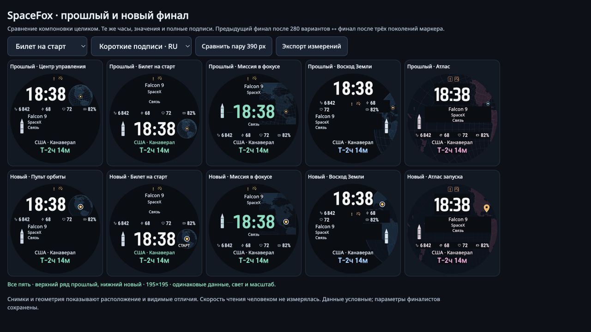

# SpaceFox: сравнение целого циферблата с прошлым финалом

2026-11-11. **Общий выигрыш в эргономике не доказан.** Последний раунд улучшал
заметность и смысл знака космодрома, сохраняя прежние компоновки. Его ограниченный
PASS нельзя переносить на выравнивание, удобство чтения и композицию всего экрана.
Ниже — парное сравнение и собственная визуальная оценка автора этой проверки;
нового независимого ревью или эксперимента с людьми здесь нет.

[Открыть парное сравнение](../prototype/marker/compare.html) ·
[сырые измерения](../openspec/changes/make-launch-site-obvious/evidence/whole-face-comparison/measurements.json) ·
[сводка](../openspec/changes/make-launch-site-obvious/evidence/whole-face-comparison/summary.json) ·
[целостность сохранённых источников](../openspec/changes/make-launch-site-obvious/evidence/whole-face-comparison/integrity.json).

## Что сравнивалось

| Прежний финал | Маркерный финал |
|---|---|
| R4-01 · Центр управления | M2-11 · Пульт орбиты |
| R4-03 · Билет на старт | M3-21 · Билет на старт |
| R4-05 · Миссия в фокусе | M2-31 · Миссия в фокусе |
| R4-12 · Восход Земли | M2-41 · Восход Земли |
| R4-09 · Атлас | M2-51 · Атлас запуска |

Источник — неизменённые пять прежних объектов из `prototype/marker/data.json` и
точный новый `final-selection.json`, соответствующие авторской ревизии
`8936c4d87ad91f00a2414c2dca41e22445fb00b8` и опубликованной
`e898e78dc7accc1a575a9e26265d0df499497fbd`. Сравнение использует общий прежний
рендерер через существующую маркерную обёртку; отдельная перерисовка «на глаз»
не создавалась. Поле `base` у всех пяти новых объектов в точности равно прежнему.

Для каждой пары одинаковы значения, условное расписание, язык и окружение:

- Короткие русские подписи: Falcon 9, SpaceX, «Связь», «США · Канаверал».
  Координата взята из существующего каталога, а не из положения пикселя.
- Длинные русские подписи: `author3-07-ru` из прежнего авторского банка.
- Соответствующие длинные английские подписи: `author3-07-en`.

Длинная сцена выбирается по длине названия компании, затем задачи и ID, без
отбора по красоте результата. Это три конкретных примера, а не все допустимые
строки, языки и координаты. В галерее есть обзор при CSS195×195 и пары CSS390×390.
Это размеры браузерного изображения: физический размер часов, яркость AMOLED,
расстояние взгляда и AOD не воспроизводятся.

## Измеряемое выравнивание и типографика

В 15 парах совпали **150 из 150 основных подписей**: время, четыре значения
фитнес-полей, ракета, компания, задача, место и отсчёт. Совпадают прямоугольники
DOM, семейство/размер шрифта, межстрочный интервал, выравнивание, цвет и текст.
Основные шрифты и геометрия текста в последнем раунде не улучшались.

Это не доказывает одинаковую скорость чтения: другой фон и более сильный маркер
меняют зрительную конкуренцию. Такой эффект нужно проверять отдельно.

Две конкретные особенности при ширине390:

- У нового «Билета» центр отдельного слова **СТАРТ на12,85 px левее центра
  маркера**; у LAUNCH — на3,27 px. Начало строки фиксировано, поэтому кажущееся
  центрирование меняется вместе с языком. Это добавленная неровность, отсутствовавшая
  в прежнем варианте. Новый текст17 px также мельче основных подписей места21 px.
- У «Атласа» названия ракеты/компании/задачи центрированы по x220, а время,
  место и отсчёт — по x195: **разница25 px унаследована**. Ракета слева может
  оптически уравновешивать смещение; само по себе оно не доказывает ошибку.
  Однако баланс группы меняется с длиной названия. Новый пин эту особенность
  не исправляет.

У «Билета» и «Миссии в фокусе» основные центрированные подписи лежат на общей
оси x195. У «Пульта» ось времени x153,5, миссия выровнена влево по x76, нижний
блок центрирован по x195. У «Восхода» верх/низ центрированы, миссия начинается
с x32. Эти системы выравнивания тоже перенесены без изменений; число осей само
по себе не является оценкой качества.

## Визуальное сравнение

Оценка ниже получена просмотром коротких и длинных RU/EN-обзоров и пяти коротких
пар390. Это профессиональное суждение о видимых отношениях, без выдуманного
эстетического балла или результатов чтения человеком.

| Компоновка | Выравнивание и читаемость | Композиция относительно прошлого финала | Решение |
|---|---|---|---|
| Пульт орбиты | Текст без изменений. Кольцо явно различимо; основные данные сохраняют прежнюю раздельную группировку. | Более тихий глобус меньше спорит с цифрами, но сетка слабее передаёт его объём. Локальное, умеренное улучшение. | Сохранить как практический контроль. Не представлять новой компоновкой. |
| Билет на старт | Общая ось текста сохранена. Новое слово СТАРТ мало и смещено относительно кольца; его положение зависит от языка. | В прежнем варианте маленький глобус был чище. Кольцо полезно, отдельное слово добавляет плотность возле нижнего блока. | Продвигать гипотезу «чистота прошлого + новое кольцо»; необходимость и выравнивание слова проверить отдельно. Такой гибрид ещё не реализован и не прошёл прежний PASS. |
| Миссия в фокусе | Большое время и основные подписи имеют общую ось. Кольцо хорошо отделяется от карты. | Наиболее убедительный из текущих вариантов: тихий фон оставляет ясный акцент на времени и точке. Разнесение метаданных над/под временем осталось прежним. | Основной кандидат из уже существующих; общий выигрыш умеренный, типографика не новая. |
| Восход Земли | Маркер стал доступнее взгляду и ушёл от края. Парные поля и индикаторы сохраняют неоднозначную группировку. | Камера перемещает точку к верхнему правому краю времени. Чёрные непрозрачные блоки заметно режут планету; целостный образ Земли слабее, чем обещает название. | Исследовательское направление. Общего выигрыша не заявлять, нужна работа с компоновкой целиком. |
| Атлас запуска | Привычный пин значительно яснее тонкой точки. Малые метаданные и разные оси остались прежними. | Сетка стала спокойнее, но яркий верхний правый пин и прямоугольные чёрные вырезы не складываются в явно более цельную карту. | Исследовательское направление. Сильнее география, общий баланс ещё требует работы. |

Ни новый маркер, ни техническое отсутствие пересечений не делают пять разных
семейств пятью одинаково законченными эргономическими победителями. Практический
выбор этой проверки: текущая **«Миссия в фокусе»**, затем доработка **«Билета»**;
**«Пульт»** — контроль простоты. «Восход» и «Атлас» пока не продвигаются как
готовые композиционные решения.

## Что проверять в следующем изменении

Это рекомендации, а не выполненное четвёртое поколение:

1. У «Билета» сравнить слово, его отсутствие и привязку к строке места; при
   сохранении слова использовать явную общую ось и проверять RU/EN. Не переносить
   маркерный PASS на вариант без слова автоматически: смысл обозначения изменится.
2. Сравнить умеренную сетку с полностью тихой, сохраняя кривизну глобуса. Фон должен
   поддерживать форму Земли и не конкурировать с точкой.
3. Для «Восхода»/«Атласа» сначала согласовать текстовые области и целую географию,
   убрать случайные прямоугольные разрывы и проверить баланс вместе с ракетой.
4. Оценивать целые задания: прочитать время → оставшееся время → место → миссию,
   затем фитнес-поля. Для измерения времени/ошибок нужны реальные люди и реальные
   условия; модельный поиск маркера этого не заменяет. Контроль должен быть парным
   и включать прежний финал, короткие/длинные подписи и разные языки.

## Квитанция и ограничения

Новые источники — только `compare.html`/`compare.js`; прежние рендереры, параметры,
критерии и испытания не менялись. Синтаксис нового JS проверен. Браузерная проверка
охватила переключение пары/обзора, трёх сцен, пяти семейств, фактический экспорт
DOM и снимки. 53 зависимости браузера,23 средства прежней проверки и9 защищённых
прежних владельцев сверены с сохранёнными хешами. Старые зелёные поведенческие
проверки не перезапускались: их семантические входы не изменились.

`pair-0.jpg`…`pair-4.jpg` — окончательные короткие пары с именами; `overview-short.jpg`
— окончательный обзор. Длинные обзоры RU/EN сохранены отдельно. Первые три снимка
`ticket-pair.jpg`, `atlas-pair.jpg`, `earthrise-pair.jpg` имеют прежние подписи
интерфейса, но те же изображения часов. `overview-initial-clipped.jpg` — отклонённая
первая версия интерфейса сравнения с неудачной высотой панели; не используется
для оценки масштаба или счёта. Исправлена только оболочка сравнения.

Оригинальные отчёт, код стенда и спецификации распространяются по MIT. Прежние
ограничения нативной реализации, батареи, AOD, живого расписания и локализации
сохранены. Ограниченный результат маркерного раунда остаётся в истории; этот
отчёт уточняет его смысл, не заменяет его критерии задним числом.
