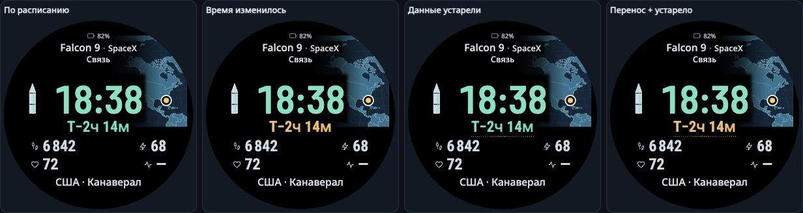

# «Миссия в фокусе»: крупные поля и время до старта

2026-11-11. Владелец выбрал **«Falcon 9 · SpaceX»**, ниже — **«Связь»**.
Эта группировка зафиксирована. Следующая доработка сравнивает три формата карты
при одинаковом более крупном переднем плане.

[Открыть текущий макет](../prototype/countdown-status/index.html).

## Что изменилось

- Четыре значения собраны в 2×2 и увеличены с 22,2 до **32 px**: размер шрифта
  вырос на 44,1%. Это размер в исходном браузерном экране 390×390, не результат
  измерения человеческой скорости чтения. Длинные числа не уменьшаются.
- Отсчёт перенесён сразу под время, на ту же ось. В короткой RU-сцене расстояние
  между измеренными чернилами времени и отсчёта уменьшилось со 127,5 до 14,5 px.
  Прежний контроль взят из сохранённого экспорта верхнего блока, без повтора теста.
- Заряд часов вынесен в компактный индикатор по центру сверху. Он не забирает один из четырёх
  слотов. В каждом слоте можно выбрать показатель; исходная демосцена содержит
  заряд и в четвёртом слоте, поэтому его можно переназначить. На картинке выбран
  стресс: его нет в этой исходной сцене, поэтому показан честный прочерк.
- Место запуска перемещено под поля; размер Noto Sans 21 px сохранён. Время
  сохраняет Barlow Condensed и прежнюю контрольную высоту чернил 58,5 px.
- Вместо жёсткой прямоугольной подложки вокруг времени карта мягко затемняется
  под текстом. Маски действуют на географию; маркер старта остаётся непрозрачным.

## Карта и фон

| Вариант | Что даёт | Компромисс |
|---|---|---|
| **01 · Мягкий край** | Заметный правый фрагмент карты, затухание к тексту | Часть Земли намеренно скрыта временем и заголовком |
| 02 · Карта в окне | Чёткое отдельное окно вокруг точки | Рамка сильнее дробит круглый экран; контекста меньше |
| 03 · Полушарие | Видимая кривизна Земли и космический характер | При заданном масштабе окрестности площадки сжимаются сильнее |

Рекомендация автора — **01 с чёрным фоном**. Это визуальная оценка, а не доказанный
победитель по человеческой эргономике. Варианты доступны для сравнения и дальнейшего
выбора владельца. Камера поворачивается к исходной координате, точка отмечает
космодром, а не положение ракеты в полёте.

Цветной прямоугольник под временем не нужен для этой композиции: чёрного фона
и мягкого затемнения карты достаточно в проверенных сценах. Тёмно-синий фон
оставлен как альтернатива. Это два тёмных оформления, а не обещание конкретного
расхода батареи. Нативный AOD требует отдельной реализации и проверки.

## Статусы рядом с отсчётом

По следующему пожеланию владельца `!` и перечёркнутое облако **убраны со всего
циферблата**. Верх освободился; заряд часов выровнен по центру.

| Состояние | Отсчёт |
|---|---|
| Обычное расписание | Мятный |
| Время запуска изменилось | Янтарный |
| Данные устарели | Мятный с пунктиром снизу |
| Перенос и устаревшие данные вместе | Янтарный с пунктиром снизу |

Устаревание означает давнее подтверждение источника, а не обязательно отсутствие
связи прямо сейчас. Неизвестное время остаётся текстом «Время уточняется»;
цвет и пунктир применяются к этой подписи. Текущее время сохраняет свой цвет.
Постоянного времени последней синхронизации на экране нет.

## Как проверено

Для новой индикации измерены **30 браузерных состояний**: четыре состояния ×
три карты × два фона и ещё шесть длинных/неизвестных отсчётов. Сохранены
[новые наблюдения](../openspec/changes/enlarge-relay-fields/evidence/countdown-status/browser.json).
Нет обнаруженных наложений, потери строк или ошибок статуса. Девять подписей
в каждом состоянии сохраняют прежние значения, шрифты и прямоугольники —
270 сравнений с сохранённым контролем. Пунктир имеет минимум 7,1 px до полей,
минимальный расчётный контраст текста — 12,19. Служебных значков нет ни в одном
проверенном состоянии. Проверка браузерная и авторская, без нативной приёмки.

Для **предыдущей версии** со значками измерены 96 фактических браузерных состояний:
3 формата × 14 RU/EN-сцен ×
2 фона и 12 дополнительных состояний переназначения четвёртого поля. Отдельно
через интерфейс переставлены все четыре поля; результат сохранён в
[ui-four-slots.json](../openspec/changes/enlarge-relay-fields/evidence/ui-four-slots.json).
Значения демонстрационные, не данные ребёнка.

В этом конечном наборе проверка не обнаружила потерь строк/ролей, наложений или
выхода за круг. Сохранены модель ракеты, исходные координаты и раздельные состояния.
Минимальный расчётный контраст текста — 13,37; минимальный зазор маркера до
измеренных элементов переднего плана — 35,16 px. Часы не уменьшены.
Проверены длинные RU/EN-подписи, пятизначные значения, неизвестное время/место,
Канаверал, Махия и Куру. Все наблюдения и хеши исходников — в
[browser.json](../openspec/changes/enlarge-relay-fields/evidence/browser.json).

Первая версия тоже прошла геометрические проверки, но авторская проверка картинки
выявила резкий вырез карты под часами. Этот недостаток исправлен мягкой маской;
первая версия и точные изменённые исходники сохранены. Это пример ограничения
автоматической геометрической проверки, а не основание объявить её исчерпывающей.

Аудитор дополнительно сверяет числа/строки/роли, круг и пересечения независимо от
поля `geometryErrors`. Отдельные тесты требуют отказа при пропавшем/изменённом
значении, подмене роли, пересечении, нарушении порядка, выдуманном заряде, скрытой,
смещённой, затухающей или ложной точке и неверном статусе.

Границы: DOM/Range использует консервативные прямоугольники чернил. География
растеризуется отдельно от нативного экрана; старый измеритель v3 использует
тёмно-синий опорный фон для прозрачных пикселей, что консервативно для контраста
текста на чёрном. Это не фотометрия AMOLED. Снимки проверены автором макета;
независимое ревью этого небольшого продолжения, чтение ребёнком, остальные языки,
Monkey C и физический FR165 не проверялись. Исторические проверки неизменённых
модулей сохранены и не перезапускались. Оригинальный код, отчёт и спека — MIT.

Четыре точных теста аудитора прошли на чистом исходном коммите; они покрывают
восемь рёбер графа требований и положительные/отрицательные случаи.
[Протокол](../openspec/changes/enlarge-relay-fields/evidence/verification-final.json)
и [сводка проверок](../openspec/changes/enlarge-relay-fields/evidence/checks.json)
сохранены. Обе затронутые OpenSpec-спеки прошли строгую структурную проверку.

Для новой индикации отдельно прошли два точных теста: принятие30 измеренных
состояний и отказ при неверном цвете, пропавшем/ложном пунктире, оставшемся значке,
пересечении линии, изменённом цвете текущего времени, сдвинутом заряде или подмене
значения. [Новый протокол](../openspec/changes/enlarge-relay-fields/evidence/countdown-status/verification.json)
сохранён отдельно. Прежние восемь рёбер графа остаются зелёными на неизменённых
исходниках исторического макета; они не пересняты как новая проверка.
