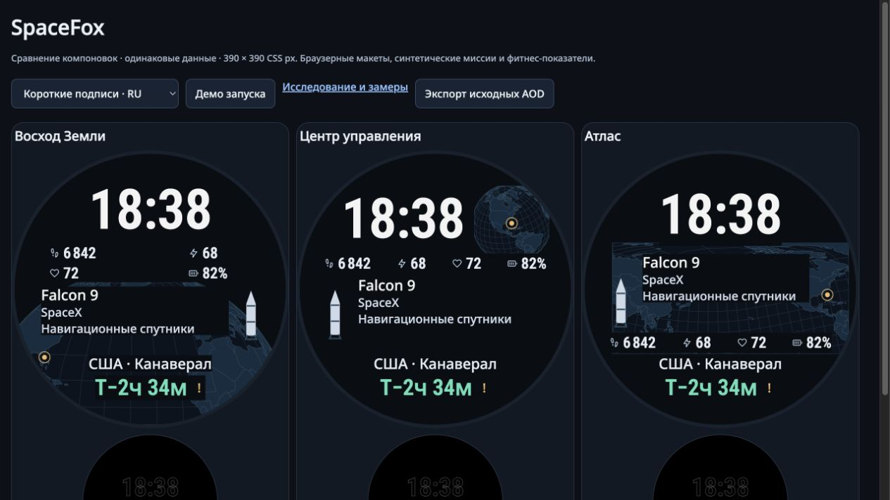

# SpaceFox: независимая проверка и три предложения

11 ноября 2026. Оригинальный текст, спецификация и код — MIT; шрифты и библиотеки сохраняют свои лицензии. Это исследование браузерных макетов для круглого экрана 390×390. Установочного циферблата Garmin пока нет.

**Рекомендованное направление — «Центр управления»**: небольшой отдельный глобус и спокойные ряды данных. «Восход Земли» сильнее раскрывает тему и группирует фитнес-поля попарно. «Атлас» отдаёт приоритет миссии и широкой карте. Все три сохраняют полные согласованные подписи в проверенных сценах.

[Открыть интерактивное сравнение](../prototype/qualification/review.html) · [лаборатория](../prototype/qualification/index.html) · [OpenSpec](../openspec/changes/independently-qualify-layouts/specs/layout-qualification/spec.md)



## Почему потребовался новый цикл

Первый независимый рецензент проверил исходные результаты прежних 319 вариантов, код и изображения. У верхнего глобуса компания/цель обрезались в 18 из 24 контрольных сцен, у карты — в восьми, у горизонта — в шести. Старый контракт разрешал часть такого сокращения. Три варианта были недостаточно различны, а валидатор принимал посторонние ID сцен, противоречивый audit и NaN координаты маркера. Это не означает, что сохранённые старые наблюдения были поддельными: реальные данные прошли исправленные старые проверки.

Рецензент написал [исходное ревью](../openspec/changes/independently-qualify-layouts/evidence/initial-independent-review.md) до нового эксперимента. Его 24 контрольные сцены и отдельный oracle были закрыты от автора до фиксации финалистов и исходников. Вторая оценка была визуальной: отдельный рецензент без авторства видел только одинаково масштабированные изображения A/B/C, без рангов и технических результатов. Это разделение ролей и свидетельств; оно не превращает модельные оценки в исследование с людьми.

## Цель и размер эксперимента

Цель, зафиксированная до отбора: три разных композиционных предложения, полные видимые подписи, четыре настроенных роли/значения, круговой fit, зазоры от 4 px, контраст текста от 4.5:1 и основных графических знаков от 3:1. Время — 80 px; место — 21; фитнес-значения — 22.2; название ракеты — 21; компания/цель — 17.2. Это размеры браузерных шрифтов, не доказанная скорость чтения. У цифр времени измеренная высота видимого знака около 58.5 px.

План: **48 → 24 → 12**, шесть структурных систем по восемь начальных вариантов, затем потомки реально измеренных родителей. Допущено одно ремонтное поколение до восьми вариантов. Политика фиксирована в [design](../openspec/changes/independently-qualify-layouts/design.md), все отбракованные варианты сохранены.

| Этап | Вариантов | Сцен на вариант | Прошли все сцены |
|---|---:|---:|---:|
| Первое поколение | 48 | 16 авторских | 24 |
| Второе | 24 | 16 авторских | 12 |
| Третье | 12 | 16 авторских | 6 |
| Первое открытие независимого контроля | 3 замороженных | 24 новых | 0 |
| Ремонтное поколение: шесть, затем два оставшихся места | 8 | 16 + 24 повторных | 8 |

Итого **92 уникальных набора визуальных параметров**. Первые 84 дали 1 344 DOM-наблюдения; ремонт — ещё 320. Контроль после ремонта — регрессия на уже известных входах. Нового независимого слепого набора после ремонта не было. Два предварительных прогона измерителя тоже сохранены как диагностика и в число 92 не входят.

## Проверенные гипотезы и решения

| Гипотеза | Наблюдение | Решение |
|---|---|---|
| Отдельная маленькая Земля освободит широкую полосу миссии | Восемь начальных вариантов прошли 16 авторских сцен; после ремонта выбранный прошёл все 40 | Сохранить как базовую композицию |
| Широкая карта с карточкой миссии даёт другой порядок чтения | Авторские сцены помещаются, но два больших значения вывели строку к круглому краю | Центрировать более широкую строку полей; признать заслонение части карты компромиссом |
| Вертикальный прибор вместит время и текст бок о бок | Ни один из восьми не прошёл: круговой fit и сближение с текстом/ракетой | Отсеять |
| Центральная орбита сохранит четыре поля внизу | Восемь вариантов дали конфликт полей с местом | Отсеять |
| Поднятый отсчёт позволит выделить близкий старт | Нижняя строка места/полей вышла к краю | Отсеять эту композицию, не заявлять доказанное преимущество при близком старте |
| Короткие подписи можно соединять, длинные переносить целиком | Проверены flow/stack, естественный перенос вместо многоточия | Сохранить обе грамматики; это не тест человеческой скорости чтения |
| Крупный отсчёт с днями безопасен в прежнем подвале | Свежий контроль нашёл касание края на длинном RU-отсчёте | Поднять место и отсчёт на 3–4 px |
| Горизонт достаточно сделать обрезанным фрагментом Земли | Слепое ревью признало географику незавершённой и слишком похожей на основной вариант | Последние два места ремонта: настоящая дуга Земли и две стабильные пары полей |

Ремонт не снижал размеры текста или зазоры и не удалял компанию/цель. Маркер получил свободную область. Рецензент дополнительно обнаружил ложную неподвижную стрелку севера на повёрнутой карте; необязательная стрелка удалена, сама проекция сохранена. Направление верха карты не объявляется севером.

## Независимый итог

На первом свежем контроле Q3-11 провалил 1/24 сцены, Q3-21 — 2/24, Q3-31 — 6/24. Рецензент подтвердил это своим отдельным вычислителем без импорта авторского детектора. После ремонта он независимо пересчитал видимые строки, роли, флаги, геометрию, зазоры, контраст и маркер. Первые отказы сохранены; их не заменяли успешной записью.

Финальные кандидаты: **Q4-11, Q4-21, Q4-33**. Каждый прошёл 16 авторских и 24 регрессионные сцены. Нет обрезанных согласованных подписей, пропущенных полей или закрытых маркеров в этих сценах. Это конечный набор примеров, не гарантия для любых сочетаний строк всех 36 языков. Длинные реальные данные принимаются, диагностируются отдельно, полные исходные названия сохраняются.

Слепой визуальный рецензент после доработки считает три предложения достаточно разными. Он предпочёл B («Центр управления») по связности, а C («Атлас») отметил как вариант с более закрытой текстом географией. Узнаваемость каждой модели по одному силуэту, читаемость AOD на запястье и скорость чтения не доказаны.

Один способ полноэкранной съёмки исказил ведущую цифру времени на снимках. DOM и фактические viewport-снимки согласуются; рецензент повторно проверил пять `native-*.jpg` и снял замечание. Исходные изображения и история замечания сохранены. Старые файлы `blind-*.png` имеют JPEG-байты; это явно исторические снимки, новые названы `.jpg` корректно.

## Три предложения

| Предложение | Зачем выбирать | Компромисс |
|---|---|---|
| **Центр управления — Q4-11, B** | Отдельный узнаваемый глобус сверху, широкий блок миссии справа от ракеты, четыре поля одним рядом. Самая спокойная и связная композиция по независимому визуальному суждению | География небольшая; подробности космодрома читаются по подписи |
| **Восход Земли — Q4-33, A** | Большая нижняя дуга планеты, четыре поля двумя стабильными парами, асимметричный блок миссии. Самое выраженное космическое настроение и самостоятельная структура | Часть планеты перекрывают непрозрачные подписи; несколько зон требуют освоения |
| **Атлас — Q4-21, C** | Сначала время и миссия, затем показатели; широкая карта связывает площадку с географическим контекстом | Текст закрывает значительную часть карты; это обзор выбранного региона, не подробная навигационная карта |

**Шрифты:** Roboto Condensed 600 для времени/чисел и Noto Sans 500 для подписей, включая кириллицу. Сравнение компоновок держит шрифт и размер времени постоянными. Выбор основан на ширине, явной иерархии, измеренной высоте глифов и имеющихся OFL-ресурсах; человеческое преимущество перед другими шрифтами не заявляется.

Ракеты — оригинальные схемы Falcon, Electron, Ariane и условная схема для неизвестной модели. Ширина основного корпуса 12 px, вместо 4.6 px в прежней тесной карте. Название остаётся главным надёжным идентификатором. Добавление полноценного обновляемого каталога и другие модели остаются нативными задачами.

## Экономный режим и границы доказательств

Пять реальных canvas-кадров 390×390 дали **2.82–4.46%** ненулевых RGB-пикселей внутри круга, включая сглаживание: 3 367–5 334 из 119 488. Исходные PNG и численные записи сохранены. Режим у трёх предложений одинаковый. Проектная цель <8% выполнена на этих кадрах; [Garmin документирует предел 10% при обновлении AMOLED AOD](https://developer.garmin.com/connect-iq/articles/user-experience-guidelines/Watch_Faces.html). Это не проверка прошивки, burn-in, автономности или разборчивости в солнечном свете.

Нативный Garmin, реальное расписание, обновляемые изображения, физический экран и все языки не квалифицированы этим экспериментом. Демо-взлёт — пользовательская иллюстрация, а не подтверждение реального запуска. Для следующего физического пилота можно использовать план коротких экспозиций из [свежего обзора источников](../openspec/changes/independently-qualify-layouts/evidence/fresh-references.md); такой пилот ещё не проведён.

## Свежие идеи и воспроизведение

Визуально изучены официальные Bell & Ross BR-03 Astro, Citizen Satellite Wave и Patek 5330G; текстовые выводы проверены по первичным исследованиям 358 циферблатов, опросу 237 пользователей и PacificVis о долевых диаграммах. Их функции и результаты не выдаются за тест SpaceFox. Источники, журнал чтения/просмотра и десять дополнительных человеческих гипотез находятся в [исследовательской записке](../openspec/changes/independently-qualify-layouts/evidence/fresh-references.md). Эти десять гипотез с краткими экспозициями пока не измерялись на людях.

Применены `typography`, `sdd-workflow` и `scientific-critical-thinking`; последний помог разделять наблюдение и вывод. Методический источник: [Kassis et al. (2026), Scientific Agent Skills](https://doi.org/10.48550/arXiv.2609.00065), не исследование эргономики часов.

```sh
python3 -m http.server 8772 --bind 127.0.0.1
# /prototype/qualification/review.html — три предложения
# /prototype/qualification/index.html — запуск 48/24/12, загрузка сохранённого контроля
python3 -B -m unittest -v tests.test_layout_qualification
```

Доказательства: [заморозка](../openspec/changes/independently-qualify-layouts/evidence/freeze.json), [первый контроль с отказами](../openspec/changes/independently-qualify-layouts/evidence/first-holdout-failures.json.gz), [весь эксперимент](../openspec/changes/independently-qualify-layouts/evidence/campaign-with-holdout.json), [техническое ревью](../openspec/changes/independently-qualify-layouts/evidence/final-technical-review.md), [визуальное ревью](../openspec/changes/independently-qualify-layouts/evidence/final-blind-visual-review.md), [AOD](../openspec/changes/independently-qualify-layouts/evidence/aod-pixels.json). Sealed генератор хранится для воспроизводимости формата; повторный запуск создаст новые случайные ID, не воспроизведёт старую печать.
