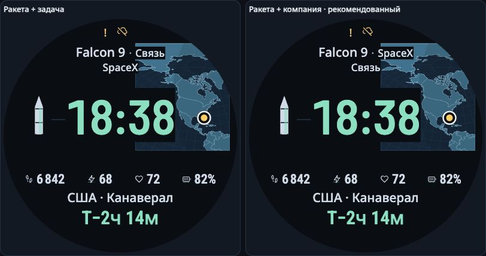

# «Миссия в фокусе»: верхний блок миссии

2026-11-11. По просьбе владельца сравниваются два способа собрать метаданные
над временем. Основа — M2-31 с выбранной умеренно светлой картой.
[Открыть сравнение](../prototype/relay/header.html).

- **Ракета + компания:** `Falcon 9 · SpaceX`, ниже — `Связь`.
- **Ракета + задача:** `Falcon 9 · Связь`, ниже — `SpaceX`.

Оба варианта переносят задачу в верхний блок и освобождают строку под временем.
Первый рекомендован автором макета: модель и компания образуют одну сущность,
а задача миссии получает отдельную строку. В последующем сообщении 2026-11-11
владелец однозначно выбрал эту группировку. В переключателе сохранены оба варианта.
Следующая [доработка полей и карты](FOCUS_LAYOUT.md) использует выбранный верх.
Выбор группировки сам по себе не означает нативную приёмку Garmin.

Пара помещается в одну строку, только если её измеренная ширина безопасна для
верхней части круглого экрана. Длинные названия переходят в три строки без
сокращений и уменьшения шрифта. Декоративная точка-разделитель при переносе
скрывается. Все подписи сохраняют прежние Noto Sans и размеры; время — Barlow
Condensed. Положение/размер времени, четырёх полей, ракеты, места и отсчёта,
проекция и координата старта не меняются.

## Проверка и компромиссы

Измерены 28 новых состояний: два варианта × 14 RU/EN-сцен. Четырнадцать прежних
контролей светлой карты использованы из сохранённого браузерного экспорта после
проверки точного состава сцен и хешей исходников; они не пересняты как новые.

В обоих вариантах:

- Сохранены все исходные значения и стили шрифтов: 280 сравнений подписей.
- Семь неподвижных подписей сохраняют полные прямоугольники/стили: 196 сравнений.
- Совпадают геометрия переднего плана и пути/координаты географии.
- На этом наборе нет наложений, выхода за круг и ошибок семантики.
- Минимальный расчётный контраст текста — 11,31 у пары с задачей и 13,37 у пары
  с компанией. Используется прежний консервативный DOM/SVG-измеритель.

Цвета карты сохранены, но площадь, закрытая метаданными, меняется. Для длинных
строк интегральный сигнал карты может снизиться примерно на 23% относительно
предыдущей светлой версии; в отдельных сценах он повышается до 2,5%. Это
изменение перекрытия, а не перекраска карты. Поэтому группировка не объявляется
безусловным улучшением всей композиции. Под временем остаётся больше свободного
пространства; поля намеренно не сдвигались в рамках этой проверки.

В данном конечном наборе компания помещалась рядом с ракетой в 6 из 14 сцен,
задача — в 2 из 14; остальные использовали перенос. Это описание выбранных
сцен, не прогноз для всех реальных запусков.

[Наблюдения](../openspec/changes/compose-brighter-geography/evidence/relay-header/browser.json)
и [сводка](../openspec/changes/compose-brighter-geography/evidence/relay-header/summary.json)
сохранены вместе с точными измеренными исходниками. После измерения уточнено
только слово в подписи интерфейса: «яркость сохранена» → «цвета сохранены»;
параметры и рендереры часов не менялись. Исходная светлая версия остаётся
[отдельно доступной](../prototype/relay/index.html).

Проверка визуальная и браузерная, выполнена автором макета. Человеческое чтение,
предпочтения ребёнка и нативный Garmin не проверялись. Код, спецификация и отчёт
распространяются по MIT; прежние лицензии шрифтов сохранены.
