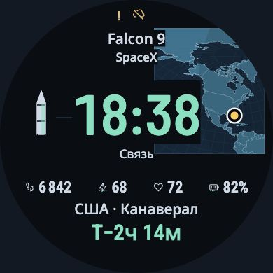

# «Миссия в фокусе»: более заметная карта

2026-11-11. По решению владельца за основу дальнейшего макета взята
**«Миссия в фокусе» M2-31**, основанная на прежней R4-05.
[Открыть сравнение](../prototype/relay/index.html).

Это небольшое уточнение оформления карты. Сохранены компоновка, большое мятное
время, ракета слева, полные подписи, четыре поля, нижние место/отсчёт, проекция
и точка космодрома. Прежний рендерер и его данные остаются неизменными; новый
слой меняет только заливку моря/суши, берег, сетку и силу географической тени.

Два варианта:

- **Карта заметнее** — основной: синеватая суша, более ясный берег и мягкая тень.
- **Карта ярче** — альтернативный: светлее суша и море, ещё меньше затемнение.

Оба используют прежние Barlow Condensed для чисел и Noto Sans для подписей.
Масштаб карты не увеличивается, текст не переносится в другие области.

## Проверка

Сравнение выполняется в браузере на 14 прежних основных/дополнительных RU/EN-сценах,
включая Канаверал, Махию, Куру, длинные подписи и отсутствие координаты. Для
каждого варианта проверяются точное совпадение геометрии/стилей текста, рисунков
переднего плана, путей географии и исходной координаты с M2-31. Цель карты —
минимум удвоенный интегральный световой сигнал при сохранённых текстах и точке.

У строки компании обнаружен пограничный случай: консервативный прямоугольник
чернил выступает примерно на 0,36 px ниже прежней CSS-подложки. Яркий берег под
этим краем снижал расчётный контраст. Добавлен запас тёмной подложки на 1 исходный
пиксель в рисунке карты; сама строка и её стили/положение не меняются. Первый
экспорт и первые исходники сохранены отдельно. Это защитная мера для края,
а не доказательство плохого чтения человеком в первоначальном варианте.

Используется исправленный SVG-диагностический измеритель предыдущего раунда.
Его Y/сигнал описывают браузерное изображение карты, а не физические ниты или
расход батареи часов. Нового независимого ревью, человеческих измерений и
нативного Garmin-теста это уточнение не добавляет.

Итог: 14 сцен × 3 оформления = 42 наблюдения. Для двух новых оформлений
совпали 280 пар основных подписей: значения, прямоугольники, шрифты, размеры,
цвета и выравнивание. Не меняются пути карты, передний план и координаты точки;
новый защитный прямоугольник относится только к рисунку подложки.
Наложений переднего плана и ошибок семантики в этом наборе нет.

Средний линейный Y карты относительно исходника вырос в 4,54–7,67 раза у
основного варианта и в 8,70–15,23 раза у яркого. Минимальный расчётный контраст
текста — 13,37. Это относительное сравнение именно M2-31; прохождение всей
матрицы и абсолютных порогов предыдущего большого композиционного раунда не
заявляется. Сохранённый рисунок карты может по-прежнему перекрываться большими
цифрами — это сознательно сохранённая основа владельца.

[Сырые наблюдения](../openspec/changes/compose-brighter-geography/evidence/relay-refinement/browser.json),
[сводка](../openspec/changes/compose-brighter-geography/evidence/relay-refinement/summary.json)
и первые отказы сохранены. Новые исходники проходят проверку синтаксиса;
53 прежних браузерных владельца остались неизменными. Неизменённые старые тесты
не перезапускались.
Исходники, исходная спека и этот отчёт распространяются по MIT; лицензии прежних
шрифтов и сторонних ресурсов сохранены.
