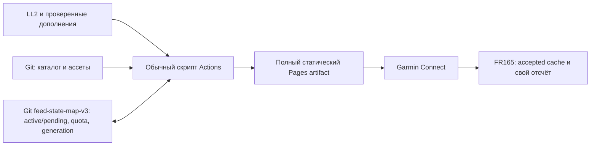

# Разработка, выпуск и обновления SpaceFox

Дата проверки требований по первичным источникам: **2026-11-11**. Состояние
реализации обновлено **2026-11-13**. Оригинальный документ — [MIT](../LICENSE).

Текущий публичный экземпляр использует единственный schema3/SFR1M `/feed.json`
с большой затухающей плоской картой. Публичный source main на момент подготовки
тестового пакета — `5679b093`; исходник подписанной сборки — `c7ad2c41`.
[Основной прогресс](../openspec/changes/spacefox-watchface/PROGRESS.md) сохраняет
точные receipts и границы. Реальное автоматическое обновление
[43433017023](https://github.com/JekaMas/SpaceFox/actions/runs/43433017023)
успешно выполнило все пять jobs; source epoch1794576343 выше предыдущего
1794572010. Это наблюдение конкретного обновления, не гарантия срока следующего.

Основной нативный сценарий проверен в официальном симуляторе: HTTPS-данные,
одна плоская карта, Auto и пять основных языков (en/ru/de/fr/es), цифровые часы
и локальный отсчёт. Все36 внутренних языковых ресурсов сохранены, остальные31
имеют best-effort статус. Физические часы/телефон и расход батареи ещё не приняты.
Production UUID и4096-bit signing identity закреплены; подписанная версия0.1.0
подготовлена как предварительный тестовый выпуск, без утверждения полной приёмки.
[Инструкция установки и теста](TESTING_ON_PHONE.ru.md) различает Store-путь с
телефона и ручной PRG через компьютер. [Privacy](PRIVACY.md),
[внешний таймер](EXTERNAL_SCHEDULE_CLOCK.md),
[runtime publisher](CLOUD_RUNTIME_CHECKOUT.md).

Возрастные условия издателя и целевого использования подтверждены владельцем;
возрастных уточнений для этого экземпляра больше нет. Точные возраста публично
не сохраняются. Коррекция прежнего автоматического возрастного блокера —
[здесь](../openspec/changes/spacefox-watchface/evidence/publication-owner-review.md).
Канонические требования — [release-lifecycle](../openspec/changes/spacefox-watchface/specs/release-lifecycle/spec.md),
[архитектура](../openspec/changes/spacefox-watchface/design.md) и
[единые задачи](../openspec/changes/spacefox-watchface/tasks.md).

## Что требует платформа и что делаем мы

| Область | Проверенное требование/ограничение | Путь SpaceFox и доказательство до выпуска |
| --- | --- | --- |
| Целевое устройство | FR165:390×390 AMOLED, API 5.2; версия SDK не равна API часов | Начать с FR165, закрепить SDK/профиль/прошивку; другие модели и Music добавлять только после квалификации |
| Приложение | Monkey C, manifest с типом, UUID, products, minApiLevel, permissions и languages | Тип watchface; точный product ID из установленного профиля; только реально проверенные устройства и языки |
| Режимы экрана | Active допускает короткую анимацию; AMOLED AOD обновляется по минутам с ограничением горящих пикселей | Выбранная04/full карта только в active; отдельный разреженный AOD, без карты/секунд/анимации, измерение пикселей и батареи |
| Сеть | У watchface связь в background; ограничены время и память | Телефон/Garmin Connect, локальный кеш; частями готовить ассеты, прерывания безопасны; не передавать весь feed через Background.exit |
| Графика | Наличие API в новейшей документации не доказывает его поддержку FR165 | Текущий SFR1M: обязательны передача, сохранение, перезагрузка и замеры на FR165 |
| Частная установка | Build for Device создаёт PRG для устройства; официальный путь — GARMIN/APPS | Сначала личный пилот через проверенный USB/MTP-путь на конкретном компьютере; симулятор не заменяет часы |
| Настройки через Garmin | Установка PRG не доказывает Store-интеграцию | Проверить URL и четыре поля на реальной установке; при необходимости owner-only beta с отдельным UUID, без обещания переноса её состояния |
| Подпись | Для обновлений нужен тот же4096-bit RSA developer key | Ключ и резервная копия вне Git/Pages/data job; стабильный production UUID; потеря ключа — блокер обновления этой идентичности |
| Публичный выпуск | Export Project создаёт IQ; загрузка, описание/скриншоты и review Garmin | Только проверенные products/languages, бесплатные все поля, точные зависимости/пределы/контакты; затем установка именно одобренной версии из Store |
| Права и данные | У Garmin есть требования к IP, приватности и честному описанию | MIT только для своего; отдельные notices карт/шрифтов/графики; данные здоровья локальны, публичный feed без личности ребёнка |
| Издатель и аудитория | Аккаунт разработчика18+; отдельно guidelines содержат правило under13 для аудитории/известного использования | Издатель — подтвердивший совершеннолетие владелец. Общего запрета разработки при неизвестном возрасте пользователя нет; правило аудитории проверить перед выпуском, без выдуманного исключения для взрослого издателя/PRG |

Основания: [устройства](https://developer.garmin.com/connect-iq/compatible-devices/),
[manifest](https://developer.garmin.com/connect-iq/articles/core-topics/Manifest_and_Permissions.html),
[экран/AOD](https://developer.garmin.com/connect-iq/articles/user-experience-guidelines/Watch_Faces.html),
[background](https://developer.garmin.com/connect-iq/articles/core-topics/Backgrounding.html),
[подпись и инструменты](https://developer.garmin.com/connect-iq/connect-iq-basics/getting-started/),
[PRG](https://developer.garmin.com/connect-iq/connect-iq-basics/your-first-app/),
[IQ и review](https://developer.garmin.com/connect-iq/submit-an-app/),
[полный текст review guidelines](https://developer.garmin.com/connect-iq/articles/app-review-guidelines/Overview.html),
[beta](https://developer.garmin.com/connect-iq/articles/core-topics/Beta_Apps.html).
Проверена доступная редакция guidelines с датой Oct13,2021; перед фактическим
выпуском её и соглашение нужно перечитать. Это проверка планирования, не правовое
заключение и не одобрение Garmin. Не публиковать возраст/аккаунтные данные семьи.

## Три разных канала обновлений

| Изменение | Как доставляется | Нужен новый Store binary? |
| --- | --- | --- |
| Monkey C, ошибки логики, permissions, новый renderer/schema, встроенные шрифты/глифы | Сборка, подпись тем же ключом, Export Project IQ, выпуск через Garmin | Да; для личного PRG — новая ручная установка |
| Новая модель/знак/кадры, исправленная карта или точка в поддерживаемом формате | Проверка каталога, неизменяемые файлы по digest, новый manifest/поколение Pages, staged activation часов | Нет, если установленный renderer/формат совместим |
| Время, статус, новый ближайший запуск, настоящая повторная проверка источника | Обычный updater → маленький schedule JSON → фоновое получение через телефон | Нет |
| Новая версия скрипта/Actions | Проверенный Git diff/commit, затем обычная работа издателя | Не сама по себе; не означает обновление кода на часах |

Версии разделены: app/build, wire schema, renderer schema, catalog revision,
content digest, монотонное publisher generation и проверка источника **по записи**.
Дата сборки каталога и успешный HTTP200/304 не обновляют возраст источника.
Единственный текущий SFR1M/schema3 формируется из принятого состояния с общей квотой.
Источник истины координат — каталог, а не вручную нарисованный декоративный pin.

Текущий внешний формат — `native-motion-v3`, envelope schema 3 и SFR1M по
единственному `/feed.json`. Примитивы SFR1 внутри него не являются отдельным
поддерживаемым профилем. Старые wire-форматы, static-экспортёры, прежние архивы,
межверсионные тесты и переходные периоды сняты, не засчитаны как пройденные.
Атомарное обновление, честный source age, точная проверка пикселей/digest,
восстановление и лимиты текущего формата остаются обязательными. Исторические
SDK/hosted результаты не подтверждают текущий источник или физические часы.

## Как будет работать личный издатель



Cron раз в15минут, со смещением от начала часа, сначала проверяет срок. Запрос
источника обычно раз в60минут, сT−2ч до неподтверждённогоT+30мин — раз в15минут.
Неизвестное время — часовой режим. Пятиминутный режим потребует соответствующего
cron и соблюдения общей квоты; это опция. Время до старта всегда считают часы.

Издатель хранит **долговечное состояние в отдельной ветке feed-state-motion-v3**: принятый
и pending snapshot, source age, переносы, due time, поколения и резерв запросов.
Текущий ledger первоначально ограничен64КиБ; размер истории Git контролируется
отдельно. Кеш Actions и однодневный artifact — ускорители/доставка, не единственные
копии состояния. Публичная CDN-копия может отставать и не используется как authority.

Один concurrency group охватывает все публикации; дополнительно нужен
expected-base/CAS-контроль ветки и поколений. Перед запросом резервируется квота,
после проверки долговечно сохраняется pending. Даже потерянный запрос считается
израсходованным. Полный artifact включает все текущие и сохраняемые совместимые
файлы: новый deploy не обязан сохранять файлы старого сайта. После deploy проверяют
точную live revision и только затем продвигают active. Сбой между этими шагами
сначала согласует pending/Git/live, затем продолжает работу. Устаревший queued run
не может перезаписать новое поколение. Это наши проектные решения, не готовая
транзакция, которую GitHub предоставляет автоматически.

Начальные бюджеты: schedule≤8192UTF-8байта после распаковки, полный Pages artifact≤1МиБ,
retention artifacts1день. Они требуют проверки полного текущего и
восстанавливаемого набора ассетов одного формата. Противоречие бюджета с полным набором нельзя скрыть урезанием
охвата. На часы идёт ограниченный slice manifest, не весь мировой справочник.
Сам JSON-ответ Garmin может разобрать до callback: проверка в callback не является
защитой от уже случившегося выделения памяти; это отдельное испытание task2.2.

Стандартные runner в публичном GitHub сейчас бесплатны; storage и Pages имеют
лимиты. Нужны contents:write только writer-у состояния и pages:write/id-token:write
job-у deploy. SDK/signing key ему не нужны. Cron может задержаться/быть пропущен,
а расписание отключиться после60дней без активности. Нужна редкая проверка работы,
а не обещание бессрочного отсутствия обслуживания.
[Actions billing](https://docs.github.com/en/billing/concepts/product-billing/github-actions),
[Pages limits](https://docs.github.com/en/pages/getting-started-with-github-pages/github-pages-limits),
[custom deploy](https://docs.github.com/en/pages/getting-started-with-github-pages/using-custom-workflows-with-github-pages),
[schedule](https://docs.github.com/en/actions/reference/workflows-and-actions/events-that-trigger-workflows#schedule),
[concurrency](https://docs.github.com/en/actions/how-tos/write-workflows/choose-when-workflows-run/control-workflow-concurrency).

## Первый выпуск и последующие исправления

Локальная упаковка теперь реализована в `tools/release.py`; SDK9.3/Java11 уже
установлены отдельно. Она не запускает Simulator и не устанавливает/публикует
приложение. `python3 -B -m tools.release --output /external/new-directory --key
/external/protected/developer.der` сохраняет production UUID и `SpaceFoxApp`,
создаёт отдельные подписанные PRG и настоящий Export Project IQ через SDK `-e`.
Сборка требует чистый Git, существующий внешний PKCS8 DER RSA4096 key с правами
0600 в каталоге0700 и совпадающий **публичный** SPKI SHA256 в committed
`release/signing-identity.json`. Production fingerprint теперь закреплён после настоящего локального восстановления
внешнего RSA4096 ключа из зашифрованного PKCS8 backup и проверки challenge-подписи.
Два candidate-пакета проверяют прежний UUID/key и более высокую версию; это не
квалификация финальной native-сборки и не публичный релиз. Development/test build по-прежнему меняет
UUID и не требует production key.

`--mode official --backup-evidence /external/protected/backup.json` дополнительно
проверяет явное свидетельство резервной копии/восстановления: тот же
`public_key_spki_sha256`, `backup_exists:true`, `restore_tested:true`, `observed_at`,
`attested_by`, `restore_receipt` и его `restore_evidence_sha256`. Указанный внешний
restore JSON должен иметь совпадающий fingerprint, `restored_public_key_matches:true`
и `proof_boundary`. Это проверка предоставленного свидетельства и его hash,
а не самостоятельное наблюдение сохранности/восстановления ключа. Оба production
режима оставляют `publication_ready:false`: device/phone/battery/Store доказательства
не возникают из успешного экспорта. Возраст и SDK agreement не запрашиваются снова.

`--previous /external/prior/release.json` требует строго более высокую версию с
прежним UUID/key, текущие products/languages из pinned manifest и сохранённый IQ с тем же
digest. После первого выпуска публичный `latest_release` в signing identity
связывает version/package digest: дальнейшая production сборка требует именно
этот предыдущий receipt/package. Сейчас `latest_release:null`, выпусков ещё нет.
`--evidence receipt.json` связывает
публичные JSON receipts с явно указанной `proof_boundary`; хранить там секреты
нельзя. Новый output обязателен; overwrite и output внутри source worktree запрещены.
Каталог сохраняет точные source inputs, generated manifest/Jungle, публичный key,
SDK/profile pins, logs и digests PRG/IQ. IQ native7z проверяется по manifest,
part number профиля, языкам/permissions и RSA4096; pinned SDK криптографически
проверяет IQ и PRG. SDK timestamps/debug paths означают, что побитовая
воспроизводимость не доказана. [Handoff](../release/HANDOFF.md) сохраняет setup,
rights/privacy/support и незакрытые реальные границы выпуска.

Для автоматической квалификации упаковщика существует отдельный
`--mode qualification --qualification-policy /external/control.json` с новым
disposable key и UUID, отличным от production/development/test. Такой control
никогда не является production artifact или доказательством backup автора.

1. Публикуем от взрослого владельца; установить инструменты в отдельной разрешённой
   задаче, закрепить профиль/прошивку; проверить API/health, передачу, кеш и AOD.
2. Реализовать native/updater/catalog/workflow с meaningful positive/negative
   evidence; проверить сбои и лимиты, затем личный PRG на фактических FR165.
3. Проверить две настоящие проверки источника, две ревизии графики, reboot,
   offline, старый CDN, перенос, неизвестное время и отсутствие ложного взлёта.
4. Квалифицировать глобальный набор и карты, права, конкретные языки/шрифты,
   настройки Garmin, восстановление текущего формата и батарею. Сохранить source/toolchain/package digests.
5. Подготовить бесплатный listing, screenshots, setup/privacy/support и IQ;
   загрузить для review Garmin и проверить установку одобренного Store-релиза.
6. При исправлении кода выпустить **более высокую версию** с прежней подписью/UUID;
   Store downgrade не обещать. Для отката картинки опубликовать новое поколение с
   прежним проверенным asset set; возраст запуска не менять. Данные исправлять
   с честным источником, без поддельной свежести или регрессии принятого состояния.

Обновления и восстановление текущего формата сохраняют четыре поля, язык, карту и URL. Новая FeedBaseUrl
изолирует записи/переносы/возраст другого экземпляра; только проверенные одинаковые
ассеты можно переиспользовать по digest. Перенос настроек PRG→Store и beta→production
нужно наблюдать, а при раздельной установке дать инструкцию повторной настройки.
Не обещать переживание uninstall. При несовместимом feed остаётся старый кеш с
честным возрастом и понятной причиной в настройках, без новых значков на циферблате.

Другая семья ставит официальный бесплатный binary и настраивает **свой издатель**
по [AGENT_SETUP.md](AGENT_SETUP.md). Собирать native заново нужно только при изменении
самого приложения; такой fork получает собственные UUID/key/listing. Ни личный
ключ автора, ни его аккаунт/сервер для повторения схемы не нужны.

## Локальное хранение production signing identity

`release/signing-identity.json` хранит только публичный SPKI SHA256, digest
зашифрованного backup и границы доказательства. Ключ RSA4096 PKCS8 DER, backup
PBES2 AES256/PBKDF2-HMAC-SHA256 (600000 итераций) и случайный пароль находятся
в разных новых внешних каталогах0700; файлы0600. Пароль передаётся OpenSSL
через stdin, никогда значением аргумента, в logs, Git, Pages или data workflows.
Личная `OWNER_RECOVERY.md` рядом с защищённым recovery-файлом содержит точные
локальные пути и команду. Публичное доказательство:
`openspec/changes/spacefox-watchface/evidence/production-signing/round1/`.

`python3 -B -m tools.release custody-init --custody-dir NEW-EXTERNAL-KEY-DIR
--backup-dir NEW-EXTERNAL-BACKUP-DIR --recovery-dir NEW-EXTERNAL-PASSWORD-DIR`
допускается только при ещё не закреплённой production identity и отказывает
при существующих каталогах. После закрепления это не способ заменить ключ.
При потере ключа восстановить именно прежний:

```sh
python3 -B -m tools.release custody-restore \
  --backup /protected-backup/developer.encrypted.pk8 \
  --recovery-file /separate-protected/recovery-password.txt \
  --output /new-owner-only-directory/developer.der \
  --expected-fingerprint PUBLIC-SPKI-SHA256 \
  --expected-backup-sha256 PINNED-ENCRYPTED-BACKUP-SHA256
```

Команда требует новый output, проверяет pinned backup digest, расшифровывает,
сверяет SPKI и подписывает/проверяет случайный публичный challenge. Ошибочный
пароль, corrupt backup или чужая identity оставляют output отсутствующим;
существующий ключ не перезаписывается. Настоящая проверка original/restored
ключей также сравнивает их подписи одного challenge и подписи SDK PRG/IQ.
Все эти локальные копии находятся на одном Mac: потеря компьютера/диска,
независимое хранение и offsite disaster recovery не проверены. Облачного backup
не создавалось. Физические часы, телефон, батарея и Store остаются отдельными границами.
Нативная языковая квалификация ограничена пятью основными режимами.

## Authorized clean cutover sequence

After current code/fixtures are accepted and the current Linux qualification passes,
the separately authorized deployment uses a tiny empty Pages data site and verifies
`/feed.json` returns404. Then bootstrap a NEW motion-v3 authority namespace and
publish freshly fetched current-format data. The old instance stops; no old parser,
snapshot migration or cross-version recovery is involved. Carry only still-live
quota reservation timestamps, or wait a complete rolling hour before any new
provider call. Source validation advances only after an actual successful fetch.
This sequence is a plan, not an observed public cutover or permission supplied by
this specification-edit unit; root owns the separately authorized execution.
