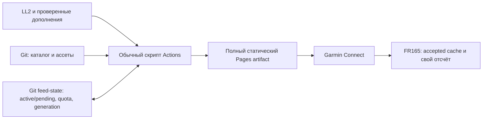

# Разработка, выпуск и обновления SpaceFox

Дата проверки первичных источников: **2026-11-11**. Оригинальный документ —
[MIT](../LICENSE). Это план реализации и выпуска; GitHub уже содержит спеку и
браузерные макеты. Monkey C, updater, Actions/Pages и Store-релиз пока отсутствуют.
Канонические требования — [release-lifecycle](../openspec/changes/spacefox-watchface/specs/release-lifecycle/spec.md),
[архитектура](../openspec/changes/spacefox-watchface/design.md) и
[единые задачи](../openspec/changes/spacefox-watchface/tasks.md).

## Что требует платформа и что делаем мы

| Область | Проверенное требование/ограничение | Путь SpaceFox и доказательство до выпуска |
| --- | --- | --- |
| Целевое устройство | FR165:390×390 AMOLED, API 5.2; версия SDK не равна API часов | Начать с FR165, закрепить SDK/профиль/прошивку; другие модели и Music добавлять только после квалификации |
| Приложение | Monkey C, manifest с типом, UUID, products, minApiLevel, permissions и languages | Тип watchface; точный product ID из установленного профиля; только реально проверенные устройства и языки |
| Режимы экрана | Active допускает короткую анимацию; AMOLED AOD обновляется по минутам с ограничением горящих пикселей | Выбранная04/full карта только в active; отдельный разреженный AOD, без карты/секунд/анимации, измерение пикселей и батареи |
| Сеть | У watchface связь в background; ограничены время и память | Телефон/Garmin Connect, локальный кеш; частями готовить ассеты, прерывания безопасны; не передавать весь feed через Background.exit |
| Графика | Наличие API в новейшей документации не доказывает его поддержку FR165 | Начальная проба — ограниченная JSON-геометрия; bitmap-путь только после передачи, сохранения, перезагрузки и замеров на FR165 |
| Частная установка | Build for Device создаёт PRG для устройства; официальный путь — GARMIN/APPS | Сначала личный пилот через проверенный USB/MTP-путь на конкретном компьютере; симулятор не заменяет часы |
| Настройки через Garmin | Установка PRG не доказывает Store-интеграцию | Проверить URL и четыре поля на реальной установке; при необходимости owner-only beta с отдельным UUID, без обещания переноса её состояния |
| Подпись | Для обновлений нужен тот же4096-bit RSA developer key | Ключ и резервная копия вне Git/Pages/data job; стабильный production UUID; потеря ключа — блокер обновления этой идентичности |
| Публичный выпуск | Export Project создаёт IQ; загрузка, описание/скриншоты и review Garmin | Только проверенные products/languages, бесплатные все поля, точные зависимости/пределы/контакты; затем установка именно одобренной версии из Store |
| Права и данные | У Garmin есть требования к IP, приватности и честному описанию | MIT только для своего; отдельные notices карт/шрифтов/графики; данные здоровья локальны, публичный feed без личности ребёнка |
| Допуск пользователя | В опубликованных guidelines есть ограничение under13, применимое не только к Store upload | До нативной разработки/использования разрешить вопрос допустимости; частная установка не считается исключением |

Основания: [устройства](https://developer.garmin.com/connect-iq/compatible-devices/),
[manifest](https://developer.garmin.com/connect-iq/articles/core-topics/Manifest_and_Permissions.html),
[экран/AOD](https://developer.garmin.com/connect-iq/articles/user-experience-guidelines/Watch_Faces.html),
[background](https://developer.garmin.com/connect-iq/articles/core-topics/Backgrounding.html),
[подпись и инструменты](https://developer.garmin.com/connect-iq/connect-iq-basics/getting-started/),
[PRG](https://developer.garmin.com/connect-iq/connect-iq-basics/your-first-app/),
[IQ и review](https://developer.garmin.com/connect-iq/submit-an-app/),
[полный текст review guidelines](https://developer.garmin.com/connect-iq/articles/app-review-guidelines/Overview.html),
[beta](https://developer.garmin.com/connect-iq/articles/core-topics/Beta_Apps.html).
Проверена доступная редакция guidelines с датой Oct13,2021; перед фактическим
выпуском её и соглашение нужно перечитать. Это проверка планирования, не правовое
заключение и не одобрение Garmin. Не публиковать возраст/аккаунтные данные семьи.

## Три разных канала обновлений

| Изменение | Как доставляется | Нужен новый Store binary? |
| --- | --- | --- |
| Monkey C, ошибки логики, permissions, новый renderer/schema, встроенные шрифты/глифы | Сборка, подпись тем же ключом, Export Project IQ, выпуск через Garmin | Да; для личного PRG — новая ручная установка |
| Новая модель/знак/кадры, исправленная карта или точка в поддерживаемом формате | Проверка каталога, неизменяемые файлы по digest, новый manifest/поколение Pages, staged activation часов | Нет, если установленный renderer/формат совместим |
| Время, статус, новый ближайший запуск, настоящая повторная проверка источника | Обычный updater → маленький schedule JSON → фоновое получение через телефон | Нет |
| Новая версия скрипта/Actions | Проверенный Git diff/commit, затем обычная работа издателя | Не сама по себе; не означает обновление кода на часах |
| Новый wire major | Совместимый новый app + параллельная выдача старой версии данных | Да для новых возможностей; старый endpoint сохраняется минимум90дней после объявления перехода |

Версии разделены: app/build, wire schema, renderer schema, catalog revision,
content digest, монотонное publisher generation и проверка источника **по записи**.
Дата сборки каталога и успешный HTTP200/304 не обновляют возраст источника.
Совместимые v1/v2 формируются из одного принятого состояния и общей квоты.
Источник истины координат — каталог, а не вручную нарисованный декоративный pin.

Начальная квалификация графики использует JSON с конечным набором примитивов,
палитрой и трансформациями анимации; чужой код или произвольный SVG не исполняется.
Экспортёр из текущих SVG ещё нужно написать. Нельзя обещать, что произвольный PNG
уже можно надёжно скачать/сохранить в фоне на FR165. Binary octet-stream из новой
документации появился только в API 6.0.3 и не является нашим исходным протоколом.
[Communications API](https://developer.garmin.com/connect-iq/api-docs/Toybox/Communications.html).

## Как будет работать личный издатель

Cron раз в15минут, со смещением от начала часа, сначала проверяет срок. Запрос
источника обычно раз в60минут, сT−2ч до неподтверждённогоT+30мин — раз в15минут.
Неизвестное время — часовой режим. Пятиминутный режим потребует соответствующего
cron и соблюдения общей квоты; это опция. Время до старта всегда считают часы.

Издатель хранит **долговечное состояние в отдельной ветке feed-state**: принятый
и pending snapshot, source age, переносы, due time, поколения и резерв запросов.
Текущий ledger первоначально ограничен64КиБ; размер истории Git контролируется
отдельно. Кеш Actions и однодневный artifact — ускорители/доставка, не единственные
копии состояния. Публичная CDN-копия может отставать и не используется как authority.

Один concurrency group охватывает все публикации; дополнительно нужен
expected-base/CAS-контроль ветки и поколений. Перед запросом резервируется квота,
после проверки долговечно сохраняется pending. Даже потерянный запрос считается
израсходованным. Полный artifact включает все текущие и сохраняемые совместимые
файлы: новый deploy не обязан сохранять файлы старого сайта. После deploy проверяют
точную live revision и только затем продвигают active. Сбой между этими шагами
сначала согласует pending/Git/live, затем продолжает работу. Устаревший queued run
не может перезаписать новое поколение. Это наши проектные решения, не готовая
транзакция, которую GitHub предоставляет автоматически.

Начальные бюджеты: schedule≤8192UTF-8байта после распаковки, полный Pages artifact≤1МиБ,
retention artifacts1день. Они требуют проверки с глобальными ассетами и90-дневным
окном совместимости. Противоречие бюджета с полным набором нельзя скрыть урезанием
охвата. На часы идёт ограниченный slice manifest, не весь мировой справочник.
Сам JSON-ответ Garmin может разобрать до callback: проверка в callback не является
защитой от уже случившегося выделения памяти; это отдельное испытание task2.2.

Стандартные runner в публичном GitHub сейчас бесплатны; storage и Pages имеют
лимиты. Нужны contents:write только writer-у состояния и pages:write/id-token:write
job-у deploy. SDK/signing key ему не нужны. Cron может задержаться/быть пропущен,
а расписание отключиться после60дней без активности. Нужна редкая проверка работы,
а не обещание бессрочного отсутствия обслуживания.
[Actions billing](https://docs.github.com/en/billing/concepts/product-billing/github-actions),
[Pages limits](https://docs.github.com/en/pages/getting-started-with-github-pages/github-pages-limits),
[custom deploy](https://docs.github.com/en/pages/getting-started-with-github-pages/using-custom-workflows-with-github-pages),
[schedule](https://docs.github.com/en/actions/reference/workflows-and-actions/events-that-trigger-workflows#schedule),
[concurrency](https://docs.github.com/en/actions/how-tos/write-workflows/choose-when-workflows-run/control-workflow-concurrency).

## Первый выпуск и последующие исправления

1. Разрешить platform eligibility, установить инструменты в отдельной разрешённой
   задаче, закрепить профиль/прошивку; проверить API/health, передачу, кеш и AOD.
2. Реализовать native/updater/catalog/workflow с meaningful positive/negative
   evidence; проверить сбои и лимиты, затем личный PRG на фактических FR165.
3. Проверить две настоящие проверки источника, две ревизии графики, reboot,
   offline, старый CDN, перенос, неизвестное время и отсутствие ложного взлёта.
4. Квалифицировать глобальный набор и карты, права, конкретные языки/шрифты,
   настройки Garmin, миграцию и батарею. Сохранить source/toolchain/package digests.
5. Подготовить бесплатный listing, screenshots, setup/privacy/support и IQ;
   загрузить для review Garmin и проверить установку одобренного Store-релиза.
6. При исправлении кода выпустить **более высокую версию** с прежней подписью/UUID;
   Store downgrade не обещать. Для отката картинки опубликовать новое поколение с
   прежним проверенным asset set; возраст запуска не менять. Данные исправлять
   с честным источником, без поддельной свежести или регрессии принятого состояния.

Версионируемые миграции сохраняют четыре поля, язык, карту и URL. Новая FeedBaseUrl
изолирует записи/переносы/возраст другого экземпляра; только проверенные одинаковые
ассеты можно переиспользовать по digest. Перенос настроек PRG→Store и beta→production
нужно наблюдать, а при раздельной установке дать инструкцию повторной настройки.
Не обещать переживание uninstall. При несовместимом feed остаётся старый кеш с
честным возрастом и понятной причиной в настройках, без новых значков на циферблате.

Другая семья ставит официальный бесплатный binary и настраивает **свой издатель**
по [AGENT_SETUP.md](AGENT_SETUP.md). Собирать native заново нужно только при изменении
самого приложения; такой fork получает собственные UUID/key/listing. Ни личный
ключ автора, ни его аккаунт/сервер для повторения схемы не нужны.
