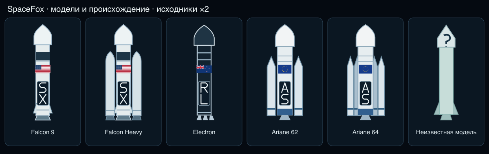
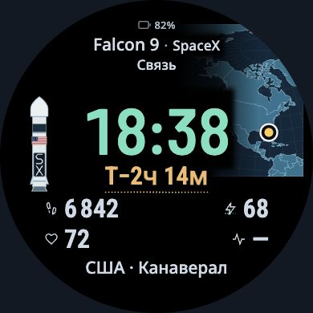

# Ракеты крупнее: модели, происхождение и компания

[Открыть макет](../prototype/rocket-models/index.html) ·
[Исходники и инструкция](../assets/rocket-pack/README.md).

Подготовлены пять разных схем: **Falcon9, FalconHeavy, Electron, Ariane62,
Ariane64**, плюс явный запасной силуэт. FalconHeavy отличается боковыми блоками;
Ariane62 и64 — конфигурацией ускорителей. Четыре ускорителя в небольшой плоской
схеме разнесены для различимости; это не точная инженерная проекция.
Оригинальные SVG, прозрачные PNG и уже собранные варианты с метками лежат в
[наборе](../assets/rocket-pack/). Название ракеты и компании над временем сохранено.

Вместо прежних76px сравниваются108 и124px. Более крупная схема позволяет разместить
маленький флаг и буквенный знак на корпусе. Они дополняют текст, а не заменяют его:
в маленьком масштабе детали маркировки всё ещё требуют проверки на самих часах.

## Значение флага

По прямому ответу владельца флаг обозначает **происхождение ракеты / оператора**.
В макете есть два режима. Карта и название космодрома по-прежнему означают место
старта и не определяют происхождение.

| Ракета / оператор | Режим «Происхождение ракеты» | Режим «Страна оператора» |
|---|---|---|
| Falcon / SpaceX | США | США |
| Electron / RocketLab | Новая Зеландия | США |
| Ariane / Arianespace | Европа, международная программа | Франция |

Для Electron это упрощённая метка семейства: основное производство в Новой Зеландии,
часть компонентов производится в США. Она не утверждает исключительно национальный
состав ракеты. Американский режим оператора отражает отдельные корпоративные данные.
Для Ariane европейский флаг — региональная метка, не национальная принадлежность.
Обоснование и первичные источники — в [источниках](../openspec/changes/prepare-model-rocket-assets/sources.md).

Компания определяется по выбранному оператору, а не автоматически по модели.
Если оператор неизвестен, знак компании исчезает. Если неизвестно происхождение
в выбранном режиме, флаг отсутствует; другой режим не подставляется молча.
Неизвестная модификация получает запасной силуэт с сохранением исходного названия.

## Обновление набора и права

На корпусе используются оригинальные буквенные знаки **SX, RL, AS**. Это ещё не
официальные логотипы компаний. Точные фирменные изображения можно подключить
отдельными файлами после установления условий распространения. В частности,
[условия Arianespace](https://www.arianespace.com/terms-and-conditions/) не дают
общего разрешения переносить фирменную графику сайта в свободный пакет.

Оригинальные схемы, буквенные знаки, векторный код флагов, PNG, код и спека — MIT.
Это не передаёт права на сторонние товарные знаки и не означает одобрение компаний.
Флаги и маркировка — информационные накладки, а не копия реальной окраски миссии.

Есть один редактируемый реестр, отдельные SVG и автоматически собираемый манифест
с хешами. Замена изображения или добавление принятой модели не требует менять
компоновку. Подготовлены чистые изображения и отдельные накладки, а также
`assets/rocket-pack/previews/` с уже нанесёнными флагом происхождения и знаком.
Источник/лицензия проверяются перед сборкой; неподтверждённые чужие картинки в
свободный набор не добавляются.

## Граница проверки

Это браузерная итерация и набор исходников. Читаемость маркировки ребёнком,
нативная память/отображение PNG, экран FR165 и AOD пока не проверены. PNG имеют
проверяемые размеры и прозрачность, но это ещё не нативная квалификация Garmin.
Измерены56 новых состояний: три размера ×14 RU/EN-сцен в режиме происхождения
ракеты и ещё14 состояний124px в режиме оператора.108px и124px проходят все
свои сцены:42 принятых состояния.140px отвергнут во всех14: выход за круг и
пересечение с полями, а на длинных подписях — также с задачей миссии. Поэтому
выбран124px, а чрезмерный вариант не предлагается как готовая компоновка.
Размер времени/полей и точка космодрома не менялись.

Старый76px контроль используется из сохранённого экспорта после проверки исходных
хешей; он не переснят как новая проверка. Промежуточные42 наблюдения с прежним
предположением о стране старта сохранены отдельно и не выданы за текущий результат
после ответа владельца. Текущие наблюдения —
[browser.json](../openspec/changes/prepare-model-rocket-assets/evidence/browser.json).

Набор содержит13 редактируемых исходных SVG,13 отдельных PNG и6 уже собранных
SVG/PNG с метками. Всего19 PNG занимают32 818байт на диске. Их размеры,
контрольные суммы, RGBA-структура, CRC и прозрачность моделей/знаков проверяются;
прямоугольные флаги сохраняют альфа-канал без требования прозрачного центра.
rendered.json связывает исходные SVG/реестр/версию сборщика с результатом
растеризации: простое обновление манифеста не позволяет выдать старый PNG за
новую версию SVG. Это целостность файлов, а не гарантия расхода памяти Garmin.

Буквенный знак занимает около14×30px на выбранной ракете, флагUS — около19×10px.
Это дополнительные ориентиры: названия сверху остаются основным читаемым
идентификатором. Автор просмотрел размер390px, длинные подписи, Electron в двух
режимах, Ariane с европейским флагом и общий набор. Независимое или человеческое
исследование распознавания моделей/флагов на физическом FR165 не проводилось.

Шесть точных тестов прошли на чистом исходном коммите: файлы/растеризация,
идентичности и браузерная компоновка с положительными и отрицательными случаями.
[Протокол](../openspec/changes/prepare-model-rocket-assets/evidence/verification-final.json)
и [сводка](../openspec/changes/prepare-model-rocket-assets/evidence/checks.json)
сохранены. Строгие проверки обеих затронутых OpenSpec-спек прошли.53 исторических
браузерных исходника и23 инструмента проверки остались побайтно прежними;
их проверки не перезапускались.
