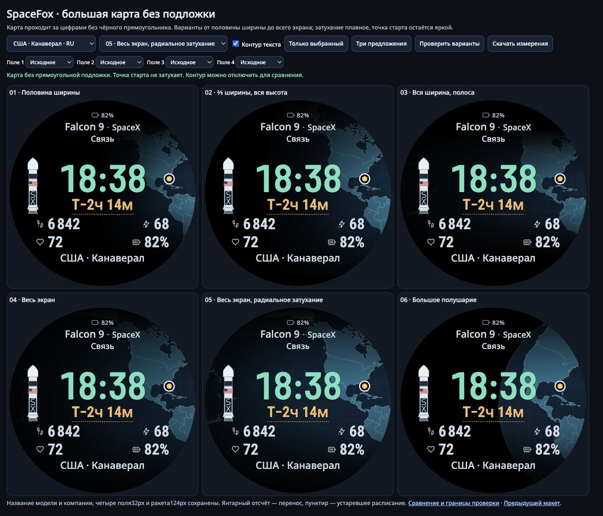
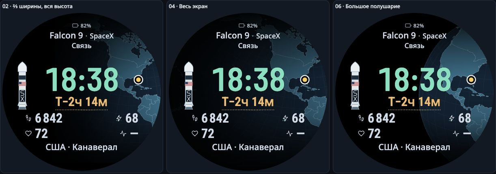

# Большая карта без подложки под временем

Оригинальные текст, код и спецификация этого дополнения — MIT.

Убрана прежняя маска, затемнявшая карту по прямоугольникам текста. Теперь карта
непрерывна и плавно затухает по всей ширине/высоте. Цифры отделены тонким чёрным
контуром по глифам:2px у времени, отсчёта и полей,1px у подписей. Контур рисуется
перед заливкой, поэтому заполненная часть букв не уменьшается. Рамка вокруг всего
блока времени не нужна: она сохранила бы ощущение отдельной плитки.

[Открыть все шесть вариантов](../prototype/wide-map/index.html).
Кнопка «Три предложения» показывает02/04/06 на одинаковых данных; выбор карты
открывает один вариант, а «Контур текста» позволяет сравнить его без обводки.
Четыре поля настраиваются независимо. Демонстрационные данные не являются
расписанием реального ближайшего запуска или данными ребёнка.

## Сравнение гипотез

Размеры относятся к исходному экрану390×390. Это окно географии, а не обещание,
что каждый его пиксель яркий: глобальные градиенты, океан и круглая граница
уменьшают видимую площадь. Во всех случаях настоящий маркер находится в335,165,
вычисляется из исходных координат и проекции и не участвует в затухании.

| № | Гипотеза | Окно, px | Площадь с сигналом карты¹, пример Канаверала | Сигнал в области времени², минимум по координатным сценам | Вывод автора |
| --- | --- | --- | ---: | ---: | --- |
| Контроль | Прежний фрагмент с масками текста | 158×190 | 14.2% | 0% в контрольном примере | Плитка под временем разрывала карту |
| 01 | Половина ширины, высокое окно | 195×280 | 26.2% | 13.7% | Сохранён как сравнение; цель≥20% не достигнута |
| 02 | Две трети ширины, вся высота | 260×390 | 45.5% | 38.1% | Спокойный компромисс: карта заметнее, левая часть остаётся тёмной |
| 03 | Вся ширина, средняя полоса | 390×260 | 49.1% | 70.5% | Карта объединяет центр, но сверху/снизу остаётся меньше географии |
| 04 | Весь экран, направленное затухание | 390×390 | 63.9% | 73.7% | Основная рекомендация: непрерывный фон и умеренная детализация |
| 05 | Весь экран, радиальное затухание | 390×390 | 89.1% | 100% | Самый заметный фон, но береговые линии сильнее конкурируют с цифрами |
| 06 | Большое полушарие с радиальным затуханием | 390×390 | 36.4% | 35.8% | Более выраженная форма Земли; светлая суша чаще проходит под текстом |

¹ Доля круглого экрана, где линейная яркость карты после композиции всех alpha
на чёрный фон превышает0.002. Маркер исключён. Это потенциальный фон, включая
фон под непрозрачными буквами/ракетой, а не доля карты, доступная глазу.

² Доля прямоугольника времени с яркостью>0.004; порог≥20% задан до реализации.
Все13 сцены с координатами проверяются отдельно; сцена без координат не входит
в этот минимум. Пороги — диагностические эвристики, не пороги человеческого зрения.

## Три предложения

**04 — весь экран:** основной выбор автора для следующего обсуждения. Карта
продолжается за временем и полями; направленное затухание оставляет достаточно
спокойную область вокруг ракеты. Время и отсчёт визуально связаны, рамка не
рассекает фон. На Канаверале левая часть — преимущественно океан; другие исходные
координаты дают другую сушу, а не искусственно подставленный красивый континент.

**02 — две трети:** запасной более спокойный вариант. Он уже в3.2 раза увеличивает
потенциальную площадь карты в контрольной сцене относительно прежнего фрагмента,
но затемнение слева сильнее. Хорош, если фон04 окажется слишком активным на часах.

**06 — полушарие:** выразительная альтернатива с видимым изгибом Земли. Её нельзя
считать победителем по читаемости: на длинных названиях и некоторых координатах
светлая суша/берег оказываются за буквами. Чёрный контур помогает отделить текст,
но его достаточность на физическом экране не проверена.

05 оставлен отдельным ярким опытом, а не объявлен улучшением во всех отношениях.
[С контуром](../openspec/changes/expand-map-without-clock-panel/evidence/radial-hero.png) ·
[без контура](../openspec/changes/expand-map-without-clock-panel/evidence/radial-no-outline.png).
Владелец пока не выбирал один из новых форматов; предыдущее принятие верхнего
блока `Falcon 9 · SpaceX` / `Связь` сохраняется.

## Что проверено

Новый реальный браузерный экспорт: **6 вариантов×14 сцен=84 состояния**.
Есть короткие/длинные RU/EN значения, Канаверал, Махия, Куру, неизвестная модель,
неизвестные координаты/время и недоступные фитнес-данные. Это14 известных сцен,
не новый закрытый набор и не тест пользователей. В первой итерации контур длинной
подписи места требовал дополнительного отступа; после подъёма подписи на2px
повторно измерена изменённая геометрия во всех вариантах.

Во всех84 состояниях сохранены10 исходных строк, роли/значения четырёх полей,
32px полей,58.5px контрольной высоты заполненных цифр и ракета54×124px.
Нет непрозрачных подложек или масок по размерам текста. Консервативные границы
с запасом на контур находятся внутри радиуса191px и имеют4px между разными
элементами; маркер проверяется с тем же запасом. Перенос — янтарный отсчёт,
устаревание — пунктир, без `!` и облака. Неизвестное значение остаётся `—`.

Состав данных, положение и непрозрачность проверяются по DOM/SVG. Добавлен новый
диагностический растеризатор, учитывающий все alpha, включая слабое затухание.
Старый CM-v3 диагностический результат сохранён неизменным, но его отсечение
alpha<0.5 не используется для новой метрики видимости карты.

Исходная строка прежнего принятого124px варианта и её зависимости сохранены
по точным хешам. Для неё выполнено одно новое измерение экспозиции; прежние
зелёные геометрические/asset-тесты не повторялись. Новые шесть тестов проверяют
контракты экспорта и отклоняют буквальные ошибки: плитку, пропавшее значение,
уменьшенный шрифт, ложную/сдвинутую точку и отсутствующий/прозрачный контур.

## Читаемость и границы доказательства

Сохраняются две отдельные диагностики: сырой контраст «цвет текста / карта»
и номинальный контраст «заливка глифа / чёрный контур». Второй не заменяет первый.

| Вариант | Минимум сырого контраста времени | Минимум остальных строк |
| --- | ---: | ---: |
| 01 | 5.26 | 4.76 |
| 02 | 3.35 | 3.13 |
| 03 | 3.18 | 3.08 |
| 04 | 3.51 | 3.36 |
| 05 | 1.83 | 2.01 |
| 06 | 1.85 | 1.93 |

В таблице учитываются все alpha на чёрном фоне и выборка через2px в границах
чернильных строк; это не измерение каждого края глифа. Номинальный контраст
заливки/контура≥12.89:1 при проверенной непрозрачной заливке и заданной толщине.
Такой результат не доказывает сплошное покрытие контуром после сглаживания и
не позволяет объявить весь текст соответствующим WCAG.
[W3C объясняет ограничения сглаживания и тонких штрихов](https://www.w3.org/WAI/WCAG22/Understanding/contrast-minimum.html).

Автор просмотрел реальные картинки390px, длинные EN подписи, Махию, Куру,
сцену без точки и радиальный фон без контура. Снимки сохранены рядом с JSON.
Это собственное визуальное ревью. Нового независимого, человеческого испытания
на скорость считывания, нативного рендера, AOD или замера энергии не было.
Более светлый фон потенциально влияет на AMOLED; величина расхода не измерена.

[OpenSpec](../openspec/changes/expand-map-without-clock-panel/specs/wide-map-face/spec.md) ·
[прогресс](../openspec/changes/expand-map-without-clock-panel/PROGRESS.md) ·
[исходные наблюдения](../openspec/changes/expand-map-without-clock-panel/evidence/browser.json) ·
[машинный итог](../openspec/changes/expand-map-without-clock-panel/evidence/summary.json).
