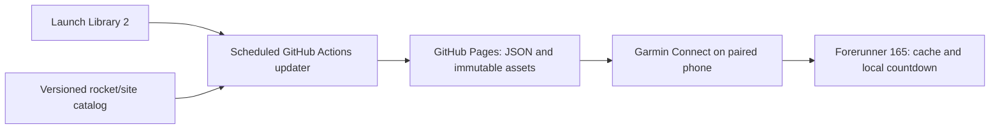

# Design

## Context

See [proposal.md](proposal.md) for intent and [baseline audit](evidence/baseline-audit.md)
for current coverage and [layout review v4](evidence/layout-review-v4.md) for the
subsequent compact-band revision. The product artifact is the browser mockup
in `prototype/mission.html`. Its schedule, health values and model graphics are
illustrative. No Monkey C owner, live service or downloadable asset pipeline exists.

The first device is Forerunner 165, 390 × 390 round AMOLED. The owner selected
GitHub Actions plus static files for one family's watch. Countdown calculation is
fully local. Data polling defaults to hourly, increasing to fifteen minutes only
near a known launch; a five-minute mode remains configurable. Longer polling adds
change-detection delay, plus deployment/CDN/queue/connectivity delays.

## Goals / Non-Goals

**Goals:** keep the native display lightweight and keep launch data, site points
and visual assets independently maintainable. The three specifications own the
behavioral contract; this document identifies the intended owners and checks.

**Non-Goals:** continuous on-watch 3D rendering, flight telemetry/trajectory claims,
a custom mobile app, a multi-user service, AWS/cloud-account provisioning,
per-refresh LLM reasoning, and enabling a live deployment during this spec increment.

## Decisions

### Use a personal static feed, not an always-running backend

Planned `watchface/` owns Monkey C rendering, settings, local countdowns and cache.
Planned `tools/update_feed.py` normalizes Launch Library 2 data and builds static
output. Planned `.github/workflows/update-feed.yml` schedules that deterministic
program and deploys a validated GitHub Pages artifact. Neither file exists yet.
The agent sets up/repairs this automation; it is not an LLM invoked on every run.

The watch's `FeedBaseUrl` setting selects its instance. Default operation needs
only the existing GitHub and Garmin accounts: no provider key, AWS, domain,
SpaceFox login, public inbound server or custom mobile app. The static URL is
public; it contains launch/catalog data, never the child's health or identity.
Other families use their own fork/feed URL; no shared author-operated service is
required. Do not make their watch silently depend on JekaMas's feed.

Direct per-watch provider polling is not the default: the provider recommends
shared caching and its normal response is unsuitable to assume fits a background
watch parser. An optional local-agent runner can invoke the same deterministic
updater and publisher, but requires an awake connected machine and is not the
selected default. It cannot run concurrently with a second publisher to the same
instance without the same serialization/rate controls.

Provider responses carry stable launch, rocket configuration and pad identifiers,
UTC time, timing precision/window, status, launch company, concise mission
name/purpose and source-validation time. Missing company/mission values remain
explicit and are never inherited from the previous selected launch. Selection is
performed on a coherent accepted snapshot. Locally reaching zero displays
"awaiting update"; only provider evidence can establish launch completion.

The compact company's label means launch service provider/operator; it is not a
guess at the rocket manufacturer. The prototype's mission purposes are illustrative
sample text rather than a claim about a currently scheduled real mission.

The default freshness limit is three hours normally and forty-five minutes in the
near-launch window: three expected publisher cycles, configurable by the owner.
Age at or above the effective limit is stale. An already stale record is latched
until newer provider validation; leaving the short window must not make the same
old data fresh by extending its age limit. Freshness is
calculated from the updater's successful provider-validation time, not the watch's
HTTP completion or artifact build time. Downloading the same old file with 200/304
does not renew it. A retained tracked record absent from a new provider batch keeps
its own older validation time; a fresh batch cannot make that record fresh.
Failed/malformed requests and catalog-only builds do not advance source validation.
A valid unchanged provider response does advance validation time, while its content
revision and any existing reschedule flag remain unchanged. A phone disconnect
does not automatically make recently validated data stale.

### Separate local rendering from changes in the external schedule

Monkey C supports ordinary computation and UTC time arithmetic. The face stores
the accepted UTC launch timestamp and calculates `launchUtc - Time.now()` on
each permitted redraw/wake. It does not need a phone, network call, running
second timer or a fetched countdown value. After sleep it recalculates from the
clock, rather than continuing a frozen/decrementing counter. Seconds and animation
remain restricted to an active display; a cached exact time can still be stale
as a prediction, independently of the accuracy of that local calculation.

| Data polling mode | Publisher and watch defaults | Source stale limit |
| --- | --- | --- |
| Normal / unknown launch time | 60 minutes | 3 hours |
| From 2 hours before exact launch until 30 minutes after an unconfirmed target | 15 minutes | 45 minutes |
| Explicit optional fast mode | 5 minutes or another permitted interval | Three configured publisher cycles by default |

After the bounded near-launch window, return to hourly checks even if status is
still unconfirmed. Keep the awaiting-update/stale state; the frequency change
does not establish liftoff or clear a latched stale flag. A provider-supplied new
time can select a new window. Cadence selection uses cached facts and is subject
to platform wake restrictions. It must not make a network call from a draw tick.

Feed metadata/configuration identifies the publisher's refresh policy; watch
polling follows it by default. Raising only watch fetch frequency cannot force
new provider data and must not change the claimed source freshness. Two hourly
polls can approach two hours of change-detection delay; two fifteen-minute polls
can approach thirty minutes, before infrastructure delays. Newly added or earlier
launches are discovered on the next successful sync; local logic cannot know an
external schedule change while disconnected.

### Publish bounded files and preserve the last working deployment

The planned static interface is:

| Path relative to `FeedBaseUrl` | Contract |
| --- | --- |
| `data/v1/schedule.json` | Schema version, launch-content revision, provider-validation/build UTC times, refresh/freshness policy, bounded launch records and pinned catalog references |
| `catalog/v1/<revision>/manifest.json` | Immutable site/model metadata, source/rights and exact asset digests/bounds |
| `assets/rockets/<model-id>/<revision>/...` | Prepared native-compatible stills and optional short frame packs |

The schedule contains a small set of upcoming launches and retained relevant
tracked identities, not the full API response or image data. Required fields cover
stable launch/model/site identity, exact UTC seconds or null, time precision/window,
explicit status, launch operator/mission context, country/coordinates and per-record
source validation. UTC values are documented integer seconds, not milliseconds.
Missing optional model/site mappings, mission context or coordinates stay explicit
and use the existing generic/no-point behavior; only the launch identity itself
is indispensable. Do not narrow accepted uncertain/unknown launch inputs to make
the compact schema easier to parse.
Initial schedule ceiling: 8192 UTF-8 bytes; actual parsing/background memory may
require reducing the supported bound. Reject oversize/unsupported/malformed or
regressing data without truncating IDs/coordinates or evicting the last good cache.
Native budget qualification in task 2.2 remains mandatory.

Target one bounded provider batch when due: normally once/hour, four/hour in the
near window. A default fifteen-minute cron can inspect the retained schedule and
skip provider fetch/publication until the appropriate interval is due; a scheduler
wakeup is not a provider update. Optional five-minute source mode also needs a
matching cron. Keep its steady calls at or below 12/hour against the documented
15/hour anonymous allowance. Pagination, detail lookups,
manual dispatch and retries count too. Qualify a query that covers upcoming and
tracked identities before implementation acceptance; an omitted identity does not
prove completion/cancellation. Use serialized runs, provider throttle information
and persisted/backed-off budget handling; do not evade limits by changing runners
or credentials. A first failure is not permission for a rapid retry loop.

Use scheduled runs away from the top of the hour and an explicit manual dispatch.
After a successful provider validation, publish a new freshness timestamp even if
launch content is unchanged. Validate the whole artifact, including referenced
licensed assets, before deploying. A provider/validation failure keeps the current
site and source timestamps; a catalog-only deployment may reuse that old schedule
without claiming new provider success. Persist/recover previous accepted state
independently of the ephemeral Actions workspace: the accepted public snapshot
also carries the bounded retained launch state and is read/validated at startup.
Actions cache may accelerate this, but is not the sole source of truth. Only a
first explicit bootstrap can start without prior state; if required accepted state
cannot be recovered, leave the current site intact and report the failure.
Missing retained state cannot be reconstructed by guessing.

Use the custom Pages Actions artifact/deploy path, rather than a commit-triggered
Pages build on each tick. This avoids frequent heartbeat commits and accommodates
the optional faster mode without the normal ten-build/hour soft limit. Serialize deployments so an
older queued run cannot overwrite a newer publication. Keep immutable file
references and watch-side validation: CDN visibility is not a cross-request atomic
transaction. Retain compatible prior assets within a documented bounded retention
policy; missing/corrupt versions retain the last working watch catalog.

Only standard public GitHub-hosted runners are selected. Keep the Pages artifact
small (initial budget 1 MiB) with short artifact retention (one day), no growing
raw-provider dumps or paid runner/storage upgrades. The agent must inspect actual
account quotas and report a limit instead of enabling billing. Free platform
availability is a current deployment choice, not a permanent service guarantee.

### Agent setup and operational recovery

`docs/AGENT_SETUP.md` is the MIT reproduction/runbook. It separates the future
implementation prerequisites from enabling an instance, derives the owner's Pages
URL, configures the watch, and requires actual first/second source-validation,
quota, offline, stale-file, reschedule and asset-update observations. A successful
workflow alone is not proof that Garmin received the file.

GitHub schedules may be delayed/dropped and are disabled after 60 days without
repository activity; forks may require explicitly enabling Actions. Scheduled
runs themselves must not be assumed to keep a repository active. Document checking
Actions, re-enabling the workflow and manually dispatching recovery. This route
requires occasional maintenance; neither fake freshness nor unsupported promises
of a forever-running unattended cron are acceptable. A local scheduled runner is
the alternative if the owner later prefers it. No automation is enabled by merely
publishing this specification/runbook.

### Use a small versioned catalog and prepared graphics

The intended maintenance interface is:

| Planned owner | Contents |
| --- | --- |
| `catalog/rockets.json` | Stable model IDs, explicit provider mappings, asset/frame references and attribution |
| `catalog/sites.json` | Stable pad/site IDs, country/place, coordinates and source |
| `assets/rockets/<model-id>/<revision>/` | Watch-compatible still images and optional short frame packs |
| `tools/catalog.py` | Validate inputs and build a versioned static manifest/package |

These paths describe future owners; the current increment does not pretend that
their implementation exists. The maintainer workflow is "add/correct data and
assets, validate, build one catalog revision". Individual entries never require
editing the layout or adding a second switch statement of model/site names.

The manifest carries schema/catalog versions, asset format/dimensions/size and
content digests. Watch compatibility and supported budgets are measured with the
Garmin SDK before accepting the native pipeline. Download into a staging version,
validate references/data/assets, and atomically activate it. An interrupted update
retains the previous accepted version. Feed and asset URLs are per-instance HTTPS
configuration. Anonymous provider access is the default; if a future owner needs
a token, it belongs in repository secrets, not the watch, JSON, artifact or source.
Garmin developer signing keys remain local and are not uploaded by this data job.

For the globe, prefer small prepared views/frames or a measured lightweight native
projection using sourced geographic geometry. Site coordinates remain the source
of truth for the marker and orientation. A globe picture with a manually positioned
decorative dot is not acceptable evidence of geographic correctness.

### Preserve the compact home screen

Use the latest "Mission" mockup: dominant white time, four icon/value fields,
a compact Earth → rocket → launch-information band, secondary countdown and a
larger country/site label. The band puts the rocket name, company and concise
mission context to the right of the rocket rather than in a duplicate row below.
Keep the rocket name strongest, then operator and mission context; unknown values
remain explicit. Long supplied text uses bounded short labels or ellipsis while
preserving full values in the accepted record and accessible preview labels.

The browser reference uses a narrow Earth/rocket slot plus a flexible text column.
The geographic view still projects real coordinates after resizing. Country/site
text grows from 11 CSS px to 13–14 CSS px and moves slightly upward into the wider
part of the circle; the corresponding native 390-pixel design uses at least 16
display pixels. Main time and four configurable fields retain their hierarchy.
There is no
permanent "updated N minutes ago" row. Full names and update details may be
available in settings/details; a new details interaction is not required by this
first specification.

Maintain a reschedule flag per launch identifier, comparing accepted target
time/precision with its previous value. Unchanged refreshes retain that flag;
moving to another launch clears it for the new identity. Known new time uses
amber plus `!`; unknown new time suppresses a precise countdown. Staleness is an
independent cloud-off marker plus dotted underline. Reserved marker positions keep
the countdown centered; normal current time does not change color with alerts.

### Animate a short visual, not a claimed real liftoff

Use a prepared still/frame pack or simple native ignition/ascent translation over
2–3 seconds on active wrist viewing. Stop on sleep/low-power entry; preserve a
static visual and user disable setting. Reuse a generic animation/fallback when
an exact model's optional frames are absent. No animation or zero crossing is
recorded as real launch evidence.

## Validation contract

The exploratory geography gallery in `prototype/layouts.html` compares eight
active-display variants and four OFL numeral fonts, without selecting a replacement
native layout. `docs/DESIGN_RESEARCH.md` defines fractions as geographic-region
height, documents skill/source suitability and records the qualitative shortlist.
Shared example data/artwork/geography keep all variants coherent. The original
Mission remains separately available; physical legibility, raster fonts and AOD
must still be qualified rather than inferred from browser screenshots.

Before semantic implementation, create the pinned workflow's `verification.json`
and relevant `discovery.json` from the exact scenarios. Do not fabricate test
identities for code that does not exist yet. The minimum meaningful boundaries are:

| Contract | Planned owner | Required independent observation |
| --- | --- | --- |
| Time/settings/health display and circle fit | Native watch face | Simulator plus physical FR165; unavailable metric and longest-label cases |
| UTC selection, reschedules, zero crossing and freshness | Updater plus watch cache | Independent timestamps; offline redraw after two hours asleep, no network on redraw, 60/15-minute window boundaries, unchanged validation, old 200/304, omitted identity and stale latch when a window ends |
| Personal static publication and reproduction | Actions/Pages plus setup runbook | First/second published validation, 429/invalid response, overlapping/old run rejection, disabled schedule recovery, another owner's fork URL and actual phone/watch readback |
| Correct point/model selection | Catalog plus native renderer | Known sourced coordinates/model IDs; missing mapping and out-of-range coordinate rejection |
| Safe catalog/image replacement | Catalog distribution plus watch cache | Two distinct revisions, interrupted/corrupt transfer, previous-version persistence and valid activation |
| Short animation/power lifecycle | Native rendering/lifecycle | Observed start/stop with disable and sleep transitions on the actual device |

Browser screenshots only establish the illustrative layout. Structural OpenSpec
checks establish artifact validity. Neither substitutes for these native/live
requirements. All three capabilities remain implementation work until those
boundaries are qualified.

## Risks / Trade-offs

- Draft language resources are now in `locales/`; the preview/license foundation
  and its bounded checks are in `../localize-free-distribution/`. Generate native
  resources/manifest from that catalog, qualify actual FR165 firmware glyphs,
  Arabic shaping/RTL, long strings, memory and local time/number settings, and
  retain English fallback. No native language support is established yet.
- Original code/specs/translations/schematics use root MIT. Official downloads
  are free, with no paid fields/subscription. Per-image rights are separate;
  unknown/incompatible assets stay out of the default pack. Preserve notices and
  exclude workflow development tooling from product packages.

- Native background bitmap persistence/memory limits → qualify one still/frame
  update on FR165 before completing the catalog transport; do not silently replace
  updateable visuals with a permanently hardcoded switch.
- Provider access/rate limits and schedule uncertainty → shared caching, bounded
  retries, explicit precision and stale markers. Launch Library coverage is not a
  guarantee that every launch worldwide is present.
- Reduced polling and GitHub queues/CDN/disabled scheduling → explicit change
  detection delay, adaptive source-age limits, retained cache and recovery runbook;
  countdown progression remains local and independent of that delay.
- Small display and AMOLED power budget → short optional animation, clear primary
  typography and no continuous rendering; inspect the longest values on-device.
- Catalog updates can fail independently of schedule refresh → separate accepted
  revisions and retain working visuals; missing graphics do not invalidate current
  time or invent schedule certainty.

## Migration Plan

No production migration is needed for this new repository. Implement and qualify
the contracts locally, including a provider-backed rehearsal when access permits.
Keep deployment and paid endpoint selection separate from the current authoring
scope. Roll back a failed catalog revision to the last accepted local revision;
retain the generic built-in visual when no downloaded version is usable.

The static-feed revision replaces the earlier planned `service/` owner. Current
work updates the specification and MIT runbook only. No Pages site, workflow,
scheduled task or updater implementation is activated in this increment.
Primary-source decision notes and retained proof limits are in
`evidence/static-feed-design-review.md`.
