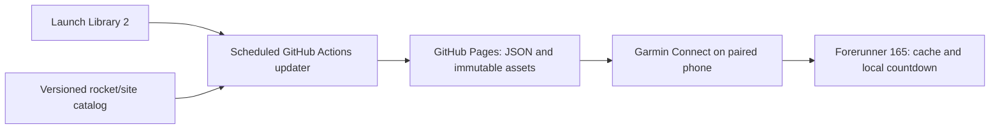

# Design

## Context

See [proposal.md](proposal.md) for intent and [final lifecycle review](evidence/final-review/review.md)
for the checked platform constraints and resolved contradictions. The accepted
active composition is [prototype/current](../../../prototype/current/index.html),
selection04/full in `prototype/current/selection.json`. Browser schedule, health
and model examples remain illustrative. The deterministic publisher, serialized
Actions workflow, catalog/graphic export and source-backed off-watch geography
have local source qualification. Native, authentic hosted/live HTTPS delivery,
full artwork and device acceptance remain pending.

The first target is Forerunner165,390×390 round AMOLED. Garmin's checked device
matrix lists API 5.2, independently of the newest desktop SDK. FR165 Music and
other products need their own qualification; neither Wi-Fi nor an API 6 binary
response is a baseline dependency. Source links and observation dates are in
[the source ledger](evidence/final-review/sources.md).

## Goals / Non-Goals

**Goals:** keep native time/fitness useful offline, make global launch content
maintainable, and establish a reproducible personal installation and free public
release. Four capability specs own the contract: watchface, launch-schedule,
visual-catalog and release-lifecycle. This document identifies owners and choices.

**Non-Goals:** flight telemetry, continuous3D, a custom mobile app, shared hosted
accounts, AWS, recurring LLM calls or enabling native/Pages/Store deployment in
this specification increment.

## Decisions

### Owner-accepted active composition and historical research

Use04/full:390×390 flat map, directed gradual fading, unfaded source-derived pin,
transparent text backgrounds and thin dark glyph contours without a clock tile.
Keep the124px left rocket, mint primary time, countdown immediately below time,
four independently configurable32px values in2×2, larger country/site below the
fields and separate small watch battery above. Rocket and operator read together
above time (`Falcon9 · SpaceX`), mission purpose on the next line. Long values
wrap or abbreviate without inventing missing context; full supplied values remain
in the accepted data. Globe remains an available planned setting.

Amber countdown means reschedule; a dotted underline independently means stale.
There is no exclamation/cloud badge or permanent last-update row. Watch charge
and Body Battery have distinct Garmin sources. The initial five model drawings,
curated model/operator-origin flags and original company letter marks use the
single `assets/rocket-pack/registry.source.json`. Origin is never inferred from
the launch country. Official logos are not included under an invented MIT grant.

Earlier white-time bands, side fragments, stacked metadata recommendations and
unselected finalists are historical research, not competing native defaults:
[baseline audit](evidence/baseline-audit.md), [band revision](evidence/layout-review-v4.md),
[Mission refinement](../../../docs/RELAY_REFINEMENT.md),
[header](../../../docs/RELAY_HEADER.md), [larger fields](../../../docs/FOCUS_LAYOUT.md),
[rocket pack](../../../docs/ROCKET_MODELS.md), [accepted wide map](../../../docs/WIDE_MAP.md).
The wide-map84-state browser evidence and prior independent research retain their
original proof limits; owner selection establishes design intent, not native
legibility, power, global artwork or36-language acceptance.

### Separate AMOLED active and always-on scenes

The accepted full-screen map belongs to active mode. AOD uses sparse thin time
and compact countdown/uncertainty on black, with no large map, rocket animation
or seconds. It must fit the applicable 10-percent lit-pixel ceiling and target
burn-in rules. Use minute updates, restrained grayscale and qualified placement
variation; a particular shift pattern is not proof of compliance. Do not apply
MIP partial-update assumptions to FR165 AMOLED.

Implement `WatchUi.WatchFace`; stop active timers/animation in `onEnterSleep`,
restore the accepted scene and recompute UTC countdown in `onExitSleep`. A user
who disables wrist wake must still have usable sparse time/launch timing. Actual
pixel counts, lifecycle behavior and battery comparison against a stated stock
face baseline require simulator plus real FR165 evidence. AOD acceptance remains
open; current browser renders do not simulate its power constraints.

### Native target, background service and health sources

Use the official SDK Manager, pinned SDK/device profiles and Monkey C tooling.
Record exact versions, firmware, manifest product ID, dependency/build settings
and minimum required API. The manifest is type `watchface`; use only products,
languages and permissions actually qualified. No SDK installation is performed
by this review. Native task2.1 establishes real owners/tests before code work.

The foreground draws cached state. The permitted background service fetches,
validates and stages bounded data; it may be terminated and has a30-second
platform deadline. Split/resume optional asset work across permitted events;
never rely on foreground networking, an always-running process or sub-five-minute
temporal events. Persist coherent accepted state before notifying the foreground
with a small revision token. Do not pass the8KiB feed through `Background.exit`:
its approximately8KiB serialized-data ceiling is a separate constraint. The cache
writer/migration protocol must be qualified, not assumed transactional.

Planned field sources are ActivityMonitor steps/calories, System watch charge and
recent SensorHistory samples for heart rate/Body Battery/stress. Check exact API
availability and needed permissions on target; take only a bounded latest sample,
not an entire history or raw sensor stream. Unavailable data shows `—`. No health,
user location, child identity or field history is uploaded to the feed. The map
uses launch-site coordinates and needs no watch GPS permission.

Garmin's App Types table allows SensorHistory for watch faces, while its manifest
permission table leaves that cell blank. Treat this documentation inconsistency
as an explicit target qualification case, not proof that every metric works or
grounds to silently remove configurable options. Store claims follow actual
firmware/API observations.

### Use a personal static feed, not an always-running backend

Planned `watchface/` owns Monkey C rendering, settings, local countdowns and cache.
`tools/update_feed.py` normalizes Launch Library 2 data and builds static
output. `.github/workflows/update-feed.yml` schedules the deterministic
`tools/cloud_feed.py` adapter and supplies the serialized Pages path. These
files have local qualification; authentic deployment remains open.
The agent sets up/repairs this automation; it is not an LLM invoked on every run.

The watch's `FeedBaseUrl` setting selects its instance. Default operation needs
only the owner's GitHub and Garmin accounts: no provider key, AWS, domain,
SpaceFox login, public inbound server or custom mobile app. The static URL is
public; it contains launch/catalog data, never the child's health or identity.
Other families install the official free binary and fork only the data publisher,
then set their own feed URL; they do not need the author's key or SDK. A native
code fork uses its own application UUID/key/listing. No shared author service is
required. The initial FeedBaseUrl is blank with explicit setup; time/fields and
bundled generic geography/rocket remain usable before the first sync. Do not make their watch silently depend on JekaMas's feed.

Direct per-watch provider polling is not the default: the provider recommends
shared caching and its normal response is unsuitable to assume fits a background
watch parser. An optional local-agent runner can invoke the same deterministic
updater and publisher, but requires an awake connected machine and is not the
selected default. It cannot run concurrently with a second publisher to the same
instance without the same serialization/rate controls.

Provider responses carry stable launch, rocket configuration and pad identifiers,
UTC time, timing precision/window, status, launch company, concise mission
name/purpose and source-validation time. Missing company/mission values remain
explicit and are never inherited from the previous selected launch. Selection is
performed on a coherent accepted snapshot. Locally reaching zero displays
"awaiting update"; only provider evidence can establish launch completion.

The compact company's label means launch service provider/operator; it is not a
guess at the rocket manufacturer. The prototype's mission purposes are illustrative
sample text rather than a claim about a currently scheduled real mission.

The default freshness limit is three hours normally and forty-five minutes in the
near-launch window: three expected publisher cycles, configurable by the owner.
Age at or above the effective limit is stale. An already stale record is latched
until newer provider validation; leaving the short window must not make the same
old data fresh by extending its age limit. Freshness is
calculated from the updater's successful provider-validation time, not the watch's
HTTP completion or artifact build time. Downloading the same old file with 200/304
does not renew it. A retained tracked record absent from a new provider batch keeps
its own older validation time; a fresh batch cannot make that record fresh.
Failed/malformed requests and catalog-only builds do not advance source validation.
A valid unchanged provider response does advance validation time, while its content
revision and any existing reschedule flag remain unchanged. A phone disconnect
does not automatically make recently validated data stale.

### Separate local rendering from changes in the external schedule

Monkey C supports ordinary computation and UTC time arithmetic. The face stores
the accepted UTC launch timestamp and calculates `launchUtc - Time.now()` on
each permitted redraw/wake. It does not need a phone, network call, running
second timer or a fetched countdown value. After sleep it recalculates from the
clock, rather than continuing a frozen/decrementing counter. Seconds and animation
remain restricted to an active display; a cached exact time can still be stale
as a prediction, independently of the accuracy of that local calculation.

| Data polling mode | Publisher and watch defaults | Source stale limit |
| --- | --- | --- |
| Normal / unknown launch time | 60 minutes | 3 hours |
| From 2 hours before exact launch until 30 minutes after an unconfirmed target | 15 minutes | 45 minutes |
| Explicit optional fast mode | 5 minutes or another permitted interval | Three configured publisher cycles by default |

After the bounded near-launch window, return to hourly checks even if status is
still unconfirmed. Keep the awaiting-update/stale state; the frequency change
does not establish liftoff or clear a latched stale flag. A provider-supplied new
time can select a new window. Cadence selection uses cached facts and is subject
to platform wake restrictions. It must not make a network call from a draw tick.

Feed metadata/configuration identifies the publisher's refresh policy; watch
polling follows it by default. Raising only watch fetch frequency cannot force
new provider data and must not change the claimed source freshness. Two hourly
polls can approach two hours of change-detection delay; two fifteen-minute polls
can approach thirty minutes, before infrastructure delays. Newly added or earlier
launches are discovered on the next successful sync; local logic cannot know an
external schedule change while disconnected.

### Publish bounded files and preserve the last working deployment

The planned static interface is:

| Path relative to `FeedBaseUrl` | Contract |
| --- | --- |
| `data/v1/schedule.json` | Bounded snapshot, publisher generation, content/catalog versions, per-record source-validation UTC, build UTC and refresh/freshness policy |
| `catalog/v1/<revision>/manifest.json` | Full publisher inventory; never a required watch download |
| `catalog/v1/<revision>/slices/<slice-id>.json` | Bounded watch dependency manifest pinned by schedule; exact asset digests, schema, size, bounds and projection metadata |
| `assets/<kind>/<content-digest>.json` | Immutable compatible geometry/palette/transforms or separately qualified native visual format |

The schedule contains a small set of upcoming launches and retained relevant
tracked identities, not the full API response or image data. Required fields cover
stable launch/model/site identity, exact UTC seconds or null, time precision/window,
explicit status, launch operator/mission context, country/coordinates and per-record
source validation. UTC values are documented integer seconds, not milliseconds.
Missing optional model/site mappings, mission context or coordinates stay explicit
and use the existing generic/no-point behavior; only the launch identity itself
is indispensable. Do not narrow accepted uncertain/unknown launch inputs to make
the compact schema easier to parse.
Initial schedule ceiling: 8192 UTF-8 bytes; actual parsing/background memory may
require reducing the supported bound. Reject oversize/unsupported/malformed or
regressing data without truncating IDs/coordinates or evicting the last good cache.
Native budget qualification in task 2.2 remains mandatory.

This ceiling is decoded UTF-8, not compressed transfer size. The publisher enforces
it before publication. Native JSON may be parsed by Garmin before the callback;
a callback size check is not a pre-parse allocation guard. Task2.2 must qualify
actual response/parser limits, excessive shape and error/restart behavior.
Version/lookup-table metadata counts toward it. Runtime containers, decode buffers,
serialized storage and graphics have separate measured budgets; none follows
automatically from the JSON byte count.

Target one bounded provider batch when due: normally once/hour, four/hour in the
near window. A default fifteen-minute cron can inspect the retained schedule and
skip provider fetch/publication until the appropriate interval is due; a scheduler
wakeup is not a provider update. Optional five-minute source mode also needs a
matching cron. Keep its steady calls at or below 12/hour against the documented
15/hour anonymous allowance. Pagination, detail lookups,
manual dispatch and retries count too. Qualify a query that covers upcoming and
tracked identities before implementation acceptance; an omitted identity does not
prove completion/cancellation. Use serialized runs, provider throttle information
and persisted/backed-off budget handling; do not evade limits by changing runners
or credentials. A first failure is not permission for a rapid retry loop.

Use scheduled runs away from the top of the hour and an explicit manual dispatch.
After a successful validation, publish new per-record freshness even when content
is unchanged. Source/validation failure keeps accepted facts and ages; catalog-only
builds do not validate launches. All scheduled/manual/catalog jobs use the same
concurrency group with cancellation disabled. Concurrency is not a logical-order
proof: a late queued run must check current source/state before doing any work.

The durable authority is a dedicated `feed-state` Git branch, not public Pages,
Actions cache or an expiring artifact. It carries compact active/pending normalized
snapshots, per-record validation/flags, monotonic generation, source/catalog/tool
revisions, due time and quota reservations/backoff. Initial current-ledger budget
is 64KiB, independent of the8KiB watch feed. Storage schema2 references exact
normalized schedule objects by SHA256and byte length outside that ledger; it
deduplicates accepted/active/pending copies, bounds each schedule object to1MiB
and each record to its64KiBterminal archive, and retains the128entry admission
limit. Schema1 embedded snapshots migrate on the next CAS without changing old
artifact revisions, exact bytes, source ages or producer identity. Missing or
corrupt objects stop recovery. These authority objects are measured separately
from the≤1MiBpublication artifact. Monitor Git history growth separately;
current-file size does not bound history. Do not force-prune history automatically.
No health, secrets or growing raw provider archive belongs in this branch.

Persist a quota reservation with an expected-base/CAS branch update before each
provider request, including pagination, retries and manual work. A lost runner's
reservation remains consumed. If required state is unavailable after bootstrap,
keep the site intact and report the failure. Authenticated Git state is authoritative;
a stale public CDN snapshot cannot reset accepted flags, due times or budget.

Persist the validated pending generation before deploying. Build the complete
Pages artifact from pinned catalog sources and durable candidate state: include
all referenced current and retained compatible assets, not only changed files.
Use custom Pages upload/deploy, then read back the exact generation/manifest before
promoting active state with an expected-base check. CDN readback observes that
request, not every edge or phone. On a crash between state/deploy/promotion, reconcile
the pending generation and live revision before new polling or publication. Retry
that same candidate or finish promotion; never let older code/state replace newer
accepted generations. Interrupted publication may delay updates but must not erase
accepted state. Test these fault boundaries explicitly.

Custom Pages uses the whole artifact, not additive file uploads. Immutable URLs
and digest validation handle cross-request visibility skew; keep compatible prior
assets for the documented90-day schema transition window and pinned recoverable
candidates. Check packaging and size before deployment. Complete global content,
retention and the1MiB initial site budget may conflict: record measured reconciliation
before acceptance rather than silently deleting global art or enlarging the budget.

This revises the earlier no-commit/CDN-recovery plan. Durable state checkpoints
are intentional commits on `feed-state`, not heartbeat commits on source `main`
or triggers for Pages builds. Not-due cron wakeups do no provider request, state
commit or deployment. Use read-only permissions for source/PR checks, `contents:
write` only for the state writer, and `pages: write`/`id-token: write` for the
`github-pages` deployment job. Data workflows never require the Garmin signing key.
Branch/environment rules and pinned third-party Actions are implementation work.

Only standard public GitHub-hosted runners are selected. Keep the Pages artifact
small (initial budget 1 MiB) with short artifact retention (one day), no growing
raw-provider dumps or paid runner/storage upgrades. The agent must inspect actual
account quotas and report a limit instead of enabling billing. Free platform
availability is a current deployment choice, not a permanent service guarantee.

### Agent setup and operational recovery

`docs/AGENT_SETUP.md` is the MIT reproduction/runbook. It separates the future
implementation prerequisites from enabling an instance, derives the owner's Pages
URL, configures the watch, and requires actual first/second source-validation,
quota, offline, stale-file, reschedule and asset-update observations. A successful
workflow alone is not proof that Garmin received the file.

GitHub schedules may be delayed/dropped and are disabled after 60 days without
repository activity; forks may require explicitly enabling Actions. Scheduled
runs themselves must not be assumed to keep a repository active. Document checking
Actions, re-enabling the workflow and manually dispatching recovery. This route
requires occasional maintenance; neither fake freshness nor unsupported promises
of a forever-running unattended cron are acceptable. A local scheduled runner is
the alternative if the owner later prefers it. No automation is enabled by merely
publishing this specification/runbook.

### Global scope, separate roles and bounded watch delivery

The owner requires all publicly documented Earth launch countries/territories,
current configurations, launch organizations and pad-level sites, including
orbital attempts and public civil suborbital/scientific flights. The five-model
sample pack is incomplete. The dated [coverage audit](../../../docs/GLOBAL_CATALOG.md)
and [reference inventory](evidence/global-catalog/reference-inventory.json) are
research evidence, not a second active catalog or a completed updater.

The checked LL2 baseline is API 2.3.0; older 2.2.x routes are unsupported. Enumerate
all pages and preserve stable IDs. Include active configurations, inactive ones
with pending launches, all upcoming schedule references and official-source
supplements. A provider-active flag is source metadata, not proof of operational
status: Ariane 64 is a concrete disagreement with dated ESA/CNES flight evidence.
Keep corrections as sourced, reviewed catalog inputs rather than layout switches.

Separate pad country/territory, operator, manufacturer and curated body-origin
records. National launch capability, a payload customer's country and a company's
registration are not interchangeable. Preserve multinational/historical/unknown
entities and source names. No region, company type or original artwork whitelist
may filter an otherwise eligible public launch.

Required artwork coverage includes every known required configuration with a
specific or reviewed shared visual, plus verified country/region and operator
marks. Runtime generic/no-mark fallbacks remain safe, but do not close artwork
gaps. Official photos/logos are not automatically MIT. Reuse the authored
`assets/rocket-pack/registry.source.json` through one catalog workflow; migration
must not create another independently maintained asset or site lookup in layout.

Use shared sourced world geometry for the accepted full-screen map and optional
globe. Prepare bounded regional detail when 110m geometry omits small islands.
Qualify every required sourced pad, date-line/polar cases and missing/mobile
positions. A departure's event position must not be replaced with a port, airport,
headquarters or unverified zero. All 216 source-flagged active pads in the reference
snapshot still need per-site geographic qualification; 213 finite coordinates
prove only numeric validity, not real launch-point accuracy.

The full catalog lives with the static publisher. The watch receives only a
qualified selection and immutable model/mark/map shards, keeping the schedule
ceiling and measured cache limits. Full catalog pagination is cached/resumable
and normally much less frequent than schedule polling; newly referenced IDs use
bounded queued lookups. Both jobs share one quota and serialized accepted state.
Do not fetch all pages on every watch sync, load all global objects into RAM or
renew launch-source freshness during a catalog-only build.

Publish coverage denominators, all source pages/counts/digests, unresolved
official-source omissions, exact-ID mappings, artwork/mark gaps and geographic
qualification separately. Provider pagination completeness is a finite checked
claim; global operational completeness needs additional source review. Native
task 4.3 owns that release evidence and remains open.

### Efficient dictionaries, immutable content and bounded caches

Use one normalized publisher-side country/organization/model/site/asset record
per typed stable ID. Wire references use IDs, not repeated full objects or source
URLs. Common labels and immutable components may be shared; pool only the selected
locale/required fallback strings on the watch. Full names, aliases and provenance
remain recoverable from the canonical publisher data. Do not load a global alias
index or all36 locale dictionaries on every startup or redraw.

Readable canonical sources and dated audit evidence remain inspectable. Generate
compact deterministic JSON for delivery. A short-key/columnar/shared-string schema
is a candidate only after lossless decode and FR165 measurements show a net
benefit over simple bounded JSON. Keep a versioned column/type definition, typed
IDs, nulls, UTC seconds and numeric precision. Never rely on undocumented array
order, truncate an ID, quantize coordinates silently or treat zero as absence.

Start with normal HTTPS JSON. Gzip/columnar/binary byte counts do not establish
native RAM efficiency; compression and alternate response paths require actual
SDK/firmware support, bounded expansion and decode-cost qualification. Do not
assume a new API feature is supported merely because it appears in current docs.
The [desktop study](evidence/efficient-storage/format-study.json) round-trips all839
archived records without changing the original audit. It is not a watch codec or
RAM benchmark. See [storage contract and metrics](../../../docs/EFFICIENT_STORAGE.md).

Cache one compatible encoded content instance per digest and reuse references.
Derived SVG/PNG/source previews are not all shipped to the watch. Reuse qualified
body/mark components or a qualified composed image; different rocket configurations
remain distinct. Load/decode only the active view/frame and bounded lookahead
needed by the accepted pipeline, with a byte-bounded eviction policy. Pin active,
staging and required recovery references until safe commit; if they cannot coexist
inside the budget, defer the candidate rather than deleting working content.

Build watch/Pages artifacts from an explicit runtime-output inventory. Do not copy
the whole repository, SDK, source previews, browser research or audit snapshots
into those artifacts. This packaging rule does not omit required production
catalog entries or qualified assets from their documented delivery location.

Separate small accepted freshness/revision/settings state from unchanged model/map
content. Redraw computes time/countdown from memory and performs no persistence
I/O, catalog deserialization or bitmap/map rebuilding. Successful new source
validation must still be persisted even when launch content is unchanged. A failed
write cannot advance the durable active revision. No countdown history or unbounded
update logs are stored merely to reconstruct the current display.

Qualification records transfer bytes, decoded feed/shard bytes, parse and activation
peak RAM, decoded bitmap/frame memory, per-value serialization, total persistent
bytes and staging/recovery peak. Document native storage keys/schema/migration and
their single writer. Use only qualified Storage value types and stable keys, not
build-dependent Symbol keys. SDK/storage errors preserve accepted state. The
documented32KB value ceiling is not a FR165 RAM or total-cache allowance; actual
target budgets may be smaller. The publisher's existing1MiB artifact budget also
needs measured reconciliation with complete global content, without hiding gaps.

### Catalog maintenance owners

The intended maintenance interface is:

| Planned owner | Contents |
| --- | --- |
| `catalog/countries.json` | Country/territory/region kinds, source IDs/codes and qualified marks |
| `catalog/organizations.json` | Distinct launch operators, manufacturers and pad agencies with sourced country associations |
| `catalog/rockets.json` | Stable model IDs, explicit provider mappings, asset/frame references and attribution |
| `catalog/sites.json` | Stable pad/site IDs, country/place, coordinates and source |
| `catalog/source-overrides.json` | Reviewed official-source supplements/corrections, retaining source values and review dates |
| `catalog/geography.json` | Shared world/regional geometry or prepared map/globe shard references and provenance |
| `catalog/coverage.json` | Dated expected/observed IDs, source pages and separate metadata/visual/mark/coordinate/map coverage |
| `assets/rockets/<model-id>/<revision>/` | Watch-compatible still images and optional short frame packs |
| `tools/catalog.py` | Validate inputs and build a versioned static manifest/package |

These paths describe future owners; the current increment does not pretend that
their implementation exists. The maintainer workflow is "add/correct data and
assets, validate, build one catalog revision". Individual entries never require
editing the layout or adding a second switch statement of model/site names.

The publisher manifest and bounded watch slice carry schema/catalog versions, asset format/dimensions/size and
content digests. Watch compatibility and supported budgets are measured with the
Garmin SDK before accepting the native pipeline. Download into a staging version,
validate references/data/assets, and atomically activate it. An interrupted update
retains the previous accepted version. Feed and asset URLs are per-instance HTTPS
configuration. Anonymous provider access is the default; if a future owner needs
a token, it belongs in repository secrets, not the watch, JSON, artifact or source.
Garmin developer signing keys remain local and are not uploaded by this data job.

### Initial bounded publisher catalog implementation

The producer unit uses `catalog/source.json` as its single active authored input:
a versioned recipe pins the preserved reference-inventory and schematic registry
as immutable seeds. `tools/spacefox/catalog.py` normalizes them into one dictionary
per typed country/organization/configuration/site/asset ID. `tools/catalog.py`
validates and builds local derived JSON. The public input/API contract and exact
proof limits are in `catalog/README.md`; it supersedes the planned per-table paths
only for this initial import adapter, not the remaining maintenance requirements.
No second active five-model lookup is authored. Provider facts, aliases, roles,
unknowns, precise source points and attribution are retained; duplicate/conflicting
IDs, unresolved typed dependencies and invalid coordinates fail. Missing source
family definitions stay explicit unresolved facts. Existing source SVGs and all
reference positions remain unqualified. The publisher dependency subset is not a
native bounded manifest, codec or canonical device-digest protocol.

VC08.P2 is the producer-only conjunct. Existing VC08.P1 retains the complete
consumer/bounds/accepted-cache contract, with all of its cases still planned.
Tasks4.1/4.3/4.4 remain unchecked: full source closure, reviewed corrections and
supplements, known-model artwork/marks, all-site map views, native transfer/storage,
activation/recovery and final global qualification are not supplied by metadata.

### Qualify updateable visuals without an API 6 dependency

Start native qualification with declarative JSON: a finite palette, bounded
polygons/lines/ellipses, normalized coordinates and short animation transforms.
The producer exporter now consumes catalog content references for the original
schematic sources; its local contract is `docs/VISUAL_PROTOCOL.md`. Native
qualification remains separate and incomplete.
The generic native renderer interprets data, never downloaded Monkey C, bytecode,
scripts or arbitrary SVG. Bound command/vertex counts, depth, coordinates, per-shard
bytes, decoded geometry and active/frame peaks. Define a canonical typed encoding
for digests and test publisher/device agreement; JSON formatting is not an identity.
Never claim raw-byte integrity from a reserialized parsed dictionary without that
contract. SHA-256 support still needs target/background resource qualification.

This is a qualification baseline, not a measured final codec. Supported JSON
Arrays/Dictionary primitives avoid assuming a new binary response API or durable
BitmapReference. A bitmap/frame path may be adopted only after actual FR165
background transfer, target storage types, reboot, integrity and peak-budget proof.
If neither path meets limits, record the failed boundary and redesign; do not
silently replace global updateable art with a five-model hardcoded switch.

Render the selected flat map or lightweight orthographic globe from qualified
sourced geometry, or use qualified prepared view shards. Orientation and the pin
come from the same sourced site coordinates/projection metadata. Regional detail
must preserve small islands, poles and date-line context. Bounded on-watch manifests
must not grow with the full worldwide asset inventory. Bundled generic/map basics
and accepted previous content keep clock/fields usable when content is unavailable.

### Preserve compact status and current settings

Reschedule flags are per launch identity; unchanged refreshes preserve them and a
new identity does not inherit them. Unknown new time replaces precision with an
uncertainty label. Amber and dotted underline remain independent in the active
scene; sparse AOD preserves both meanings through qualified restrained treatments. Full
update/version diagnostics belong in settings/runbook, without new service badges
on the active face. Keep the dedicated battery separate from the four slots.

### Animate a short visual, not a claimed real liftoff

Use a prepared still/frame pack or simple native ignition/ascent translation over
2–3 seconds on active wrist viewing. Stop on sleep/low-power entry; preserve a
static visual and user disable setting. Reuse a generic animation/fallback when
an exact model's optional frames are absent. No animation or zero crossing is
recorded as real launch evidence.

## Validation contract

The subsequent `evolve-spacefox-layouts` research retains 319 parameter-unique
candidates, qualified current browser measurements and three recommendations:
upper globe G7-003, lower flat map G5-016 and curved horizon G6-002. The owner's
new instruction allows paired/distributed metadata rather than a mandatory right
column. `docs/LAYOUT_AUTORESEARCH.md` owns objectives, eliminations and evidence.
The research's 21-pixel site target does not replace the existing native 16-pixel
minimum or qualify physical font legibility; the historical layout choice is superseded by the owner's 04/full selection; physical native qualification remains open.

The exploratory geography gallery in `prototype/layouts.html` compares eight
active-display variants and four OFL numeral fonts, without selecting a replacement
native layout. `docs/DESIGN_RESEARCH.md` defines fractions as geographic-region
height, documents skill/source suitability and records the qualitative shortlist.
Shared example data/artwork/geography keep all variants coherent. The original
Mission remains separately available; physical legibility, raster fonts and AOD
must still be qualified rather than inferred from browser screenshots.

Record source-bound behavior verification against exact scenarios. Do not fabricate
test identities for code that does not exist yet. The minimum meaningful boundaries are:

| Contract | Planned owner | Required independent observation |
| --- | --- | --- |
| Time/settings/health display and circle fit | Native watch face | Simulator plus physical FR165; unavailable metric and longest-label cases |
| UTC selection, reschedules, zero crossing and freshness | Updater plus watch cache | Independent timestamps; offline redraw after two hours asleep, no network on redraw, 60/15-minute window boundaries, unchanged validation, old 200/304, omitted identity and stale latch when a window ends |
| Personal static publication and reproduction | Actions/Pages plus setup runbook | First/second published validation, 429/invalid response, overlapping/old run rejection, disabled schedule recovery, another owner's fork URL and actual phone/watch readback |
| Correct point/model selection | Catalog plus native renderer | Known sourced coordinates/model IDs; missing mapping and out-of-range coordinate rejection |
| Safe catalog/image replacement | Catalog distribution plus watch cache | Two distinct revisions, interrupted/corrupt transfer, previous-version persistence and valid activation |
| Short animation/AOD lifecycle | Native rendering/lifecycle | Actual start/stop, sparse lit-pixel counts, minute updates, disabled wrist wake and measured battery impact |
| Durable publisher and ordering | Git state plus Pages | Faults before/after quota reservation, candidate persistence, deploy and promotion; stale-code/CAS rejection and complete artifact reconstruction |
| Release/migration | Signed PRG/IQ plus Store | Stable identity/key, preserved settings, supported/unsupported schemas, approved Store install, higher-version repair and pinned asset rollback |

Browser screenshots only establish the illustrative layout. Structural OpenSpec
checks establish artifact validity. Neither substitutes for these native/live
requirements. All four capabilities remain implementation work until those
boundaries are qualified.

## Risks / Trade-offs

- Draft language resources are now in `locales/`; the preview/license foundation
  and its bounded checks are in `../localize-free-distribution/`. Generate native
  resources/manifest from that catalog, qualify actual FR165 firmware glyphs,
  Arabic shaping/RTL, long strings, memory and local time/number settings, and
  retain English fallback. No native language support is established yet.
- Original code/specs/translations/schematics use root MIT. Official downloads
  are free, with no paid fields/subscription. Per-image rights are separate;
  unknown/incompatible assets stay out of the default pack. Preserve notices and
  exclude workflow development tooling from product packages.

- Native background bitmap persistence/memory limits → qualify one still/frame
  update on FR165 before completing the catalog transport; do not silently replace
  updateable visuals with a permanently hardcoded switch.
- Provider access/rate limits and schedule uncertainty → shared caching, bounded
  retries, explicit precision and stale markers. Launch Library coverage is not a
  guarantee that every launch worldwide is present.
- Reduced polling and GitHub queues/CDN/disabled scheduling → explicit change
  detection delay, adaptive source-age limits, retained cache and recovery runbook;
  countdown progression remains local and independent of that delay.
- Small display and AMOLED power budget → short optional animation, clear primary
  typography and no continuous rendering; inspect the longest values on-device.
- Catalog updates can fail independently of schedule refresh → separate accepted
  revisions and retain working visuals; missing graphics do not invalidate current
  time or invent schedule certainty.

## Development, release and update lifecycle

[RELEASE_AND_UPDATES.md](../../../docs/RELEASE_AND_UPDATES.md) describes platform
requirements versus the exact SpaceFox route. Source publication is already
MIT/GitHub; it is not native distribution, feed deployment or Store approval.

The adult owner is the official publisher. Start native task2.1/2.2 and an actual personal
PRG pilot using Build for Device and the verified USB/MTP GARMIN/APPS route.
For production, retain one application UUID and securely backed-up 4096-bit RSA
key; losing it prevents updating that Store identity. Export a tested `.iq` with
only qualified products/languages, accurate free listing/screenshots, permissions,
setup dependencies, privacy/data-flow and support/rights details. Garmin review
and actual approved Store installation remain required observations. Owner-only
beta can qualify Garmin settings integration if needed, with a separate beta UUID;
it is not a shared public beta or guaranteed state migration to production.

The separate review guideline concerns under13 intended/known use, including a
caveat for general-audience apps when such use is known. Adult publication does
not override it. Preserve the real family motivation and audience facts; do not
relabel the product or assume a private-install exemption. Check the applicable
rule during release preparation; unknown viewer age alone is not a new universal
implementation prerequisite. This clarification is not Garmin approval or legal
clearance.

Separate versions: native app/build; feed wire major; renderer schema; catalog
revision; immutable asset digest; monotonic publisher generation; per-record
source-validation time. Supported content updates do not require a Store release.
New logic, permissions, fonts/glyphs or renderer operations do. Never download
executable watch code as an asset. Keep current and previous wire majors for at
least 90 days after an announced transition; both are output projections of the
same accepted source state and shared quota, not separate provider polling.
Preserve old compatible assets/schemas throughout that window. An unsupported app
keeps cache with honest age and an actionable settings/update message.

Version persistent settings/cache and test migrations. Preserve four assignments,
language, projection and feed URL; validate before committing new cache keys.
Isolate launch/flag/age state when FeedBaseUrl changes; identical verified content
may reuse digest cache. Do not promise lossless sideload-to-Store/beta-to-production
migration or uninstall survival without observing it. Document backup/reconfiguration
if a platform boundary requires a separate installation.

Code rollback means a tested higher-version signed corrective release with the
same identity/key, not a promised Store downgrade. Asset rollback uses a new
publisher generation that pins reviewed prior compatible content. Schedule
corrections retain actual source validation and provenance; no fake timestamp or
regression is allowed to make an old schedule look fresh. Source tags, package
digests, supported schemas, catalog/asset manifests and evidence make each release
reconstructible. Review upstream code/workflow updates in each fork before deploying;
source Git updates do not automatically update installed native binaries.

Publisher/updater and scheduled-workflow source now have local qualification.
No SDK, native signing key, authentic live Pages or Store release is provisioned
by this source snapshot. Native and full integration/release tasks remain open.

## Independently reviewed browser proposals

The second experiment (`independently-qualify-layouts`) adds 48/24/12 plus eight
repair candidates, sealed reviewer-owned inputs, separate technical and blind
visual reviews, and three proposals: Mission Control, Earthrise and Atlas.
See `docs/LAYOUT_QUALIFICATION.md` for actual outcomes and proof limits. The first
fresh holdout failed; repaired finalists passed the same inputs as regression.
This does not select a native layout, prove all language/font combinations or
complete the watch-face, live-feed, catalog transport or physical power tasks.

### Producer visual protocol v1 (independent qualification pending)

`tools/spacefox/graphics.py` and portable `tools/export_visuals.py` implement the
producer-only VC13.P2/VC15.P2/VC17.P2/VC18.P2 conjuncts. The one active catalog
supplies typed assets, exact facts, attribution and source content pins. Original
SVGs are resolved off-watch to opaque painter-order simple polygons; unsupported
source semantics fail the whole candidate. Curves/strokes have a declared analytic
1/32 nominal pixel boundary ceiling plus1/32pixel fixed-point rounding, with
curved boundaries conservatively restricted inside viewports. There is no source
site-coordinate quantization or second model switch.

The fixed integer array protocol uses RGB24, a flat unique packedXY vertex pool
(x+16384*y, both in1/32 nominal pixel units) and indexed polygon commands. Optional
whole-visual2–3second translation/scale keyframes are finite data. Canonical compact
array JSON defines SHA-256 preimages. Each delivered standalone shard is<=4096
decoded UTF-8 bytes, with its own local palette/pool; ordered complete-asset digest
assembly rejects missing/mixed/reordered fragments. Measured all13 original sources
fit at most4shards; no full logical asset must be fetched/parsed in one response.
A65536-byte logical/selection producer refusal bound is not a Garmin allowance.

MIT/default-pack admission is explicit; unknown/incompatible rights reject. Full
asset records and source hashes remain in publisher metadata. Selected rows retain
all facts and precise source points, while unrelated global source/import metadata
stays publisher-side. Verified immutable shards are reused by digest. Local
manifest replacement occurs only after the complete candidate validates; failed
local attempts retain the previous manifest. No hosting publication occurs.

The schema, measured limits, curve/stroke approximation and clipping restrictions,
source gaps, standalone-shard/reference assembly and local-failure boundaries are
documented in `docs/VISUAL_PROTOCOL.md`. This does not qualify native JSON/SHA
agreement, parse/decoded/resident/staging peaks, graphics, storage/reboot/cache,
HTTPS, prompt schedule activation, optional-asset fallback, host changes or release.
All original native companion cases and tasks4.1/4.2/4.4/4.5 remain open.

## Durable publisher control-core implementation boundary (round1)

`tools/spacefox/publisher.py` now owns the local/remote Git control authority,
validated64KiB ledger, normalized accepted schedule/policy, shared request
reservations/backoff, active/pending generations and real Git-stored declared
artifact bytes. `docs/PUBLISHER_STATE.md` records schema/API/trust and storage
limits; `tools/publisher_state.py` is a functional local-only operator CLI.
This is the LS04.P2/LS13.P2/LS14.P2 conjunct. The original mixed P1 properties
remain planned: actual provider normalization/HTTP, authenticated GitHub/Actions
serialization, complete feed/retained-asset assembler and actual Pages readback
are different owners. A controlled conditional deployment port is explicit; no
receipt file or declared expected-file list closes actual Pages/asset discovery.

Bootstrap atomically creates an independent anchor and state branch. Each state
mutation is a parent-linked Git commit pushed with the exact old SHA lease.
Missing/corrupt previously bootstrapped authority fails closed. The current source
ref is checked before work permission; source checkout is unnecessary. Future
Actions source checkout must remain sparse rather than uploading the research
tree or private workflow. Policy/IDs/nulls/per-record UTC and latches are durable.
Prepare advances stale evaluation without source validation and persists exact
candidate files before conditional deployment. Compatible current code can adopt
the retained schema and finish an older pinned pending candidate without changing
its revision; older queued code cannot obtain permission.

Real local Git semantics and a two-process CAS race are qualified here. The
conditional deployment port still requires real serialization/readback from its
actual adapter. No provider network call, public mutation, workflow enablement,
GitHub API authentication or native observation is performed by this unit.

### Maintained global producer increment — 2026-11-12

`catalog/source.json` now declares compatible producer2: pinned curation revisions
retain effective/original facts, correction history, exact typed mappings, rights
and primary-source evidence. Legacy schema1 recipes/APIs and SFV renderer1 remain
supported. `tools/catalog.py --amend` validates the complete configured art before
atomic recipe replacement; imported reference/registry/13SVG/browser evidence
remain unchanged. Official JAXA sounding configurations and unresolved Esrange/
Uchinoura sounding areas are explicit SpaceFox additions, not fabricated LL2 rows.
See `docs/GLOBAL_VISUAL_CATALOG.md` for complete contract and finite gaps.

A shared pinned Natural Earth source drives equirectangular and orthographic
context for every finite site coordinate, with source facts kept exact and only
art quantized. Sea/air reference positions omit markers absent sourced event fixes.
Low-detail context does not qualify tiny-island detail or actual pad accuracy.
Geography selection manifests stay at8KiB and geometry shards at4KiB; complete
current/one-prior local bundle closures retain the1MiB artifact ceiling. The large
normalized publisher catalog is not a mandatory delivered file. Native transfer,
selection integration, memory/persistence and90-day hosted retention remain open.
The current global.3 content maps108/171 required configurations, with63 exact
art gaps. Upcoming-reference closure and worldwide official-source completeness
remain explicit.

## Cloud delivery increment: exact Git authority and async finality

`docs/CLOUD_DELIVERY.md` owns the concrete adapter/workflow protocol. Additive
cloud.json state-tree CAS binds exact pending/source/ref/run/artifact intent before
POST. The unique pre-intent state SHA is pages_build_version; actual service
acceptance/status/cancel lookup remains a remote qualification obligation. Same
workflow concurrency spans all four least-permission jobs. Status404/lost/unknown
retains the intent and forbids new work even with visible pending bytes, except
that exact authenticated completed Actions records may positively prove the
whole deploy job or POST step was skipped. Missing/cancelled/started records
remain uncertain; never infer quiescence from404 alone. Exact
HTTPS mutable feed + every immutable file + final feed reread precedes promotion.
The original provider/publisher/wire owners remain unchanged. Current delivery is
feed/catalog only, current+one active immutable dependency closure, not recursive
prior artifact unions. Prior wire-major90day graphics/compatible endpoints remain
open rather than being replaced by retaining all historical daily catalogs.

Tracked sparse materialization follows the single catalog recipe and checks
all declared transitive source bytes. Status-first error handling closes non-success
HTTP bodies unread; exact success bodies retain their strict wire limit. These
local properties do not establish authentic hosted behavior.

## Producer visual bridge v2 — local apply contract

See docs/PUBLISHER_VISUAL_BRIDGE.md. Root feed.json remains closed v1. The new
wire2/feed.json and immutable wire2 catalog project the same accepted state,
source age, generation and shared quota. Selection/descriptors are immutable
content-addressed objects and bind typed role/entity IDs before optional fetch.
Descriptor raw SHA is independent of complete semantic SFV SHA; all fragment
raw hashes/paths/lengths are mandatory. There is no envelope hash cycle.

Current plus previous delivery traverses exact complete dependencies; the old
mutable wire root is not retained as immutable content. Compatibility policy is
announced separately from proof of elapsed90days. A catalog/art source change
flows through the real cloud prepare path and durable Publisher.prepare; code
adoption alone neither changes asset identity nor validates provider data.

This apply is a producer/local handoff, not native transport, full artwork,
physical, hosted retention, Store or whole-DAG acceptance. Existing source and
execution receipts remain historical. New tests exercise production build,
durable Git, recovery, complete closure and exact local HTTP observation with
literal positive/negative oracles; remote services remain substituted.

The current implementation makes the current cloud/content and provider-accept paths
request `visual-v2` explicitly, independent of the produced files. New product
snapshots persist the concrete artifact profile inside their revision; complete
product closure and durable source/selected-fact binding are validated on prepare,
Git write, authenticated reopen and cloud traversal. Legacy bound no-profile API
calls admit only complete valid v1/dual output and persist its resolved profile;
unmarked historical snapshots recover without changing saved artifact bytes.
Byte inspection cannot recover missing first-call intent, so compatibility API
v1 admission is not evidence of v2 production. Dual-to-v1 regression and edits to
a saved pending snapshot are refused. Current v2 compatibility constants also
retain exact JSON types. 
Pending feed selection-validation age additionally equals the durable source
epoch; rehashing both feed roots cannot silently renew launch selection age.
Cloud admission additionally supplies the authenticated origin ledger instance to cloud
snapshot admission. Current/prior traversal and historical unmarked v1/dual
snapshots obey the same namespace binding as public write and normal reopen;
raw authentication alone cannot waive a divergent feed instance.

## Empty-status Pages recovery boundary

An authenticated recovery lookup can return HTTP200 with `{"status":""}` for a
saved build version whose completed exact old workflow attempt skipped deployment.
The status alone is uncertain. Preserve the original six recovery polls and five
second delays; classify a window as empty-only only if every parsed status was the
empty string. A dedicated CloudError subtype lets recovery consult the unchanged
Pages.never_started predicate after that window, just as for404. A nonempty status
at any point, even followed by empty/404, prevents this inference. Malformed or
failed calls remain strict. Normal progress/terminal polling never prechecks Actions.

Only the exact repository/source/workflow/run/attempt completed skipped-deploy
witness permits `not_started`. This changes the journal alone; pending files,
active files, source epochs, reservations and quota remain exact. The old intent
is never POSTed; a later new run needs a new state/build-version intent. A terminal
Pages response still precedes exact complete HTTP admission and promotion.

## Historical portable metadata and reviewed artwork — global.4

The current global.4.bridge1 source has632 pinned inputs plus its recipe; prepare
authenticates all633. The derived21-file runtime excludes source/art data.
Metadata shares whole-workflow concurrency and runs after successful no-pending
prepare or promotion. Pending/armed journals yield before service reads/writes
or collector import. Exact full live readback precedes daily candidate cadence.
Four table requests can complete a small metadata candidate; no automatic recipe
adoption follows. Reviewed art reaches144/171 mappings with27 exact gaps and 598
assets. An art-only update preserves launch/site facts and source age; unchanged
content-addressed maps are reused. Hosted generation5 on6494602 was separately
observed; this successor still needs its own publication/qualification.

## Historical portable page-policy and artwork successor — global.5

Current global.5.review1.bridge1 authenticates647 input pins plus recipe648,
retains156/171 mappings,611assets and15exact gaps. The scheduled candidate-only
collector migrates a saved20-row collection without redownload and starts later
collections at100; source ages, shared quota and explicit adoption remain intact.
The portable control checks the exact80-row public prefix, source/quota isolation,
specific radial LM5 producer and21-file metadata sparse shell. This local successor
requires separate publication/hosted qualification; native/release remain open.

## Portable current catalog and external clock

The portable source is global.14.current-context1: 198 dated records,
139 qualified current, 54 review and five placeholders; 128 current specific/shared
mappings and eleven generic gaps. The 638 retained/new assets are an archive count.
The source recipe has 683 pins plus itself (684 materialized files); saved-state
jobs use 23 runtime files. Page-policy/current-art control is tests.test_page_art_public;
tests.test_metadata_art_public retains its explicitly frozen historical scope.
The optional external clock requires each instance's exact deployed source,
natural events, whole-workflow outcomes and a due-source update/readback. This
portable snapshot includes no private operator evidence or current-account
attestation. Worldwide/native/full-scene/phone/device/Store and whole tasks remain open.

### Source-dated current event/program context (global14)

`currentContexts` is an optional digest-pinned source-recipe input. Its nonempty
records bind an exact configuration and site to a 2026+ event/program interval,
source list, uncertainty and explicitly sourced organization roles. This is an
editorial context inventory, not a second launch schedule; windows never become
exact countdown times. The existing current model projection stays independent.
The map audit explicitly joins current context roots, while `--scope archive`
retains the complete geographic rendering sweep. Empty scope is an error before
output activation. No association with a rocket alone makes a site current.

Entity origin has four optional reviewed facts (`curatedOriginId`,
`curatedOriginSources`, `curatedOriginReviewedAt`, `curatedOriginNote`) admitted
through the existing curation operation. Typed source membership and date
validation apply at creation, update and selected metadata replay. Explicit
entity provenance takes precedence over legacy asset provenance; explicit null
means unavailable without falling back. Unchanged rows preserve legacy origin
behavior. Origin-only changes do not reopen lifecycle decisions. Asset geometry,
exact identity and selected-watch size limits remain independent.

### Metadata duplicate and expired-prefix recovery

A rejected duplicate source identity SHALL be recorded as a failed reserved
provider request and remain a visible refusal. The collector may discard the
incomplete collection and its conditional cache after that refusal, while
retaining earlier complete collections and their original source dates. It
SHALL not deduplicate rows or change accepted schedule, prior complete candidate,
quota, or backoff. The next eligible attempt starts that collection at offset
zero. If any staged source page has expired, the traversal SHALL restart with
freshly validated page proofs; existing source dates SHALL never be rewritten.
All count, link, duplicate, completeness and source-age checks still apply.
This supports recovery but cannot guarantee progress under a persistently invalid
or changing provider, and does not establish a transactional source snapshot.

### Versioned metadata sites ordering

Scheduled metadata uses the schema-3 writer policy with sites `ordering=id`
and strictly increasing site IDs. Complete earlier tables, raw page proofs,
source ages, current/previous candidates and URL-scoped cache survive migration;
an incomplete unordered sites prefix is discarded. A fully saved legacy stage
finalizes under its original candidate policy while atomically checkpointing
the new writer policy. Expiry or explicit restart checkpoints schema 3 before
replacement HTTP. Legacy candidates retain their own query policy, and a writer
without the explicit ordering policy refuses schema 3 before HTTP. Standalone
commands opt in with `--stable-sites-order`; page-size migration is separate.
This query policy provides no transactional snapshot or hosted-completion claim.
