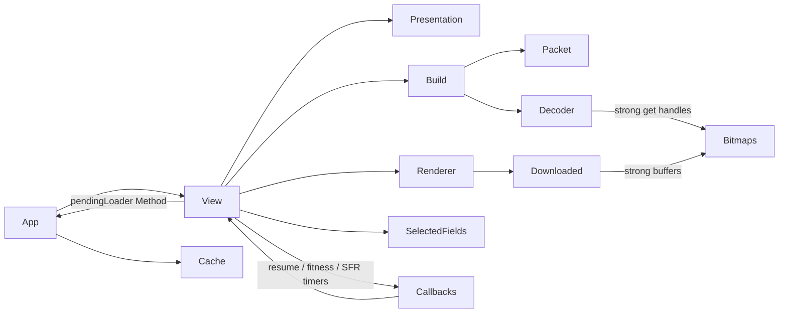

# Native resource audit — 0.1.18 source at 943f320c

## Retained measurements

The exact production UUID/key and release flags `-l 3 -O 2 -w -r` were used in the retained fields018 peer stock runs. These are simulator observations, not physical-watch power or graphics-pool results. See `../fields018/peer-stock390/observation.json`, `../fields018/peer-stock454/observation.json`, their source-bound compile receipts and `../fields018/INDEPENDENT.md:13`.

| Profile | Current application memory | Observed peak | Limit | Approximate peak margin |
|---|---:|---:|---:|---:|
| FR165 Music / 390 | 106.7 KiB | 122.0 KiB | 123.8 KiB | 1.8 KiB (1.45%) |
| FR965 / 454 | 107.1 KiB | 122.4 KiB | 123.8 KiB | 1.4 KiB (1.13%) |

Values are rounded by the Memory Viewer. A passing finite run does not prove all provider icons, locale combinations or decode overlaps fit. App memory is not total graphics memory. Earlier diagnostic UUID/non-release stock observations are not substituted for these measurements.

## A1 ownership and lifetime

| Resource | Owner and creation | Release / bound | Conclusion |
|---|---|---|---|
| Renderer, selected basic icons, bundled map/rocket, AOD map/font | SceneRenderer:25-80,202-203 | References replaced on model/point change; entire renderer dropped on hide/settings | STATIC: references bounded; no claim of immediate graphics-pool reclamation |
| Downloaded map, outline, rocket, flag | SpaceFoxView.downloaded / renderer.downloaded | setContext:215 and onHide:289-292; native decode old/new overlap in A2 | Bounded current scene; potential dual bundled/downloaded assets retained |
| Logical scale canvas | SpaceFoxView:238,258 | 390x390 at depth16 on non-390 displays; dropped onHide:292 | Nominal pixel storage 304,200 B (297.1 KiB), excluding overhead; graphics allocation, not app-heap estimate |
| Rest mask | onLayout:234 | onHide:292 | One resource reference; LOW blit skipped within same minute |
| SFR job and 50ms timer | :297-331 | :301-302, transition LOW, OFF, hide, success/failure | One job; slices 18ms/16 rows are checked in A2, constructor work separate |
| Resume timer | :79-87 | One 50ms shot; LOW/OFF/hide cancel | First frame precedes heavier resume work |
| Fitness timer | :89-107 | One 60s repeat only while active; stop on LOW/OFF/hide/settings | No active health polling in LOW |
| Complication subscriptions, provider icons/text | SelectedFields:160-206 | At most four selected unique IDs; stop unsubscribes, deregisters callback and clears maps | Explicit reference cleanup; provider callback can refresh all four sources |
| Locale fonts, dictionary, grapheme tables | LocalePresentation:21-52 | Old locale dictionary/small/count nulled before load; common handles live with view | One active dictionary; grapheme data lifetime reviewed A4 |
| Accepted scene/packet and successors | SpaceFoxView:33-38,127-188 | Replaced atomically; <=2 successors and <=3 passed keys | Retained while hidden intentionally, protects data from transient errors |

## Provisional findings from A1

- **MEM-01 / high risk / RETAINED MEASUREMENT:** observed release peak headroom is only approximately 1.4–1.8 KiB. No new OOM is asserted. Prioritize removing simultaneous raw/decode/render working sets before adding features. Validate the actual release flags/UUID, largest real selected provider icon and decode + active draw overlap; do not merely measure post-load steady state.
- **MEM-02 / moderate optimization / STATIC:** `SceneRenderer:54-80,111-115,139,202-214` retains bundled active art/map even while selected downloaded visuals are complete. AOD can be a third map representation. These handles may reside in separate graphics pools; exact savings unknown. A repair must preserve matching LOW outline, immediate wake and incomplete-decode continuity.
- **CPU-01 / moderate optimization / STATIC:** `SceneRenderer:92-107,122-180` recomputes fit/width/format for unchanged titles, date and all four metrics every active/animation frame. Outline contour1 issues eight shadow drawText calls plus foreground for each item. Cache a bounded layout/text snapshot by actual text/font/width/settings identity, retaining dynamic countdown/clock; measure before/after frame time and cache memory rather than adding an unbounded cache.
- **CPU-02 / moderate optimization / STATIC:** `SelectedFields:181-199` rebuilds all labels/text/icons on each selected callback, and per-source `FieldText.menu()` reloads resource JSON through `activityLabels/systemLabels`. Weather/status lookups do the same. Dedup within one read/event, and only refresh affected provider value if correct for shared IDs; bounded event-local reuse first, not five resident dictionaries.
- **CPU-03 / low cold-path optimization / STATIC:** `SettingsMenu.locale()` constructs/loads settings repeatedly while menus are built; `SettingsMenuText.values()` constructs four arrays then selects one. Six-entry picker is memory-bounded but repeatedly enumerates provider prefixes on later pages. These are settings-only costs; do not spend scarce active heap caching the whole inventory.

No product code was changed. These are audit findings, not an optimization success claim.

## A2 feed, decoding and storage

The only production watch HTTP route is `FeedService.request:19`: asynchronous, serial GET of `<base>/<path>.txt` through Garmin. Foreground `NativeForegroundApp` never directly requests the Internet. `feed.json.txt` is <=8192 accepted UTF-8 bytes; catalog/transfer/descriptor/shard objects <=4096. Network payload arrives before stage validation; this is an admission bound, not a guarantee the OS never allocates an oversized response. No ETag/304 path is configured on the watch; immutable objects skip download only after local digest validation. Cadence is accepted policy; first failure retries no earlier than300s; pending paired markers preserve a5min wake. Countdown draws perform arithmetic, no HTTP.

| Phase | Live allocation / release boundary |
|---|---|
| Background receive | One raw response + NativeWireHash128-char buffer +512-char piece + readback; persists provisional two-bank fragments. Never constructs full scene or accepted NativeFeed. NativeBatch retains parsed<=40 references. |
| Foreground incoming | <=8KiB bytearray + converted string + provisional marker; renderer released for new admission. Old packet replaced with NativePrior. NativeIncoming.takeRaw clears row reference. |
| Admission | Raw feed + parsed projection +<=4KiB catalog, multiple SHA traversals and current/recovery markers; candidate compacted before commit; per-chunk readback; raw local cleared before final marker. Failed candidate leaves old durable state and strict restore path. |
| Decode | Scene descriptor and expected refs, current shard<=4KiB,96-byte block, prior scanline; full raster in graphics pool. Map one-row scratch and optional1bit390x390 outline; current phase bitmap(s) remain alongside active bundled renderer. Row/time cap does not include all initialization, hashing, role construction or an indivisible row. |
| Completed visuals | Renderer holds map390x390, rocket54x124, flag20x12 and optional outline. Row/colors/hash/DC/descriptor cleared; build dropped. Bundled map/art handles remain available too. |
| Cancel/hide | Timer stopped, build=null/generation invalidated. Hide also drops downloaded/renderer/mask/scale canvas. Monkey C uses reference counts: clearing the final strong reference permits release. Other aliases/cycles can retain objects; graphics-pool reclamation timing is not measured. |

**IO-01 / moderate / STATIC:** `NativeImmutable:66-67` restarts object scan at zero after every receive. In the retained real production stock fixture (`BATCH-COST.json`, transfer3e4b…cb4),17 unique refs total50,005bytes but their prefix verification alone rereads153objects and hashes527,343bytes (10.55x unique bytes). This excludes repeated catalog/index verification, put readback and final closure, so it is not total event cost. A stable closure/generation-bound cursor can skip earlier known-complete prefixes within one event; preserve final closure and corruption checks at admission, never use mutable trust across unrelated events without evidence.

**IO-02 / moderate / STATIC:** `FeedService:19` limits request *starts* to44 and checks elapsed22,000ms before launch. It does not cancel in-flight web requests or bound callback hashing. Do not describe it as a22s hard event deadline. Existing serial callbacks prevent request fanout; OS background termination is a separate bound. No custom `:timeout` option is documented on Garmin makeWebRequest; do not invent one.

**MEM-03 / moderate / STATIC:** all dynamic raster buffers use `createBufferedBitmap(...).get()` (`NativeSfr:17`) and non-390 scale canvas does too (`SpaceFoxView:238`). These are strong graphics-pool locks until references die. Exact pool peak is unmeasured. Nominal pixels alone: map390x390x3 logical RGB input456,300B (GPU representation not inferred), scale16bit304,200B, 1bitoutline19,013B before row alignment, rocket6,696pixels, flag240pixels. A map's input channels do not prove its actual GPU depth. Keep this separate from the app-heap123.8KiB.

**IO-03 / low bounded-storage cleanup / STATIC:** alternating provisional/feed slots retain trailing fragments from earlier longer content; key counts remain bounded (feed3x16chunks; provisionalfeed2x16). They are not an unbounded leak. Immutable object cap56/229,376B excludes feed chunks, provisional fragments, indices, markers, reminder and future queues. `NativeUpcomingCache` creates per-URL keys without an eviction index; publisher pins cap8 namespaces, but queue creation/cleanup is not governed by that cap at its owner. Account total serialized store before changing caps; do not mistake one object-cap constant for total storage usage.

**CLEAN-01 / low / STATIC:** `LaunchReminder:84-88` still upgrades the initial0.1.15 reminder-consumed marker. This is a specific old-state compatibility branch despite the user's no-legacy direction. NativeTransfer:22-24 and NativeForegroundCache:16-19 also accept older derived projections of the same current format; these are not extra public wire formats. Retiring them needs an explicit current-state reset/migration consequence in a later implementation task; this analysis does not delete state or code.

## Official API interpretation (checked2026-11-16)

- [Garmin graphics pool](https://developer.garmin.com/connect-iq/core-topics/graphics/): resource storage is separate from application heap; retaining the object from get() locks it and can exhaust pool space. Buffer release timing and pool peak remain unmeasured.
- [ResourceReference API](https://developer.garmin.com/connect-iq/api-docs/Toybox/Graphics/ResourceReference.html): strong objects prevent purging; .get() may fail with OutOfGraphicsMemoryException.
- [makeWebRequest API](https://developer.garmin.com/connect-iq/api-docs/Toybox/Communications.html): asynchronous callback, Wi-Fi or phone connection; documented options contain no custom timeout or general response-byte cap. Our stage guards apply after delivery.

## Strong references, callbacks and cycles

Garmin documents reference-counted objects and warns that strong cycles prevent automatic object release ([Monkey C reference](https://developer.garmin.com/connect-iq/reference-guides/monkey-c-reference/), checked 2026-11-16). A Method callback strongly retains its owning instance. The native audit therefore does not assume a tracing garbage collector will repair cycles.

**LIFE-01 / low conditional retention risk / STATIC:** `NativeForegroundApp:10` assigns `view.pendingLoader=app.method(:reloadFeed)` while app retains view. This is one persistent app↔view strong cycle. It is intentional for the current singleton lifetime; no observed growing sequence or cross-process leak is asserted. There is no explicit onStop break in SpaceFoxApp. If the app/view owner is replaced or embedded, break this edge on actual teardown or use a weak owner; keep it across ordinary hide/settings if needed for reload. Measure lifecycle reclamation before labeling it a leak. Timer cycles are broken by stopping and nulling each timer field; complications deregister the callback on stop. NativeIncoming.queueView is cleared in finally. Parser callbacks are temporary locals with no persistent owner→parser reverse edge found. SFR result/scene has no source-level backreference to the build. Graphics-internal ownership is not inferable from these source references.

**MEM-05 / moderate capacity risk / STATIC, no failing device case:** `FieldSources:117-129,181-199` retains provider String values/labels verbatim and retains a user complication's original icon alongside an 18x18 draw transform. Scaling the draw does not resize its backing bitmap. The [Complications API](https://developer.garmin.com/connect-iq/api-docs/Toybox/Complications.html) specifies String/bitmap types without a size bound on that page; this is not evidence the OS accepts arbitrary sizes. With only 1.4–1.8KiB observed heap margin, qualify the largest actually discovered field text/icon from supported models. Prefer bounded display representations and reuse stable icons; do not invent a synthetic stress corpus or silently drop supported fields.

**CPU-04 / moderate cold-frame cost / STATIC:** steady draw has no HTTP or storage path, but drawing is not universally allocation/resource-load-free. `SpaceFoxView.updateForDisplayMode:255` can construct the renderer through onLayout. A deadline snapshot goes through `snapshotAt:109`→`resolveSelection:141`→`setContext:218`→`SceneRenderer.prepare:54-80`, loading changed map/art (and LOW map if applicable) on that permitted frame. This is a bounded transition cost rather than repeated every-tick I/O. Measure the first rollover/wake frame separately from warmed redraw; do not cite steady-frame tests as proof of zero cold-frame load.

**PERF-01 / moderate conditional scene-readiness cost / STATIC:** `NativeSfrDecoder.step:72` processes at most one RGB map row per call when no bundled outline matches, or at most five rows when it can skip outline generation. `SpaceFoxView.startSfrTimer:297` nominally calls every 50ms. A 390-row map therefore needs 390 row-work callbacks (about19.5s of nominal cadence), or at least78 callbacks/about3.9s with five rows per slice, excluding shard-only, constructor, closure and other-role work. These are source-derived nominal counts, not measured wake latency. ACTIVE drawing remains available during the build in current0.1.18; do not call this a19.5s blocked wake. LOW cancels an incomplete build, so short wake/sleep cycles can restart the decode. Measure real cold-scene readiness and first-frame latency separately; retain the18/12ms CPU slice budgets if increasing row throughput.
