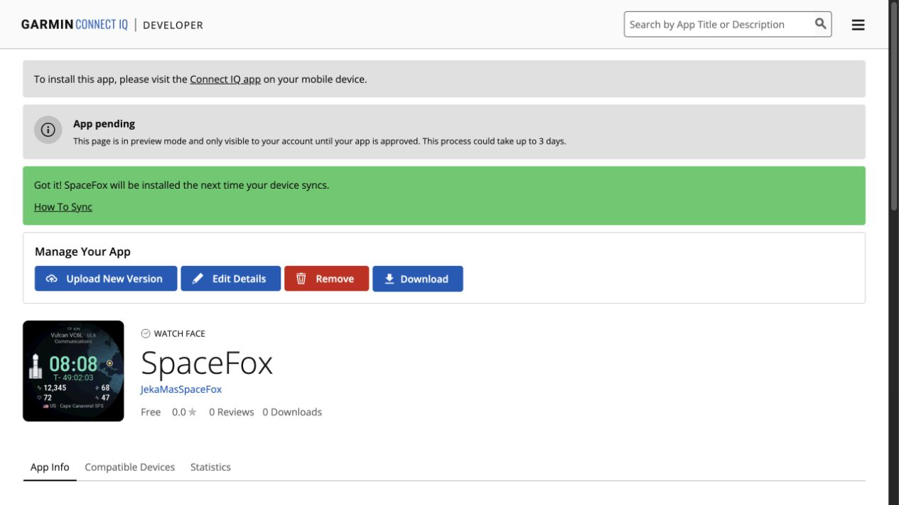

# SpaceFox 0.1.7 publication

Public main and tag `v0.1.7` were published at `bb08bf25`; the signed
[GitHub prerelease](https://github.com/JekaMas/SpaceFox/releases/tag/v0.1.7)
contains the IQ, ten PRGs, receipts, instructions and license notices. GitHub
reported all seventeen assets uploaded, including the IQ digest
`f8b41e9870654436ea4a8a7be63ca64451a0863254a8731b2f1a50659d91cde5`.
All 1,087 receipt inputs matched the clean integration/tag. The compiled source
remains `a3a19216`; subsequent publication-status and signing-history bookkeeping
does not replace or rebuild that artifact. The original source/tag inputs remain
immutable. No behavior test was invalidated by this publication-only update.

Garmin accepted the exact IQ under the existing production UUID and key at the
[original ordinary card](https://apps.garmin.com/apps/7ef095e4-72fe-44cd-bc39-8987b6ab49e3).
The upload form reported File Verified, Signature Verified and all ten targets.
After the details were submitted, the saved card displayed **0.1.7 (Internal 6)**.
Three actual signed-program native previews replaced the prior gallery. The card
still reports App pending; public approval is not claimed.

The owner confirmed the agreement/submission and existing permissions at action
time. The ordinary card's Download flow selected the existing Forerunner 165
Music. Compatibility explicitly requested `internalAppVersion=6` and returned
HTTP 200. The installation POST returned HTTP 200 and the portal displayed:
“Got it! SpaceFox will be installed the next time your device syncs.”
The sanitized [queue receipt](queue.json) contains no device identifier.

The same card link, version and synchronization/apply instructions were sent
once to Ivan Danilenko through Telegram. The message was observed sent, not seen.
No credentials or health data were sent.

The visible Store/queue outcome does not prove phone delivery or executing code
on the physical watch. Those checks, physical settings/health/power acceptance
and public approval remain unobserved. Software work and this authorized
publication/queue are complete; physical testing can proceed in the next task.
